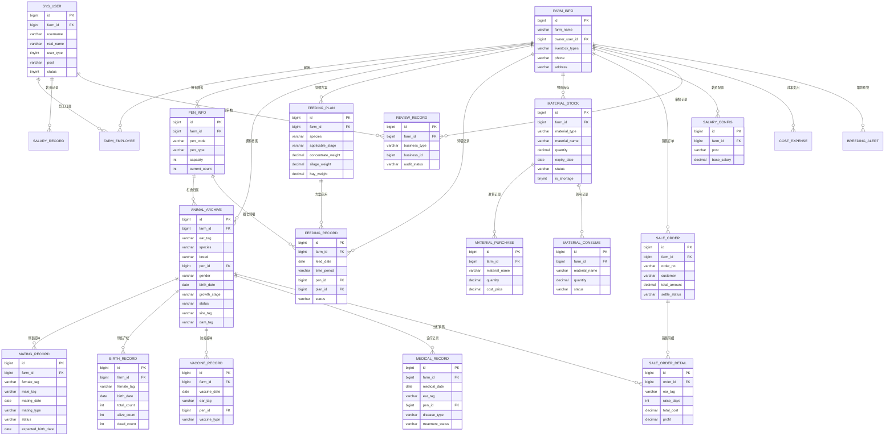

# 智能养殖信息管理系统 数据库设计文档（DBD）

| 文档版本 | 修订日期 | 修订作者 | 修订内容摘要 |
| -------- | -------- | -------- | ------------ |
| V1.0 | 2026-08-10 | 系统架构组 | 初版发布，覆盖用户权限、养殖场、圈舍、档案、饲喂、繁育、防疫诊疗、物资、销售财务、审核、系统等 11 个模块共 30+ 张表设计 |

> 文档名称：DBD-智能养殖信息管理系统
> 适用数据库：MySQL 8.0
> 数据库名：livestock_db
> 字符集：utf8mb4
> 文档状态：正式发布

---

## 1. 文档信息

### 1.1 文档目的
本文档用于定义「智能养殖信息管理系统」的数据库结构设计，为后端开发、数据库管理员（DBA）以及测试人员提供统一的数据建模依据。文档覆盖以下内容：

- 数据库总体选型与命名规范
- 核心实体关系（ER）图
- 全部业务表与系统表的字段结构
- 索引设计、数据字典、视图、存储过程、触发器设计
- 数据初始化脚本及备份恢复策略

### 1.2 文档范围
本系统以「养殖场」为多租户单位进行数据隔离，覆盖牛、羊、猪三种养殖种类的全流程管理，包括圈舍管理、畜禽档案、饲喂管理、繁育管理、防疫诊疗、物资管理、销售与利润核算、薪资管理、审核流转等业务域。

### 1.3 修订记录
详见文首「文档版本」表。

---

## 2. 数据库概述

### 2.1 数据库选型

| 项目 | 选型 |
| ---- | ---- |
| 数据库管理系统 | MySQL 8.0 |
| 存储引擎 | InnoDB（支持事务、行级锁、外键） |
| 字符集 | utf8mb4（完整支持中文、Emoji） |
| 排序规则 | utf8mb4_0900_ai_ci |
| 主键策略 | BIGINT 自增（雪花 ID 可扩展） |
| 时间存储 | DATETIME（存储本机时间） |
| 金额存储 | DECIMAL(12,2) |
| 布尔类型 | TINYINT(1)（0 否 / 1 是） |
| 枚举类型 | TINYINT 或 VARCHAR |
| 是否使用外键 | 物理外键关闭，使用逻辑外键（应用层维护） |

### 2.2 命名规范

| 对象类型 | 规范 | 示例 |
| -------- | ---- | ---- |
| 库名 | 小写、与业务名一致 | livestock_db |
| 表名 | 小写、下划线分隔、模块前缀 | sys_user、feeding_record |
| 字段名 | 小写、下划线分隔 | create_time、farm_id |
| 主键 | 统一命名为 id | id |
| 外键 | 业务表名缩写_id | farm_id、pen_id |
| 时间字段 | create_time / update_time | create_time |
| 布尔字段 | is_xxx | is_shortage |
| 枚举字段 | 使用 tinyint 或 varchar，配合字典表 | status、user_type |
| 索引 | idx_字段名 | idx_farm_id |
| 唯一索引 | uk_字段名 | uk_ear_tag |
| 联合索引 | idx_字段1_字段2 | idx_farm_species |

### 2.3 公共字段
所有业务表均包含以下公共字段：

| 字段名 | 类型 | 说明 |
| ------ | ---- | ---- |
| id | BIGINT UNSIGNED | 主键，自增 |
| farm_id | BIGINT UNSIGNED | 养殖场 ID（多租户隔离字段，系统表允许为 NULL） |
| create_time | DATETIME | 创建时间，默认 CURRENT_TIMESTAMP |
| update_time | DATETIME | 更新时间，ON UPDATE CURRENT_TIMESTAMP |
| create_by | BIGINT UNSIGNED | 创建人用户 ID |
| update_by | BIGINT UNSIGNED | 更新人用户 ID |
| deleted | TINYINT(1) | 逻辑删除标记（0 未删除 / 1 已删除），默认 0 |

### 2.4 多租户隔离策略
本系统采用「字段隔离」模式实现多租户：

- 每个养殖场主注册时创建一条 `farm_info` 记录，得到 `farm_id`。
- 所有业务表均携带 `farm_id` 字段，数据访问层在 SQL 层强制追加 `WHERE farm_id = ?` 条件。
- 超级管理员（user_type=1）可跨租户查询所有养殖场数据。
- 养殖场主管理员（user_type=2）只能访问本养殖场数据。
- 员工（user_type=3）通过 `farm_employee` 关联到具体养殖场，仅可访问所属养殖场数据。
- 联合索引均以 `farm_id` 作为最左前缀，确保查询性能。

---

## 3. ER 图

以下为核心实体关系图，使用 Mermaid `erDiagram` 语法绘制：



---

## 4. 表结构设计

### 4.1 用户权限模块

#### 4.1.1 sys_user（用户表）

| 字段名 | 类型 | 非空 | 默认值 | 注释 | 索引 |
| ------ | ---- | ---- | ------ | ---- | ---- |
| id | BIGINT UNSIGNED | 是 | AUTO | 主键 ID | PK |
| farm_id | BIGINT UNSIGNED | 否 | NULL | 养殖场 ID（超级管理员为 NULL） | INDEX |
| username | VARCHAR(50) | 是 | - | 登录账号 | UNIQUE |
| password | VARCHAR(100) | 是 | - | 密码（BCrypt 加密） | - |
| real_name | VARCHAR(50) | 是 | - | 真实姓名 | - |
| phone | VARCHAR(20) | 否 | NULL | 手机号 | INDEX |
| avatar | VARCHAR(255) | 否 | NULL | 头像 URL | - |
| user_type | TINYINT | 是 | 3 | 用户类型（1 超级管理员 2 养殖场主 3 员工） | INDEX |
| post | VARCHAR(20) | 否 | NULL | 岗位（饲喂员/兽医/繁育员/库管员） | - |
| gender | TINYINT | 否 | 0 | 性别（0 未知 1 男 2 女） | - |
| status | TINYINT | 是 | 1 | 账号状态（0 停用 1 正常） | - |
| last_login_time | DATETIME | 否 | NULL | 最后登录时间 | - |
| last_login_ip | VARCHAR(50) | 否 | NULL | 最后登录 IP | - |
| remark | VARCHAR(255) | 否 | NULL | 备注 | - |
| create_time | DATETIME | 是 | CURRENT_TIMESTAMP | 创建时间 | - |
| update_time | DATETIME | 是 | CURRENT_TIMESTAMP | 更新时间 | - |
| create_by | BIGINT UNSIGNED | 否 | NULL | 创建人 | - |
| update_by | BIGINT UNSIGNED | 否 | NULL | 更新人 | - |
| deleted | TINYINT(1) | 是 | 0 | 逻辑删除 | - |

#### 4.1.2 sys_role（角色表）

| 字段名 | 类型 | 非空 | 默认值 | 注释 | 索引 |
| ------ | ---- | ---- | ------ | ---- | ---- |
| id | BIGINT UNSIGNED | 是 | AUTO | 主键 ID | PK |
| role_name | VARCHAR(50) | 是 | - | 角色名称 | INDEX |
| role_key | VARCHAR(50) | 是 | - | 角色权限字符串（admin/farm_owner/employee） | UNIQUE |
| role_sort | INT | 是 | 0 | 显示排序 | - |
| status | TINYINT | 是 | 1 | 状态（0 停用 1 正常） | - |
| data_scope | TINYINT | 是 | 1 | 数据范围（1 全部 2 本养殖场 3 个人） | - |
| remark | VARCHAR(255) | 否 | NULL | 备注 | - |
| create_time | DATETIME | 是 | CURRENT_TIMESTAMP | 创建时间 | - |
| update_time | DATETIME | 是 | CURRENT_TIMESTAMP | 更新时间 | - |
| deleted | TINYINT(1) | 是 | 0 | 逻辑删除 | - |

#### 4.1.3 sys_user_role（用户角色关联表）

| 字段名 | 类型 | 非空 | 默认值 | 注释 | 索引 |
| ------ | ---- | ---- | ------ | ---- | ---- |
| id | BIGINT UNSIGNED | 是 | AUTO | 主键 ID | PK |
| user_id | BIGINT UNSIGNED | 是 | - | 用户 ID | INDEX |
| role_id | BIGINT UNSIGNED | 是 | - | 角色 ID | INDEX |
| create_time | DATETIME | 是 | CURRENT_TIMESTAMP | 创建时间 | - |

#### 4.1.4 sys_menu（菜单权限表）

| 字段名 | 类型 | 非空 | 默认值 | 注释 | 索引 |
| ------ | ---- | ---- | ------ | ---- | ---- |
| id | BIGINT UNSIGNED | 是 | AUTO | 主键 ID | PK |
| parent_id | BIGINT UNSIGNED | 是 | 0 | 父菜单 ID | INDEX |
| menu_name | VARCHAR(50) | 是 | - | 菜单名称 | - |
| menu_type | TINYINT | 是 | 1 | 类型（1 目录 2 菜单 3 按钮） | - |
| path | VARCHAR(200) | 否 | NULL | 路由路径 | - |
| component | VARCHAR(255) | 否 | NULL | 组件路径 | - |
| perms | VARCHAR(100) | 否 | NULL | 权限标识 | INDEX |
| icon | VARCHAR(100) | 否 | NULL | 图标 | - |
| menu_sort | INT | 是 | 0 | 排序 | - |
| visible | TINYINT | 是 | 1 | 是否可见（0 隐藏 1 显示） | - |
| status | TINYINT | 是 | 1 | 状态（0 停用 1 正常） | - |
| create_time | DATETIME | 是 | CURRENT_TIMESTAMP | 创建时间 | - |
| update_time | DATETIME | 是 | CURRENT_TIMESTAMP | 更新时间 | - |
| deleted | TINYINT(1) | 是 | 0 | 逻辑删除 | - |

#### 4.1.5 sys_role_menu（角色菜单关联表）

| 字段名 | 类型 | 非空 | 默认值 | 注释 | 索引 |
| ------ | ---- | ---- | ------ | ---- | ---- |
| id | BIGINT UNSIGNED | 是 | AUTO | 主键 ID | PK |
| role_id | BIGINT UNSIGNED | 是 | - | 角色 ID | INDEX |
| menu_id | BIGINT UNSIGNED | 是 | - | 菜单 ID | INDEX |
| create_time | DATETIME | 是 | CURRENT_TIMESTAMP | 创建时间 | - |

#### 4.1.6 sys_dict_type（字典类型表）

| 字段名 | 类型 | 非空 | 默认值 | 注释 | 索引 |
| ------ | ---- | ---- | ------ | ---- | ---- |
| id | BIGINT UNSIGNED | 是 | AUTO | 主键 ID | PK |
| dict_name | VARCHAR(50) | 是 | - | 字典名称 | - |
| dict_type | VARCHAR(50) | 是 | - | 字典类型（唯一标识） | UNIQUE |
| status | TINYINT | 是 | 1 | 状态 | - |
| remark | VARCHAR(255) | 否 | NULL | 备注 | - |
| create_time | DATETIME | 是 | CURRENT_TIMESTAMP | 创建时间 | - |
| update_time | DATETIME | 是 | CURRENT_TIMESTAMP | 更新时间 | - |
| deleted | TINYINT(1) | 是 | 0 | 逻辑删除 | - |

#### 4.1.7 sys_dict_data（字典数据表）

| 字段名 | 类型 | 非空 | 默认值 | 注释 | 索引 |
| ------ | ---- | ---- | ------ | ---- | ---- |
| id | BIGINT UNSIGNED | 是 | AUTO | 主键 ID | PK |
| dict_type | VARCHAR(50) | 是 | - | 字典类型 | INDEX |
| dict_label | VARCHAR(50) | 是 | - | 字典标签 | - |
| dict_value | VARCHAR(50) | 是 | - | 字典键值 | - |
| dict_sort | INT | 是 | 0 | 排序 | - |
| dict_extra | VARCHAR(255) | 否 | NULL | 扩展信息（如阶段对应日龄范围 JSON） | - |
| status | TINYINT | 是 | 1 | 状态 | - |
| create_time | DATETIME | 是 | CURRENT_TIMESTAMP | 创建时间 | - |
| update_time | DATETIME | 是 | CURRENT_TIMESTAMP | 更新时间 | - |
| deleted | TINYINT(1) | 是 | 0 | 逻辑删除 | - |

---

### 4.2 养殖场模块

#### 4.2.1 farm_info（养殖场表）

| 字段名 | 类型 | 非空 | 默认值 | 注释 | 索引 |
| ------ | ---- | ---- | ------ | ---- | ---- |
| id | BIGINT UNSIGNED | 是 | AUTO | 主键 ID | PK |
| farm_name | VARCHAR(100) | 是 | - | 养殖场名称 | INDEX |
| owner_user_id | BIGINT UNSIGNED | 是 | - | 养殖场主用户 ID | INDEX |
| phone | VARCHAR(20) | 否 | NULL | 联系电话 | - |
| livestock_types | VARCHAR(50) | 是 | - | 养殖种类（多选，逗号分隔：cattle,sheep,pig） | - |
| address | VARCHAR(255) | 否 | NULL | 养殖场地址 | - |
| province | VARCHAR(50) | 否 | NULL | 省份 | - |
| city | VARCHAR(50) | 否 | NULL | 城市 | - |
| district | VARCHAR(50) | 否 | NULL | 区县 | - |
| business_license | VARCHAR(50) | 否 | NULL | 营业执照号 | - |
| status | TINYINT | 是 | 1 | 状态（0 停用 1 正常 2 待审核） | - |
| remark | VARCHAR(255) | 否 | NULL | 备注 | - |
| create_time | DATETIME | 是 | CURRENT_TIMESTAMP | 创建时间 | - |
| update_time | DATETIME | 是 | CURRENT_TIMESTAMP | 更新时间 | - |
| create_by | BIGINT UNSIGNED | 否 | NULL | 创建人 | - |
| update_by | BIGINT UNSIGNED | 否 | NULL | 更新人 | - |
| deleted | TINYINT(1) | 是 | 0 | 逻辑删除 | - |

#### 4.2.2 farm_employee（员工关联表）

| 字段名 | 类型 | 非空 | 默认值 | 注释 | 索引 |
| ------ | ---- | ---- | ------ | ---- | ---- |
| id | BIGINT UNSIGNED | 是 | AUTO | 主键 ID | PK |
| farm_id | BIGINT UNSIGNED | 是 | - | 养殖场 ID | INDEX |
| user_id | BIGINT UNSIGNED | 是 | - | 用户 ID | INDEX |
| post | VARCHAR(20) | 是 | - | 岗位（饲喂员/兽医/繁育员/库管员） | INDEX |
| entry_date | DATE | 否 | NULL | 入职日期 | - |
| quit_date | DATE | 否 | NULL | 离职日期 | - |
| salary_base | DECIMAL(10,2) | 否 | NULL | 基础薪资（可由养殖场主自定义） | - |
| status | TINYINT | 是 | 1 | 状态（0 离职 1 在职） | - |
| remark | VARCHAR(255) | 否 | NULL | 备注 | - |
| create_time | DATETIME | 是 | CURRENT_TIMESTAMP | 创建时间 | - |
| update_time | DATETIME | 是 | CURRENT_TIMESTAMP | 更新时间 | - |
| create_by | BIGINT UNSIGNED | 否 | NULL | 创建人 | - |
| update_by | BIGINT UNSIGNED | 否 | NULL | 更新人 | - |
| deleted | TINYINT(1) | 是 | 0 | 逻辑删除 | - |

> 联合唯一索引 uk_farm_user：farm_id + user_id

---

### 4.3 圈舍模块

#### 4.3.1 pen_info（圈舍表）

| 字段名 | 类型 | 非空 | 默认值 | 注释 | 索引 |
| ------ | ---- | ---- | ------ | ---- | ---- |
| id | BIGINT UNSIGNED | 是 | AUTO | 主键 ID | PK |
| farm_id | BIGINT UNSIGNED | 是 | - | 养殖场 ID | INDEX |
| pen_code | VARCHAR(20) | 是 | - | 圈舍编号（2 位，如 01、02） | INDEX |
| pen_name | VARCHAR(50) | 否 | NULL | 圈舍名称（如 1 号育雏舍） | - |
| pen_type | VARCHAR(2) | 是 | - | 圈舍类型（A 育雏舍/B 育成舍/C 繁育舍/D 种畜圈舍） | INDEX |
| species | VARCHAR(10) | 否 | NULL | 适用养殖种类（cattle/sheep/pig） | - |
| capacity | INT | 是 | - | 容量（A=12 B=12 C=6 D=1） | - |
| current_count | INT | 是 | 0 | 当前存栏数 | - |
| status | VARCHAR(10) | 是 | '空闲' | 状态（正常/空闲/维修中） | - |
| remark | VARCHAR(255) | 否 | NULL | 备注 | - |
| create_time | DATETIME | 是 | CURRENT_TIMESTAMP | 创建时间 | - |
| update_time | DATETIME | 是 | CURRENT_TIMESTAMP | 更新时间 | - |
| create_by | BIGINT UNSIGNED | 否 | NULL | 创建人 | - |
| update_by | BIGINT UNSIGNED | 否 | NULL | 更新人 | - |
| deleted | TINYINT(1) | 是 | 0 | 逻辑删除 | - |

> 联合唯一索引 uk_farm_pencode：farm_id + pen_code

---

### 4.4 档案模块

#### 4.4.1 animal_archive（畜禽档案表）

| 字段名 | 类型 | 非空 | 默认值 | 注释 | 索引 |
| ------ | ---- | ---- | ------ | ---- | ---- |
| id | BIGINT UNSIGNED | 是 | AUTO | 主键 ID | PK |
| farm_id | BIGINT UNSIGNED | 是 | - | 养殖场 ID | INDEX |
| ear_tag | VARCHAR(10) | 是 | - | 耳标（4 位 = 圈舍 2 位 + 顺序 2 位） | UNIQUE |
| species | VARCHAR(10) | 是 | - | 养殖种类（cattle/sheep/pig） | INDEX |
| breed | VARCHAR(50) | 否 | NULL | 品种（如荷斯坦、杜泊、长白） | - |
| pen_id | BIGINT UNSIGNED | 否 | NULL | 当前圈舍 ID | INDEX |
| gender | VARCHAR(2) | 是 | - | 性别（M 公 F 母） | - |
| birth_date | DATE | 否 | NULL | 出生日期 | - |
| in_date | DATE | 否 | NULL | 入栏日期 | INDEX |
| out_date | DATE | 否 | NULL | 出栏日期 | - |
| growth_stage | VARCHAR(20) | 否 | NULL | 生长阶段（犊牛/保育期/生长期等） | INDEX |
| day_age | INT | 否 | 0 | 日龄（运行时计算或每日更新） | - |
| status | VARCHAR(10) | 是 | '在栏' | 状态（在栏/已出栏/已死亡/已淘汰） | INDEX |
| source | VARCHAR(20) | 否 | NULL | 来源（自繁/外购/调拨） | - |
| sire_tag | VARCHAR(10) | 否 | NULL | 父本耳标 | - |
| dam_tag | VARCHAR(10) | 否 | NULL | 母本耳标 | - |
| weight_current | DECIMAL(8,2) | 否 | NULL | 当前体重（kg） | - |
| weight_out | DECIMAL(8,2) | 否 | NULL | 出栏体重 | - |
| is_breeding | TINYINT(1) | 是 | 0 | 是否可繁育（0 否 1 是） | - |
| remark | VARCHAR(255) | 否 | NULL | 备注 | - |
| create_time | DATETIME | 是 | CURRENT_TIMESTAMP | 创建时间 | - |
| update_time | DATETIME | 是 | CURRENT_TIMESTAMP | 更新时间 | - |
| create_by | BIGINT UNSIGNED | 否 | NULL | 创建人 | - |
| update_by | BIGINT UNSIGNED | 否 | NULL | 更新人 | - |
| deleted | TINYINT(1) | 是 | 0 | 逻辑删除 | - |

> 联合索引 idx_farm_species_status：farm_id + species + status

#### 4.4.2 animal_archive_history（档案历史表）

字段结构与 `animal_archive` 完全一致，附加以下字段：

| 字段名 | 类型 | 非空 | 默认值 | 注释 | 索引 |
| ------ | ---- | ---- | ------ | ---- | ---- |
| original_id | BIGINT UNSIGNED | 是 | - | 原档案 ID | INDEX |
| delete_time | DATETIME | 是 | CURRENT_TIMESTAMP | 删除时间 | INDEX |
| restore_deadline | DATETIME | 是 | - | 自动彻底删除截止时间（删除时间 + 180 天） | - |
| delete_reason | VARCHAR(50) | 否 | NULL | 删除原因 | - |
| delete_by | BIGINT UNSIGNED | 否 | NULL | 删除人 | - |

> 业务说明：档案逻辑删除时（deleted=1）写入历史表，180 天后由定时任务物理删除。

---

### 4.5 饲喂模块

#### 4.5.1 feeding_plan（饲喂方案表）

| 字段名 | 类型 | 非空 | 默认值 | 注释 | 索引 |
| ------ | ---- | ---- | ------ | ---- | ---- |
| id | BIGINT UNSIGNED | 是 | AUTO | 主键 ID | PK |
| farm_id | BIGINT UNSIGNED | 是 | - | 养殖场 ID | INDEX |
| species | VARCHAR(10) | 是 | - | 适用种类（cattle/sheep/pig） | INDEX |
| plan_name | VARCHAR(50) | 是 | - | 方案名称 | - |
| applicable_stage | VARCHAR(50) | 是 | - | 适用生长阶段（如保育期、生长期） | - |
| applicable_pen_type | VARCHAR(10) | 否 | NULL | 适用圈舍类型（A/B/C/D） | - |
| feed_times_per_day | INT | 是 | 2 | 每日投喂次数 | - |
| concentrate_weight | DECIMAL(8,2) | 否 | NULL | 精料计划重量（kg/只·次） | - |
| silage_weight | DECIMAL(8,2) | 否 | NULL | 青贮计划重量（kg/只·次） | - |
| hay_weight | DECIMAL(8,2) | 否 | NULL | 干草计划重量（kg/只·次） | - |
| concentrate_price | DECIMAL(10,2) | 否 | NULL | 精料单价（元/吨） | - |
| silage_price | DECIMAL(10,2) | 否 | NULL | 青贮单价（元/吨） | - |
| hay_price | DECIMAL(10,2) | 否 | NULL | 干草单价（元/吨） | - |
| est_cost_per_day | DECIMAL(10,2) | 否 | NULL | 预计单只日成本 | - |
| status | TINYINT | 是 | 1 | 状态（0 停用 1 启用） | - |
| remark | VARCHAR(255) | 否 | NULL | 备注 | - |
| create_time | DATETIME | 是 | CURRENT_TIMESTAMP | 创建时间 | - |
| update_time | DATETIME | 是 | CURRENT_TIMESTAMP | 更新时间 | - |
| create_by | BIGINT UNSIGNED | 否 | NULL | 创建人 | - |
| update_by | BIGINT UNSIGNED | 否 | NULL | 更新人 | - |
| deleted | TINYINT(1) | 是 | 0 | 逻辑删除 | - |

#### 4.5.2 feeding_record（饲喂记录表）

| 字段名 | 类型 | 非空 | 默认值 | 注释 | 索引 |
| ------ | ---- | ---- | ------ | ---- | ---- |
| id | BIGINT UNSIGNED | 是 | AUTO | 主键 ID | PK |
| farm_id | BIGINT UNSIGNED | 是 | - | 养殖场 ID | INDEX |
| feed_date | DATE | 是 | - | 饲喂日期 | INDEX |
| time_period | VARCHAR(4) | 是 | - | 时段（早/晚） | - |
| pen_id | BIGINT UNSIGNED | 是 | - | 圈舍 ID | INDEX |
| pen_type | VARCHAR(2) | 否 | NULL | 圈舍类型 | - |
| plan_id | BIGINT UNSIGNED | 否 | NULL | 关联饲喂方案 ID | INDEX |
| plan_concentrate | DECIMAL(8,2) | 否 | NULL | 计划精料重量 | - |
| plan_silage | DECIMAL(8,2) | 否 | NULL | 计划青贮重量 | - |
| plan_hay | DECIMAL(8,2) | 否 | NULL | 计划干草重量 | - |
| actual_concentrate | DECIMAL(8,2) | 否 | NULL | 实际精料重量 | - |
| actual_silage | DECIMAL(8,2) | 否 | NULL | 实际青贮重量 | - |
| actual_hay | DECIMAL(8,2) | 否 | NULL | 实际干草重量 | - |
| animal_count | INT | 否 | NULL | 饲喂头数 | - |
| feed_cost | DECIMAL(10,2) | 否 | NULL | 本次饲喂成本 | - |
| status | VARCHAR(10) | 是 | '未投喂' | 状态（未投喂/已投喂/已跳过） | - |
| audit_status | VARCHAR(10) | 是 | '待审核' | 审核状态（待审核/通过/驳回） | - |
| operator_user_id | BIGINT UNSIGNED | 否 | NULL | 负责人 ID | INDEX |
| feed_time | DATETIME | 否 | NULL | 实际投喂时间 | - |
| remark | VARCHAR(255) | 否 | NULL | 备注 | - |
| create_time | DATETIME | 是 | CURRENT_TIMESTAMP | 创建时间 | - |
| update_time | DATETIME | 是 | CURRENT_TIMESTAMP | 更新时间 | - |
| create_by | BIGINT UNSIGNED | 否 | NULL | 创建人 | - |
| update_by | BIGINT UNSIGNED | 否 | NULL | 更新人 | - |
| deleted | TINYINT(1) | 是 | 0 | 逻辑删除 | - |

> 联合索引 idx_farm_date_period：farm_id + feed_date + time_period

---

### 4.6 繁育模块

#### 4.6.1 breeding_female（母畜档案表）

| 字段名 | 类型 | 非空 | 默认值 | 注释 | 索引 |
| ------ | ---- | ---- | ------ | ---- | ---- |
| id | BIGINT UNSIGNED | 是 | AUTO | 主键 ID | PK |
| farm_id | BIGINT UNSIGNED | 是 | - | 养殖场 ID | INDEX |
| archive_id | BIGINT UNSIGNED | 是 | - | 关联畜禽档案 ID | INDEX |
| ear_tag | VARCHAR(10) | 是 | - | 耳标 | UNIQUE |
| species | VARCHAR(10) | 是 | - | 养殖种类 | - |
| breed | VARCHAR(50) | 否 | NULL | 品种 | - |
| pen_id | BIGINT UNSIGNED | 否 | NULL | 圈舍 ID | - |
| birth_date | DATE | 否 | NULL | 出生日期 | - |
| first_mating_date | DATE | 否 | NULL | 初配日期 | - |
| mating_count | INT | 是 | 0 | 累计配种次数 | - |
| birth_count | INT | 是 | 0 | 累计产仔次数 | - |
| last_mating_date | DATE | 否 | NULL | 最近配种日期 | - |
| last_birth_date | DATE | 否 | NULL | 最近产仔日期 | - |
| pregnancy_status | VARCHAR(10) | 是 | '未配种' | 妊娠状态（未配种/配种待孕检/已孕/空怀） | INDEX |
| expected_birth_date | DATE | 否 | NULL | 预产日期 | INDEX |
| health_status | VARCHAR(10) | 是 | '正常' | 健康状态 | - |
| status | VARCHAR(10) | 是 | '在栏' | 状态 | - |
| remark | VARCHAR(255) | 否 | NULL | 备注 | - |
| create_time | DATETIME | 是 | CURRENT_TIMESTAMP | 创建时间 | - |
| update_time | DATETIME | 是 | CURRENT_TIMESTAMP | 更新时间 | - |
| create_by | BIGINT UNSIGNED | 否 | NULL | 创建人 | - |
| update_by | BIGINT UNSIGNED | 否 | NULL | 更新人 | - |
| deleted | TINYINT(1) | 是 | 0 | 逻辑删除 | - |

#### 4.6.2 breeding_male（公畜档案表）

| 字段名 | 类型 | 非空 | 默认值 | 注释 | 索引 |
| ------ | ---- | ---- | ------ | ---- | ---- |
| id | BIGINT UNSIGNED | 是 | AUTO | 主键 ID | PK |
| farm_id | BIGINT UNSIGNED | 是 | - | 养殖场 ID | INDEX |
| archive_id | BIGINT UNSIGNED | 是 | - | 关联畜禽档案 ID | INDEX |
| ear_tag | VARCHAR(10) | 是 | - | 耳标 | UNIQUE |
| species | VARCHAR(10) | 是 | - | 养殖种类 | - |
| breed | VARCHAR(50) | 否 | NULL | 品种 | - |
| pen_id | BIGINT UNSIGNED | 否 | NULL | 圈舍 ID | - |
| birth_date | DATE | 否 | NULL | 出生日期 | - |
| service_years | DECIMAL(3,1) | 否 | NULL | 使用年限 | - |
| mating_count | INT | 是 | 0 | 累计配种次数 | - |
| last_mating_date | DATE | 否 | NULL | 最近配种日期 | - |
| health_status | VARCHAR(10) | 是 | '正常' | 健康状态 | - |
| status | VARCHAR(10) | 是 | '在栏' | 状态 | - |
| remark | VARCHAR(255) | 否 | NULL | 备注 | - |
| create_time | DATETIME | 是 | CURRENT_TIMESTAMP | 创建时间 | - |
| update_time | DATETIME | 是 | CURRENT_TIMESTAMP | 更新时间 | - |
| create_by | BIGINT UNSIGNED | 否 | NULL | 创建人 | - |
| update_by | BIGINT UNSIGNED | 否 | NULL | 更新人 | - |
| deleted | TINYINT(1) | 是 | 0 | 逻辑删除 | - |

#### 4.6.3 mating_record（配种记录表）

| 字段名 | 类型 | 非空 | 默认值 | 注释 | 索引 |
| ------ | ---- | ---- | ------ | ---- | ---- |
| id | BIGINT UNSIGNED | 是 | AUTO | 主键 ID | PK |
| farm_id | BIGINT UNSIGNED | 是 | - | 养殖场 ID | INDEX |
| female_tag | VARCHAR(10) | 是 | - | 母畜耳标 | INDEX |
| male_tag | VARCHAR(10) | 否 | NULL | 公畜耳标 | INDEX |
| species | VARCHAR(10) | 是 | - | 养殖种类 | - |
| mating_date | DATE | 是 | - | 配种日期 | INDEX |
| mating_type | VARCHAR(10) | 是 | - | 配种方式（本交/人工受精） | - |
| semen_source | VARCHAR(100) | 否 | NULL | 精液来源（人工受精时填写） | - |
| status | VARCHAR(10) | 是 | '待孕检' | 状态（待孕检/成功怀孕/配种失败） | INDEX |
| pregnancy_check_date | DATE | 否 | NULL | 孕检日期（配种后 60 天） | - |
| pregnancy_check_result | VARCHAR(10) | 否 | NULL | 孕检结果（阳性/阴性） | - |
| expected_birth_date | DATE | 否 | NULL | 预计生产日期 | INDEX |
| remain_days | INT | 否 | NULL | 剩余生产天数（运行时计算） | - |
| gestation_days | INT | 否 | NULL | 妊娠期天数（牛 280/羊 150/猪 114） | - |
| operator_user_id | BIGINT UNSIGNED | 否 | NULL | 操作人 ID | - |
| remark | VARCHAR(255) | 否 | NULL | 备注 | - |
| create_time | DATETIME | 是 | CURRENT_TIMESTAMP | 创建时间 | - |
| update_time | DATETIME | 是 | CURRENT_TIMESTAMP | 更新时间 | - |
| create_by | BIGINT UNSIGNED | 否 | NULL | 创建人 | - |
| update_by | BIGINT UNSIGNED | 否 | NULL | 更新人 | - |
| deleted | TINYINT(1) | 是 | 0 | 逻辑删除 | - |

#### 4.6.4 birth_record（产犊记录表）

| 字段名 | 类型 | 非空 | 默认值 | 注释 | 索引 |
| ------ | ---- | ---- | ------ | ---- | ---- |
| id | BIGINT UNSIGNED | 是 | AUTO | 主键 ID | PK |
| farm_id | BIGINT UNSIGNED | 是 | - | 养殖场 ID | INDEX |
| female_tag | VARCHAR(10) | 是 | - | 母畜耳标 | INDEX |
| mating_id | BIGINT UNSIGNED | 否 | NULL | 关联配种记录 ID | - |
| species | VARCHAR(10) | 是 | - | 养殖种类 | - |
| birth_date | DATE | 是 | - | 生产日期 | INDEX |
| total_count | INT | 是 | 0 | 产仔总数 | - |
| alive_count | INT | 是 | 0 | 成活数量 | - |
| dead_count | INT | 是 | 0 | 死亡数量 | - |
| survival_rate | DECIMAL(5,2) | 否 | NULL | 成活率（%） | - |
| offspring_tags | VARCHAR(255) | 否 | NULL | 仔畜耳标列表（逗号分隔） | - |
| remark | VARCHAR(255) | 否 | NULL | 备注 | - |
| create_time | DATETIME | 是 | CURRENT_TIMESTAMP | 创建时间 | - |
| update_time | DATETIME | 是 | CURRENT_TIMESTAMP | 更新时间 | - |
| create_by | BIGINT UNSIGNED | 否 | NULL | 创建人 | - |
| update_by | BIGINT UNSIGNED | 否 | NULL | 更新人 | - |
| deleted | TINYINT(1) | 是 | 0 | 逻辑删除 | - |

#### 4.6.5 breeding_alert（繁育预警表）

| 字段名 | 类型 | 非空 | 默认值 | 注释 | 索引 |
| ------ | ---- | ---- | ------ | ---- | ---- |
| id | BIGINT UNSIGNED | 是 | AUTO | 主键 ID | PK |
| farm_id | BIGINT UNSIGNED | 是 | - | 养殖场 ID | INDEX |
| alert_type | VARCHAR(10) | 是 | - | 预警类型（孕检/临产/未发情） | INDEX |
| animal_tag | VARCHAR(10) | 是 | - | 关联耳标 | INDEX |
| related_id | BIGINT UNSIGNED | 否 | NULL | 关联业务记录 ID | - |
| alert_date | DATE | 是 | - | 预警日期 | INDEX |
| alert_content | VARCHAR(255) | 否 | NULL | 预警内容 | - |
| status | VARCHAR(10) | 是 | '待处理' | 状态（待处理/已处理/已忽略） | - |
| handle_time | DATETIME | 否 | NULL | 处理时间 | - |
| handle_by | BIGINT UNSIGNED | 否 | NULL | 处理人 | - |
| handle_remark | VARCHAR(255) | 否 | NULL | 处理备注 | - |
| create_time | DATETIME | 是 | CURRENT_TIMESTAMP | 创建时间 | - |
| update_time | DATETIME | 是 | CURRENT_TIMESTAMP | 更新时间 | - |
| deleted | TINYINT(1) | 是 | 0 | 逻辑删除 | - |

---

### 4.7 防疫诊疗模块

#### 4.7.1 vaccine_record（防疫记录表）

| 字段名 | 类型 | 非空 | 默认值 | 注释 | 索引 |
| ------ | ---- | ---- | ------ | ---- | ---- |
| id | BIGINT UNSIGNED | 是 | AUTO | 主键 ID | PK |
| farm_id | BIGINT UNSIGNED | 是 | - | 养殖场 ID | INDEX |
| vaccine_date | DATE | 是 | - | 防疫日期 | INDEX |
| ear_tag | VARCHAR(10) | 是 | - | 耳标 | INDEX |
| pen_id | BIGINT UNSIGNED | 否 | NULL | 圈舍 ID | - |
| species | VARCHAR(10) | 是 | - | 养殖种类 | - |
| breed | VARCHAR(50) | 否 | NULL | 品种 | - |
| growth_stage | VARCHAR(20) | 否 | NULL | 生长阶段 | - |
| vaccine_type | VARCHAR(50) | 是 | - | 疫苗类型（口蹄疫/布病/小反刍兽疫/猪瘟等） | INDEX |
| vaccine_name | VARCHAR(100) | 否 | NULL | 疫苗名称 | - |
| dosage | VARCHAR(50) | 否 | NULL | 接种剂量 | - |
| next_vaccine_date | DATE | 否 | NULL | 下次接种日期 | - |
| audit_status | VARCHAR(10) | 是 | '待审核' | 审核状态 | - |
| operator_user_id | BIGINT UNSIGNED | 否 | NULL | 负责人 ID | - |
| remark | VARCHAR(255) | 否 | NULL | 备注 | - |
| create_time | DATETIME | 是 | CURRENT_TIMESTAMP | 创建时间 | - |
| update_time | DATETIME | 是 | CURRENT_TIMESTAMP | 更新时间 | - |
| create_by | BIGINT UNSIGNED | 否 | NULL | 创建人 | - |
| update_by | BIGINT UNSIGNED | 否 | NULL | 更新人 | - |
| deleted | TINYINT(1) | 是 | 0 | 逻辑删除 | - |

#### 4.7.2 medical_record（诊疗记录表）

| 字段名 | 类型 | 非空 | 默认值 | 注释 | 索引 |
| ------ | ---- | ---- | ------ | ---- | ---- |
| id | BIGINT UNSIGNED | 是 | AUTO | 主键 ID | PK |
| farm_id | BIGINT UNSIGNED | 是 | - | 养殖场 ID | INDEX |
| medical_date | DATE | 是 | - | 诊疗日期 | INDEX |
| ear_tag | VARCHAR(10) | 是 | - | 耳标 | INDEX |
| pen_id | BIGINT UNSIGNED | 否 | NULL | 圈舍 ID | - |
| species | VARCHAR(10) | 是 | - | 养殖种类 | - |
| breed | VARCHAR(50) | 否 | NULL | 品种 | - |
| growth_stage | VARCHAR(20) | 否 | NULL | 生长阶段 | - |
| onset_date | DATE | 否 | NULL | 发病日期 | - |
| disease_type | VARCHAR(50) | 是 | - | 病情类型（感冒/腹泻/肺炎/外伤等） | INDEX |
| symptom | VARCHAR(500) | 否 | NULL | 主要症状 | - |
| medicine | VARCHAR(500) | 是 | - | 诊疗用药 | - |
| treatment_plan | VARCHAR(500) | 否 | NULL | 治疗方案 | - |
| treatment_status | VARCHAR(10) | 是 | '治疗中' | 诊疗状态（治疗中/已康复/死亡） | INDEX |
| cure_date | DATE | 否 | NULL | 康复日期 | - |
| audit_status | VARCHAR(10) | 是 | '待审核' | 审核状态 | - |
| operator_user_id | BIGINT UNSIGNED | 否 | NULL | 负责人 ID | - |
| remark | VARCHAR(255) | 否 | NULL | 备注 | - |
| create_time | DATETIME | 是 | CURRENT_TIMESTAMP | 创建时间 | - |
| update_time | DATETIME | 是 | CURRENT_TIMESTAMP | 更新时间 | - |
| create_by | BIGINT UNSIGNED | 否 | NULL | 创建人 | - |
| update_by | BIGINT UNSIGNED | 否 | NULL | 更新人 | - |
| deleted | TINYINT(1) | 是 | 0 | 逻辑删除 | - |

---

### 4.8 物资模块

#### 4.8.1 material_stock（物资库存表）

| 字段名 | 类型 | 非空 | 默认值 | 注释 | 索引 |
| ------ | ---- | ---- | ------ | ---- | ---- |
| id | BIGINT UNSIGNED | 是 | AUTO | 主键 ID | PK |
| farm_id | BIGINT UNSIGNED | 是 | - | 养殖场 ID | INDEX |
| material_type | VARCHAR(10) | 是 | - | 物资类型（饲料/疫苗/兽药） | INDEX |
| material_name | VARCHAR(100) | 是 | - | 物资名称 | INDEX |
| specification | VARCHAR(100) | 否 | NULL | 规格型号 | - |
| quantity | DECIMAL(12,2) | 是 | 0 | 库存数量 | - |
| unit | VARCHAR(10) | 是 | 'kg' | 单位（kg/瓶/盒/袋） | - |
| warning_threshold | DECIMAL(12,2) | 否 | NULL | 缺货预警阈值 | - |
| production_date | DATE | 否 | NULL | 生产日期 | - |
| expiry_date | DATE | 否 | NULL | 有效期 | INDEX |
| status | VARCHAR(10) | 是 | '正常' | 状态（正常/即将过期/已过期） | INDEX |
| is_shortage | TINYINT(1) | 是 | 0 | 是否缺货（0 否 1 是） | - |
| manager_user_id | BIGINT UNSIGNED | 否 | NULL | 负责人 ID | - |
| remark | VARCHAR(255) | 否 | NULL | 备注 | - |
| create_time | DATETIME | 是 | CURRENT_TIMESTAMP | 创建时间 | - |
| update_time | DATETIME | 是 | CURRENT_TIMESTAMP | 更新时间 | - |
| create_by | BIGINT UNSIGNED | 否 | NULL | 创建人 | - |
| update_by | BIGINT UNSIGNED | 否 | NULL | 更新人 | - |
| deleted | TINYINT(1) | 是 | 0 | 逻辑删除 | - |

> 联合唯一索引 uk_farm_type_name：farm_id + material_type + material_name

#### 4.8.2 material_purchase（进货记录表）

| 字段名 | 类型 | 非空 | 默认值 | 注释 | 索引 |
| ------ | ---- | ---- | ------ | ---- | ---- |
| id | BIGINT UNSIGNED | 是 | AUTO | 主键 ID | PK |
| farm_id | BIGINT UNSIGNED | 是 | - | 养殖场 ID | INDEX |
| stock_id | BIGINT UNSIGNED | 否 | NULL | 关联库存 ID | INDEX |
| material_type | VARCHAR(10) | 是 | - | 物资类型 | - |
| material_name | VARCHAR(100) | 是 | - | 物资名称 | - |
| batch_no | VARCHAR(50) | 否 | NULL | 批次号 | - |
| quantity | DECIMAL(12,2) | 是 | - | 进货数量 | - |
| unit | VARCHAR(10) | 是 | 'kg' | 单位 | - |
| cost_price | DECIMAL(10,2) | 是 | - | 进货单价 | - |
| total_cost | DECIMAL(12,2) | 否 | NULL | 进货总金额 | - |
| production_date | DATE | 否 | NULL | 生产日期 | - |
| expiry_date | DATE | 否 | NULL | 有效期 | - |
| supplier | VARCHAR(100) | 否 | NULL | 供应商 | - |
| purchase_date | DATE | 是 | - | 进货日期 | INDEX |
| audit_status | VARCHAR(10) | 是 | '待审核' | 审核状态 | - |
| operator_user_id | BIGINT UNSIGNED | 否 | NULL | 操作人 ID | - |
| remark | VARCHAR(255) | 否 | NULL | 备注 | - |
| create_time | DATETIME | 是 | CURRENT_TIMESTAMP | 创建时间 | - |
| update_time | DATETIME | 是 | CURRENT_TIMESTAMP | 更新时间 | - |
| create_by | BIGINT UNSIGNED | 否 | NULL | 创建人 | - |
| update_by | BIGINT UNSIGNED | 否 | NULL | 更新人 | - |
| deleted | TINYINT(1) | 是 | 0 | 逻辑删除 | - |

#### 4.8.3 material_consume（领用记录表）

| 字段名 | 类型 | 非空 | 默认值 | 注释 | 索引 |
| ------ | ---- | ---- | ------ | ---- | ---- |
| id | BIGINT UNSIGNED | 是 | AUTO | 主键 ID | PK |
| farm_id | BIGINT UNSIGNED | 是 | - | 养殖场 ID | INDEX |
| stock_id | BIGINT UNSIGNED | 否 | NULL | 关联库存 ID | INDEX |
| material_type | VARCHAR(10) | 是 | - | 物资类型 | - |
| material_name | VARCHAR(100) | 是 | - | 物资名称 | - |
| batch_no | VARCHAR(50) | 否 | NULL | 批次号 | - |
| quantity | DECIMAL(12,2) | 是 | - | 领用数量 | - |
| unit | VARCHAR(10) | 是 | 'kg' | 单位 | - |
| consume_date | DATE | 是 | - | 领用日期 | INDEX |
| related_module | VARCHAR(20) | 否 | NULL | 关联模块（饲喂/防疫/诊疗） | - |
| related_id | BIGINT UNSIGNED | 否 | NULL | 关联业务记录 ID | - |
| status | VARCHAR(10) | 是 | '成功' | 状态（成功/失败） | - |
| consumer_user_id | BIGINT UNSIGNED | 否 | NULL | 领用人 ID | - |
| remark | VARCHAR(255) | 否 | NULL | 备注 | - |
| create_time | DATETIME | 是 | CURRENT_TIMESTAMP | 创建时间 | - |
| update_time | DATETIME | 是 | CURRENT_TIMESTAMP | 更新时间 | - |
| create_by | BIGINT UNSIGNED | 否 | NULL | 创建人 | - |
| update_by | BIGINT UNSIGNED | 否 | NULL | 更新人 | - |
| deleted | TINYINT(1) | 是 | 0 | 逻辑删除 | - |

---

### 4.9 销售财务模块

#### 4.9.1 sale_order（销售订单表）

| 字段名 | 类型 | 非空 | 默认值 | 注释 | 索引 |
| ------ | ---- | ---- | ------ | ---- | ---- |
| id | BIGINT UNSIGNED | 是 | AUTO | 主键 ID | PK |
| farm_id | BIGINT UNSIGNED | 是 | - | 养殖场 ID | INDEX |
| order_no | VARCHAR(32) | 是 | - | 订单编号（规则：SO+yyyyMMdd+流水） | UNIQUE |
| customer | VARCHAR(100) | 是 | - | 客户名称 | INDEX |
| customer_phone | VARCHAR(20) | 否 | NULL | 客户电话 | - |
| animal_count | INT | 是 | 0 | 销售数量 | - |
| total_weight | DECIMAL(10,2) | 是 | 0 | 总重量（kg） | - |
| unit_price | DECIMAL(10,2) | 是 | - | 单价（元/kg） | - |
| total_amount | DECIMAL(12,2) | 是 | 0 | 总销售额 | - |
| order_date | DATETIME | 是 | - | 订单时间 | INDEX |
| settle_status | VARCHAR(10) | 是 | '未结算' | 结算状态（已结算/未结算/部分结算） | INDEX |
| settle_time | DATETIME | 否 | NULL | 结算时间 | - |
| species | VARCHAR(10) | 否 | NULL | 养殖种类 | - |
| remark | VARCHAR(255) | 否 | NULL | 备注 | - |
| create_time | DATETIME | 是 | CURRENT_TIMESTAMP | 创建时间 | - |
| update_time | DATETIME | 是 | CURRENT_TIMESTAMP | 更新时间 | - |
| create_by | BIGINT UNSIGNED | 否 | NULL | 创建人 | - |
| update_by | BIGINT UNSIGNED | 否 | NULL | 更新人 | - |
| deleted | TINYINT(1) | 是 | 0 | 逻辑删除 | - |

#### 4.9.2 sale_order_detail（销售明细表）

| 字段名 | 类型 | 非空 | 默认值 | 注释 | 索引 |
| ------ | ---- | ---- | ------ | ---- | ---- |
| id | BIGINT UNSIGNED | 是 | AUTO | 主键 ID | PK |
| order_id | BIGINT UNSIGNED | 是 | - | 销售订单 ID | INDEX |
| farm_id | BIGINT UNSIGNED | 是 | - | 养殖场 ID | INDEX |
| ear_tag | VARCHAR(10) | 是 | - | 耳标 | INDEX |
| archive_id | BIGINT UNSIGNED | 否 | NULL | 档案 ID | - |
| species | VARCHAR(10) | 是 | - | 养殖种类 | - |
| breed | VARCHAR(50) | 否 | NULL | 品种 | - |
| weight | DECIMAL(8,2) | 是 | - | 销售重量（kg） | - |
| raise_days | INT | 否 | NULL | 饲养天数 | - |
| feed_cost | DECIMAL(12,2) | 否 | NULL | 饲料成本 | - |
| medicine_cost | DECIMAL(12,2) | 否 | NULL | 药品疫苗成本 | - |
| labor_cost | DECIMAL(12,2) | 否 | NULL | 分摊人工成本 | - |
| consumable_cost | DECIMAL(12,2) | 否 | NULL | 分摊耗材成本 | - |
| total_cost | DECIMAL(12,2) | 否 | NULL | 饲养总成本 | - |
| sale_amount | DECIMAL(12,2) | 否 | NULL | 销售收入 | - |
| profit | DECIMAL(12,2) | 否 | NULL | 单只利润 | - |
| profit_rate | DECIMAL(6,2) | 否 | NULL | 利润率（%） | - |
| remark | VARCHAR(255) | 否 | NULL | 备注 | - |
| create_time | DATETIME | 是 | CURRENT_TIMESTAMP | 创建时间 | - |
| update_time | DATETIME | 是 | CURRENT_TIMESTAMP | 更新时间 | - |

#### 4.9.3 cost_expense（成本支出表）

| 字段名 | 类型 | 非空 | 默认值 | 注释 | 索引 |
| ------ | ---- | ---- | ------ | ---- | ---- |
| id | BIGINT UNSIGNED | 是 | AUTO | 主键 ID | PK |
| farm_id | BIGINT UNSIGNED | 是 | - | 养殖场 ID | INDEX |
| expense_type | VARCHAR(20) | 是 | - | 支出类型（饲料/兽药/疫苗/人工/水电/其他） | INDEX |
| amount | DECIMAL(12,2) | 是 | - | 支出金额 | - |
| expense_date | DATE | 是 | - | 支出日期 | INDEX |
| related_material_id | BIGINT UNSIGNED | 否 | NULL | 关联物资 ID | - |
| related_order_id | BIGINT UNSIGNED | 否 | NULL | 关联销售订单 ID | - |
| related_user_id | BIGINT UNSIGNED | 否 | NULL | 关联用户 ID（人工成本） | - |
| voucher_no | VARCHAR(50) | 否 | NULL | 凭证号 | - |
| remark | VARCHAR(255) | 否 | NULL | 备注 | - |
| create_time | DATETIME | 是 | CURRENT_TIMESTAMP | 创建时间 | - |
| update_time | DATETIME | 是 | CURRENT_TIMESTAMP | 更新时间 | - |
| create_by | BIGINT UNSIGNED | 否 | NULL | 创建人 | - |
| update_by | BIGINT UNSIGNED | 否 | NULL | 更新人 | - |
| deleted | TINYINT(1) | 是 | 0 | 逻辑删除 | - |

#### 4.9.4 salary_config（薪资配置表）

| 字段名 | 类型 | 非空 | 默认值 | 注释 | 索引 |
| ------ | ---- | ---- | ------ | ---- | ---- |
| id | BIGINT UNSIGNED | 是 | AUTO | 主键 ID | PK |
| farm_id | BIGINT UNSIGNED | 是 | - | 养殖场 ID | INDEX |
| post | VARCHAR(20) | 是 | - | 岗位（饲喂员/兽医/繁育员/库管员） | INDEX |
| base_salary | DECIMAL(10,2) | 是 | - | 基础薪资（默认 4500/6500/5500/4000） | - |
| bonus_ratio | DECIMAL(5,2) | 否 | NULL | 奖金比例 | - |
| deduct_rule | VARCHAR(255) | 否 | NULL | 扣罚规则 | - |
| status | TINYINT | 是 | 1 | 状态 | - |
| remark | VARCHAR(255) | 否 | NULL | 备注 | - |
| create_time | DATETIME | 是 | CURRENT_TIMESTAMP | 创建时间 | - |
| update_time | DATETIME | 是 | CURRENT_TIMESTAMP | 更新时间 | - |
| create_by | BIGINT UNSIGNED | 否 | NULL | 创建人 | - |
| update_by | BIGINT UNSIGNED | 否 | NULL | 更新人 | - |
| deleted | TINYINT(1) | 是 | 0 | 逻辑删除 | - |

> 联合唯一索引 uk_farm_post：farm_id + post

#### 4.9.5 salary_record（薪资记录表）

| 字段名 | 类型 | 非空 | 默认值 | 注释 | 索引 |
| ------ | ---- | ---- | ------ | ---- | ---- |
| id | BIGINT UNSIGNED | 是 | AUTO | 主键 ID | PK |
| farm_id | BIGINT UNSIGNED | 是 | - | 养殖场 ID | INDEX |
| user_id | BIGINT UNSIGNED | 是 | - | 用户 ID | INDEX |
| post | VARCHAR(20) | 是 | - | 岗位 | - |
| pay_month | VARCHAR(7) | 是 | - | 工资月份（如 2026-08） | INDEX |
| base_salary | DECIMAL(10,2) | 是 | - | 基础薪资 | - |
| bonus | DECIMAL(10,2) | 否 | 0 | 奖金 | - |
| deduct | DECIMAL(10,2) | 否 | 0 | 扣款 | - |
| actual_pay | DECIMAL(10,2) | 是 | - | 实发金额 | - |
| pay_time | DATETIME | 否 | NULL | 发放时间 | - |
| status | VARCHAR(10) | 是 | '待发放' | 状态（待发放/已发放） | - |
| remark | VARCHAR(255) | 否 | NULL | 备注 | - |
| create_time | DATETIME | 是 | CURRENT_TIMESTAMP | 创建时间 | - |
| update_time | DATETIME | 是 | CURRENT_TIMESTAMP | 更新时间 | - |
| create_by | BIGINT UNSIGNED | 否 | NULL | 创建人 | - |
| update_by | BIGINT UNSIGNED | 否 | NULL | 更新人 | - |
| deleted | TINYINT(1) | 是 | 0 | 逻辑删除 | - |

> 联合唯一索引 uk_farm_user_month：farm_id + user_id + pay_month

---

### 4.10 审核模块

#### 4.10.1 review_record（审核记录表）

| 字段名 | 类型 | 非空 | 默认值 | 注释 | 索引 |
| ------ | ---- | ---- | ------ | ---- | ---- |
| id | BIGINT UNSIGNED | 是 | AUTO | 主键 ID | PK |
| farm_id | BIGINT UNSIGNED | 是 | - | 养殖场 ID | INDEX |
| business_type | VARCHAR(20) | 是 | - | 业务类型（饲喂/繁育/库存/兽医/采购/销售） | INDEX |
| business_id | BIGINT UNSIGNED | 是 | - | 业务记录 ID | - |
| business_desc | VARCHAR(255) | 否 | NULL | 业务描述摘要 | - |
| submit_user_id | BIGINT UNSIGNED | 是 | - | 提交人 ID | INDEX |
| submit_time | DATETIME | 是 | CURRENT_TIMESTAMP | 提交时间 | - |
| audit_user_id | BIGINT UNSIGNED | 否 | NULL | 审核人 ID | - |
| audit_status | VARCHAR(10) | 是 | '待审核' | 审核状态（待审核/通过/驳回） | INDEX |
| audit_time | DATETIME | 否 | NULL | 审核时间 | - |
| audit_remark | VARCHAR(255) | 否 | NULL | 审核意见 | - |
| create_time | DATETIME | 是 | CURRENT_TIMESTAMP | 创建时间 | - |
| update_time | DATETIME | 是 | CURRENT_TIMESTAMP | 更新时间 | - |
| deleted | TINYINT(1) | 是 | 0 | 逻辑删除 | - |

> 联合索引 idx_farm_status_type：farm_id + audit_status + business_type

---

### 4.11 系统模块

#### 4.11.1 sys_oper_log（操作日志表）

| 字段名 | 类型 | 非空 | 默认值 | 注释 | 索引 |
| ------ | ---- | ---- | ------ | ---- | ---- |
| id | BIGINT UNSIGNED | 是 | AUTO | 主键 ID | PK |
| farm_id | BIGINT UNSIGNED | 否 | NULL | 养殖场 ID | INDEX |
| title | VARCHAR(50) | 是 | - | 模块标题 | - |
| business_type | VARCHAR(20) | 否 | NULL | 业务类型 | - |
| method | VARCHAR(200) | 否 | NULL | 方法名称 | - |
| request_method | VARCHAR(10) | 否 | NULL | 请求方式 | - |
| oper_name | VARCHAR(50) | 否 | NULL | 操作人员 | - |
| oper_url | VARCHAR(255) | 否 | NULL | 请求 URL | - |
| oper_ip | VARCHAR(50) | 否 | NULL | 主机地址 | - |
| oper_param | TEXT | 否 | NULL | 请求参数 | - |
| json_result | TEXT | 否 | NULL | 返回参数 | - |
| status | TINYINT | 是 | 1 | 操作状态（0 异常 1 正常） | - |
| error_msg | VARCHAR(2000) | 否 | NULL | 错误消息 | - |
| oper_time | DATETIME | 是 | CURRENT_TIMESTAMP | 操作时间 | INDEX |
| cost_time | BIGINT | 否 | 0 | 消耗时间（ms） | - |

#### 4.11.2 sys_login_log（登录日志表）

| 字段名 | 类型 | 非空 | 默认值 | 注释 | 索引 |
| ------ | ---- | ---- | ------ | ---- | ---- |
| id | BIGINT UNSIGNED | 是 | AUTO | 主键 ID | PK |
| user_id | BIGINT UNSIGNED | 否 | NULL | 用户 ID | INDEX |
| farm_id | BIGINT UNSIGNED | 否 | NULL | 养殖场 ID | INDEX |
| username | VARCHAR(50) | 是 | - | 登录账号 | - |
| login_type | VARCHAR(10) | 是 | 'login' | 登录类型（login/logout） | - |
| ipaddr | VARCHAR(50) | 否 | NULL | 登录 IP | - |
| login_location | VARCHAR(255) | 否 | NULL | 登录地点 | - |
| browser | VARCHAR(50) | 否 | NULL | 浏览器 | - |
| os | VARCHAR(50) | 否 | NULL | 操作系统 | - |
| status | TINYINT | 是 | 1 | 状态（0 失败 1 成功） | - |
| msg | VARCHAR(255) | 否 | NULL | 提示消息 | - |
| login_time | DATETIME | 是 | CURRENT_TIMESTAMP | 登录时间 | INDEX |

#### 4.11.3 sys_notice（通知表）

| 字段名 | 类型 | 非空 | 默认值 | 注释 | 索引 |
| ------ | ---- | ---- | ------ | ---- | ---- |
| id | BIGINT UNSIGNED | 是 | AUTO | 主键 ID | PK |
| farm_id | BIGINT UNSIGNED | 否 | NULL | 养殖场 ID（NULL 为系统通知） | INDEX |
| notice_title | VARCHAR(100) | 是 | - | 通知标题 | - |
| notice_type | TINYINT | 是 | 1 | 通知类型（1 通知 2 公告 3 预警） | - |
| notice_content | TEXT | 否 | NULL | 通知内容 | - |
| receiver_id | BIGINT UNSIGNED | 否 | NULL | 接收人 ID（NULL 为全员） | INDEX |
| status | TINYINT | 是 | 1 | 状态（0 草稿 1 发布） | - |
| read_status | TINYINT | 是 | 0 | 阅读状态（0 未读 1 已读） | - |
| create_time | DATETIME | 是 | CURRENT_TIMESTAMP | 创建时间 | - |
| update_time | DATETIME | 是 | CURRENT_TIMESTAMP | 更新时间 | - |
| create_by | BIGINT UNSIGNED | 否 | NULL | 创建人 | - |
| deleted | TINYINT(1) | 是 | 0 | 逻辑删除 | - |

---

## 5. 索引设计

### 5.1 索引设计原则

1. **主键索引**：所有表均使用 BIGINT 自增主键，InnoDB 自动创建聚簇索引。
2. **多租户隔离索引**：所有业务表均建立以 `farm_id` 为前缀的索引，确保数据隔离查询高效。
3. **外键索引**：所有外键字段（如 `pen_id`、`ear_tag`、`user_id`）均建立普通索引，加速关联查询。
4. **唯一索引**：对业务唯一标识（如 `ear_tag`、`order_no`、`username`）建立唯一索引。
5. **联合索引**：对常用组合查询条件建立联合索引，遵循最左前缀原则。
6. **避免冗余**：若联合索引已覆盖单字段查询，则不再单独为该字段建索引。

### 5.2 各表索引清单

| 表名 | 索引名 | 索引类型 | 字段 | 用途 |
| ---- | ------ | -------- | ---- | ---- |
| sys_user | uk_username | UNIQUE | username | 登录账号唯一 |
| sys_user | idx_farm_id | INDEX | farm_id | 按养殖场查询用户 |
| sys_user | idx_user_type | INDEX | user_type | 按用户类型查询 |
| farm_info | idx_owner_user_id | INDEX | owner_user_id | 查询用户拥有的养殖场 |
| farm_employee | uk_farm_user | UNIQUE | farm_id, user_id | 防止重复雇佣 |
| pen_info | uk_farm_pencode | UNIQUE | farm_id, pen_code | 圈舍编号唯一 |
| animal_archive | uk_ear_tag | UNIQUE | ear_tag | 耳标全局唯一 |
| animal_archive | idx_farm_species_status | INDEX | farm_id, species, status | 按种类状态查询 |
| animal_archive | idx_pen_id | INDEX | pen_id | 按圈舍查询档案 |
| feeding_record | idx_farm_date_period | INDEX | farm_id, feed_date, time_period | 按日期时段查询 |
| feeding_record | idx_pen_id | INDEX | pen_id | 按圈舍查询饲喂记录 |
| mating_record | idx_female_tag | INDEX | female_tag | 查询母畜配种历史 |
| mating_record | idx_mating_date | INDEX | mating_date | 按配种日期查询 |
| mating_record | idx_expected_birth | INDEX | expected_birth_date | 预产期预警 |
| birth_record | idx_female_tag | INDEX | female_tag | 查询母畜产仔历史 |
| breeding_alert | idx_alert_status | INDEX | farm_id, status, alert_date | 待处理预警查询 |
| vaccine_record | idx_ear_tag_date | INDEX | ear_tag, vaccine_date | 查询耳标防疫记录 |
| medical_record | idx_treatment_status | INDEX | farm_id, treatment_status | 治疗中记录查询 |
| material_stock | uk_farm_type_name | UNIQUE | farm_id, material_type, material_name | 物资唯一 |
| material_stock | idx_expiry_status | INDEX | farm_id, expiry_date, status | 过期预警查询 |
| material_consume | idx_consume_date | INDEX | farm_id, consume_date | 按日期查询领用 |
| sale_order | uk_order_no | UNIQUE | order_no | 订单号唯一 |
| sale_order | idx_order_date | INDEX | farm_id, order_date | 按日期查询销售 |
| salary_record | uk_farm_user_month | UNIQUE | farm_id, user_id, pay_month | 防止重复发薪 |
| review_record | idx_farm_status_type | INDEX | farm_id, audit_status, business_type | 待审核业务查询 |
| sys_oper_log | idx_oper_time | INDEX | oper_time | 按时间查询日志 |
| sys_login_log | idx_login_time | INDEX | login_time | 按时间查询日志 |

---

## 6. 数据字典

### 6.1 user_type（用户类型）

| 值 | 含义 |
| ---- | ---- |
| 1 | 超级管理员 |
| 2 | 养殖场主管理员 |
| 3 | 员工 |

### 6.2 post（岗位）

| 值 | 含义 | 默认薪资（元） |
| ---- | ---- | -------------- |
| feeder | 饲喂员 | 4500 |
| vet | 兽医 | 6500 |
| breeder | 繁育员 | 5500 |
| keeper | 库管员 | 4000 |

### 6.3 species（养殖种类）

| 值 | 含义 | 妊娠期（天） | 可繁育日龄 |
| ---- | ---- | ------------ | ---------- |
| cattle | 牛 | 280 | 365 以上 |
| sheep | 羊 | 150 | 300 以上 |
| pig | 猪 | 114 | 220 以上 |

### 6.4 pen_type（圈舍类型）

| 值 | 含义 | 容量 |
| ---- | ---- | ---- |
| A | 育雏舍 | 12 |
| B | 育成舍 | 12 |
| C | 繁育舍 | 6 |
| D | 种畜圈舍 | 1 |

### 6.5 growth_stage（生长阶段）

#### 牛（cattle）

| 值 | 含义 | 日龄范围 |
| ---- | ---- | -------- |
| calf | 犊牛 | 1-60 |
| nursery | 保育期 | 61-180 |
| growing | 生长期 | 181-365 |
| fattening | 育肥期 | 366-540 |
| breedable | 可繁育 | 365 以上 |
| gestation | 妊娠期 | 配种后 0-280 |

#### 羊（sheep）

| 值 | 含义 | 日龄范围 |
| ---- | ---- | -------- |
| lamb | 羔羊 | 1-45 |
| nursery | 保育 | 46-90 |
| growing | 生长 | 91-180 |
| fattening | 育肥 | 181-270 |
| breedable | 可繁育 | 300 以上 |
| gestation | 妊娠期 | 配种后 0-150 |

#### 猪（pig）

| 值 | 含义 | 日龄范围 |
| ---- | ---- | -------- |
| piglet | 仔猪 | 1-28 |
| nursery | 保育 | 29-70 |
| growing | 生长 | 71-120 |
| fattening | 育肥 | 121-180 |
| breedable | 可繁育 | 220 以上 |
| gestation | 妊娠期 | 配种后 0-114 |

### 6.6 animal_status（档案状态）

| 值 | 含义 |
| ---- | ---- |
| 在栏 | 正常饲养中 |
| 已出栏 | 已销售出栏 |
| 已死亡 | 死亡 |
| 已淘汰 | 淘汰处理 |

### 6.7 material_type（物资类型）

| 值 | 含义 |
| ---- | ---- |
| 饲料 | 精料/青贮/干草/全价颗粒料 |
| 疫苗 | 各类防疫疫苗 |
| 兽药 | 诊疗用药 |

### 6.8 audit_status（审核状态）

| 值 | 含义 |
| ---- | ---- |
| 待审核 | 已提交待审核 |
| 通过 | 审核通过 |
| 驳回 | 审核驳回 |

### 6.9 settle_status（结算状态）

| 值 | 含义 |
| ---- | ---- |
| 已结算 | 销售已结算 |
| 未结算 | 待结算 |
| 部分结算 | 部分结算 |

### 6.10 mating_type（配种方式）

| 值 | 含义 |
| ---- | ---- |
| 本交 | 自然交配 |
| 人工受精 | 人工授精 |

### 6.11 mating_status（配种状态）

| 值 | 含义 |
| ---- | ---- |
| 待孕检 | 配种后未到孕检时间 |
| 成功怀孕 | 孕检阳性 |
| 配种失败 | 孕检阴性或返情 |

### 6.12 alert_type（预警类型）

| 值 | 含义 | 触发规则 |
| ---- | ---- | -------- |
| 孕检 | 配种后孕检提醒 | 配种后 60 天 |
| 临产 | 临产提醒 | 预产期前 15 天 |
| 未发情 | 产后未发情提醒 | 产后 60 天未发情 |

### 6.13 treatment_status（诊疗状态）

| 值 | 含义 |
| ---- | ---- |
| 治疗中 | 治疗进行中 |
| 已康复 | 治愈 |
| 死亡 | 治疗无效死亡 |

### 6.14 vaccine_type（疫苗类型）

| 值 | 适用种类 | 说明 |
| ---- | -------- | ---- |
| 口蹄疫 | 牛/羊/猪 | 口蹄疫疫苗 |
| 布病 | 牛/羊 | 布鲁氏菌病疫苗 |
| 小反刍兽疫 | 羊 | 小反刍兽疫疫苗 |
| 猪瘟 | 猪 | 猪瘟活疫苗 |
| 口蹄疫O型 | 猪 | O 型口蹄疫疫苗 |
| 蓝耳病 | 猪 | 猪繁殖与呼吸综合征疫苗 |
| 伪狂犬 | 猪/羊 | 伪狂犬病疫苗 |
| 牛结节性皮肤病 | 牛 | 结节性皮肤病疫苗 |

### 6.15 feed_cost_unit（饲料成本单价 元/吨）

| 种类 | 精料 | 青贮 | 干草 |
| ---- | ---- | ---- | ---- |
| 牛 | 3000 | 450 | 2500 |
| 羊 | 3300 | 500 | 800 |
| 猪 | 全价颗粒料 3500 | - | - |

---

## 7. 视图设计

### 7.1 v_female_archive（母畜档案视图）

用于汇总母畜档案、最近配种、最近产仔等信息。

```sql
CREATE OR REPLACE VIEW v_female_archive AS
SELECT
    f.id AS farm_id,
    f.farm_name,
    bf.ear_tag,
    bf.species,
    bf.breed,
    bf.pen_id,
    p.pen_code,
    bf.pregnancy_status,
    bf.last_mating_date,
    bf.expected_birth_date,
    bf.last_birth_date,
    bf.mating_count,
    bf.birth_count,
    bf.health_status,
    bf.remark
FROM breeding_female bf
LEFT JOIN farm_info f ON bf.farm_id = f.id
LEFT JOIN pen_info p ON bf.pen_id = p.id
WHERE bf.deleted = 0;
```

### 7.2 v_stock_summary（库存汇总视图）

按养殖场 + 物资类型汇总库存数量与缺货情况。

```sql
CREATE OR REPLACE VIEW v_stock_summary AS
SELECT
    farm_id,
    material_type,
    COUNT(*) AS material_count,
    SUM(quantity) AS total_quantity,
    SUM(CASE WHEN is_shortage = 1 THEN 1 ELSE 0 END) AS shortage_count,
    SUM(CASE WHEN status = '即将过期' THEN 1 ELSE 0 END) AS near_expiry_count,
    SUM(CASE WHEN status = '已过期' THEN 1 ELSE 0 END) AS expired_count
FROM material_stock
WHERE deleted = 0
GROUP BY farm_id, material_type;
```

### 7.3 v_profit_summary（利润汇总视图）

按销售订单汇总销售收入、成本、利润。

```sql
CREATE OR REPLACE VIEW v_profit_summary AS
SELECT
    so.farm_id,
    so.id AS order_id,
    so.order_no,
    so.customer,
    so.order_date,
    so.animal_count,
    so.total_weight,
    so.total_amount,
    SUM(sod.total_cost) AS total_cost,
    so.total_amount - SUM(sod.total_cost) AS total_profit,
    ROUND((so.total_amount - SUM(sod.total_cost)) / so.total_amount * 100, 2) AS profit_rate
FROM sale_order so
LEFT JOIN sale_order_detail sod ON so.id = sod.order_id
WHERE so.deleted = 0
GROUP BY so.id;
```

### 7.4 v_pen_usage（圈舍使用率视图）

```sql
CREATE OR REPLACE VIEW v_pen_usage AS
SELECT
    p.farm_id,
    p.id AS pen_id,
    p.pen_code,
    p.pen_type,
    p.capacity,
    p.current_count,
    ROUND(p.current_count / p.capacity * 100, 2) AS usage_rate,
    p.status
FROM pen_info p
WHERE p.deleted = 0;
```

### 7.5 v_breeding_alert_pending（待处理繁育预警视图）

```sql
CREATE OR REPLACE VIEW v_breeding_alert_pending AS
SELECT
    ba.id AS alert_id,
    ba.farm_id,
    ba.alert_type,
    ba.animal_tag,
    ba.alert_date,
    ba.alert_content,
    ba.status,
    bf.species,
    bf.breed,
    p.pen_code
FROM breeding_alert ba
LEFT JOIN breeding_female bf ON ba.animal_tag = bf.ear_tag AND ba.farm_id = bf.farm_id
LEFT JOIN pen_info p ON bf.pen_id = p.id
WHERE ba.status = '待处理' AND ba.deleted = 0;
```

---

## 8. 存储过程/函数设计

### 8.1 fn_generate_ear_tag（耳标生成函数）

根据圈舍编号与当前顺序生成 4 位耳标。

```sql
DROP FUNCTION IF EXISTS fn_generate_ear_tag;
DELIMITER $$
CREATE FUNCTION fn_generate_ear_tag(p_farm_id BIGINT, p_pen_id BIGINT)
RETURNS VARCHAR(10)
READS SQL DATA
DETERMINISTIC
BEGIN
    DECLARE v_pen_code VARCHAR(2);
    DECLARE v_seq INT;
    DECLARE v_ear_tag VARCHAR(10);
    DECLARE v_max_seq INT;

    -- 取圈舍编号
    SELECT pen_code INTO v_pen_code
    FROM pen_info
    WHERE id = p_pen_id AND farm_id = p_farm_id AND deleted = 0;

    -- 取已使用耳标的最大顺序号
    SELECT IFNULL(MAX(CAST(SUBSTRING(ear_tag, 3, 2) AS UNSIGNED)), 0)
    INTO v_max_seq
    FROM animal_archive
    WHERE pen_id = p_pen_id AND farm_id = p_farm_id AND deleted = 0;

    -- 从历史表中查找可重用的空出耳标
    SELECT MIN(CAST(SUBSTRING(ear_tag, 3, 2) AS UNSIGNED))
    INTO v_seq
    FROM animal_archive_history
    WHERE original_id IS NULL
      AND SUBSTRING(ear_tag, 1, 2) = v_pen_code
      AND deleted = 0;

    IF v_seq IS NULL THEN
        SET v_seq = v_max_seq + 1;
    END IF;

    SET v_ear_tag = CONCAT(v_pen_code, LPAD(v_seq, 2, '0'));
    RETURN v_ear_tag;
END$$
DELIMITER ;
```

### 8.2 sp_calc_animal_total_cost（计算单只畜禽饲养总成本）

```sql
DROP PROCEDURE IF EXISTS sp_calc_animal_total_cost;
DELIMITER $$
CREATE PROCEDURE sp_calc_animal_total_cost(
    IN p_farm_id BIGINT,
    IN p_archive_id BIGINT,
    OUT o_feed_cost DECIMAL(12,2),
    OUT o_medicine_cost DECIMAL(12,2),
    OUT o_labor_cost DECIMAL(12,2),
    OUT o_consumable_cost DECIMAL(12,2),
    OUT o_total_cost DECIMAL(12,2)
)
BEGIN
    DECLARE v_ear_tag VARCHAR(10);
    DECLARE v_in_date DATE;
    DECLARE v_raise_days INT;

    SELECT ear_tag, in_date INTO v_ear_tag, v_in_date
    FROM animal_archive
    WHERE id = p_archive_id AND farm_id = p_farm_id AND deleted = 0;

    SET v_raise_days = DATEDIFF(CURDATE(), IFNULL(v_in_date, CURDATE()));

    -- 饲料成本（关联饲喂记录中本耳标所在圈舍的累计成本分摊）
    SELECT IFNULL(SUM(feed_cost), 0) INTO o_feed_cost
    FROM feeding_record
    WHERE farm_id = p_farm_id
      AND pen_id = (SELECT pen_id FROM animal_archive WHERE id = p_archive_id)
      AND feed_date BETWEEN v_in_date AND CURDATE()
      AND deleted = 0;

    -- 药品疫苗成本
    SELECT IFNULL((
        SELECT SUM(IFNULL(cost_amount, 0))
        FROM (
            SELECT mc.medical_date AS biz_date, 0 AS cost_amount
            FROM medical_record mc
            WHERE mc.ear_tag = v_ear_tag AND mc.farm_id = p_farm_id AND mc.deleted = 0
            UNION ALL
            SELECT vc.vaccine_date AS biz_date, 0 AS cost_amount
            FROM vaccine_record vc
            WHERE vc.ear_tag = v_ear_tag AND vc.farm_id = p_farm_id AND vc.deleted = 0
        ) t
    ), 0) INTO o_medicine_cost;

    -- 注：实际药品疫苗成本应通过 material_consume 关联物资单价计算，此处为占位逻辑
    SET o_medicine_cost = IFNULL(o_medicine_cost, 0);

    -- 分摊人工成本（按饲养天数占比）
    SELECT IFNULL((
        SELECT SUM(actual_pay) / COUNT(DISTINCT user_id)
        FROM salary_record
        WHERE farm_id = p_farm_id AND deleted = 0
          AND pay_month BETWEEN DATE_FORMAT(v_in_date, '%Y-%m') AND DATE_FORMAT(CURDATE(), '%Y-%m')
    ) * v_raise_days / 30, 0) INTO o_labor_cost;

    SET o_consumable_cost = 0;
    SET o_total_cost = o_feed_cost + o_medicine_cost + o_labor_cost + o_consumable_cost;
END$$
DELIMITER ;
```

### 8.3 sp_refresh_growth_stage（刷新生长阶段与日龄）

每日凌晨调度执行，根据日龄重新计算每只畜禽的生长阶段。

```sql
DROP PROCEDURE IF EXISTS sp_refresh_growth_stage;
DELIMITER $$
CREATE PROCEDURE sp_refresh_growth_stage()
BEGIN
    -- 牛
    UPDATE animal_archive
    SET day_age = DATEDIFF(CURDATE(), birth_date),
        growth_stage = CASE
            WHEN DATEDIFF(CURDATE(), birth_date) BETWEEN 1 AND 60 THEN '犊牛'
            WHEN DATEDIFF(CURDATE(), birth_date) BETWEEN 61 AND 180 THEN '保育期'
            WHEN DATEDIFF(CURDATE(), birth_date) BETWEEN 181 AND 365 THEN '生长期'
            WHEN DATEDIFF(CURDATE(), birth_date) >= 366 THEN '育肥期'
        END
    WHERE species = 'cattle' AND birth_date IS NOT NULL AND status = '在栏' AND deleted = 0;

    -- 羊
    UPDATE animal_archive
    SET day_age = DATEDIFF(CURDATE(), birth_date),
        growth_stage = CASE
            WHEN DATEDIFF(CURDATE(), birth_date) BETWEEN 1 AND 45 THEN '羔羊'
            WHEN DATEDIFF(CURDATE(), birth_date) BETWEEN 46 AND 90 THEN '保育'
            WHEN DATEDIFF(CURDATE(), birth_date) BETWEEN 91 AND 180 THEN '生长'
            WHEN DATEDIFF(CURDATE(), birth_date) BETWEEN 181 AND 270 THEN '育肥'
            WHEN DATEDIFF(CURDATE(), birth_date) >= 300 THEN '可繁育'
        END
    WHERE species = 'sheep' AND birth_date IS NOT NULL AND status = '在栏' AND deleted = 0;

    -- 猪
    UPDATE animal_archive
    SET day_age = DATEDIFF(CURDATE(), birth_date),
        growth_stage = CASE
            WHEN DATEDIFF(CURDATE(), birth_date) BETWEEN 1 AND 28 THEN '仔猪'
            WHEN DATEDIFF(CURDATE(), birth_date) BETWEEN 29 AND 70 THEN '保育'
            WHEN DATEDIFF(CURDATE(), birth_date) BETWEEN 71 AND 120 THEN '生长'
            WHEN DATEDIFF(CURDATE(), birth_date) BETWEEN 121 AND 180 THEN '育肥'
            WHEN DATEDIFF(CURDATE(), birth_date) >= 220 THEN '可繁育'
        END
    WHERE species = 'pig' AND birth_date IS NOT NULL AND status = '在栏' AND deleted = 0;
END$$
DELIMITER ;
```

### 8.4 sp_generate_breeding_alert（生成繁育预警）

```sql
DROP PROCEDURE IF EXISTS sp_generate_breeding_alert;
DELIMITER $$
CREATE PROCEDURE sp_generate_breeding_alert()
BEGIN
    -- 配种后 60 天孕检预警
    INSERT INTO breeding_alert(farm_id, alert_type, animal_tag, alert_date, alert_content, status, create_time)
    SELECT mr.farm_id, '孕检', mr.female_tag, DATE_ADD(mr.mating_date, INTERVAL 60 DAY),
           CONCAT('耳标 ', mr.female_tag, ' 配种后 60 天需孕检'), '待处理', NOW()
    FROM mating_record mr
    WHERE mr.status = '待孕检'
      AND DATEDIFF(CURDATE(), mr.mating_date) >= 60
      AND mr.deleted = 0
      AND NOT EXISTS (
          SELECT 1 FROM breeding_alert ba
          WHERE ba.farm_id = mr.farm_id AND ba.animal_tag = mr.female_tag
            AND ba.alert_type = '孕检' AND ba.related_id = mr.id
      );

    -- 临产前 15 天预警
    INSERT INTO breeding_alert(farm_id, alert_type, animal_tag, alert_date, alert_content, status, create_time)
    SELECT mr.farm_id, '临产', mr.female_tag, DATE_SUB(mr.expected_birth_date, INTERVAL 15 DAY),
           CONCAT('耳标 ', mr.female_tag, ' 距预产期 15 天'), '待处理', NOW()
    FROM mating_record mr
    WHERE mr.status = '成功怀孕'
      AND mr.expected_birth_date IS NOT NULL
      AND DATEDIFF(mr.expected_birth_date, CURDATE()) <= 15
      AND DATEDIFF(mr.expected_birth_date, CURDATE()) >= 0
      AND mr.deleted = 0
      AND NOT EXISTS (
          SELECT 1 FROM breeding_alert ba
          WHERE ba.farm_id = mr.farm_id AND ba.animal_tag = mr.female_tag
            AND ba.alert_type = '临产' AND ba.related_id = mr.id
      );

    -- 产后 60 天未发情预警
    INSERT INTO breeding_alert(farm_id, alert_type, animal_tag, alert_date, alert_content, status, create_time)
    SELECT br.farm_id, '未发情', br.female_tag, DATE_ADD(br.birth_date, INTERVAL 60 DAY),
           CONCAT('耳标 ', br.female_tag, ' 产后 60 天未发情'), '待处理', NOW()
    FROM birth_record br
    WHERE br.deleted = 0
      AND DATEDIFF(CURDATE(), br.birth_date) >= 60
      AND NOT EXISTS (
          SELECT 1 FROM mating_record mr
          WHERE mr.female_tag = br.female_tag AND mr.farm_id = br.farm_id
            AND mr.mating_date > br.birth_date AND mr.deleted = 0
      )
      AND NOT EXISTS (
          SELECT 1 FROM breeding_alert ba
          WHERE ba.farm_id = br.farm_id AND ba.animal_tag = br.female_tag
            AND ba.alert_type = '未发情' AND ba.related_id = br.id
      );
END$$
DELIMITER ;
```

### 8.5 sp_clean_archive_history（清理过期档案历史）

删除半年前已删除的档案历史记录。

```sql
DROP PROCEDURE IF EXISTS sp_clean_archive_history;
DELIMITER $$
CREATE PROCEDURE sp_clean_archive_history()
BEGIN
    DELETE FROM animal_archive_history
    WHERE restore_deadline < NOW();
END$$
DELIMITER ;
```

---

## 9. 触发器设计

### 9.1 trg_sale_update_archive（销售出栏后更新档案状态）

```sql
DROP TRIGGER IF EXISTS trg_sale_detail_after_insert;
DELIMITER $$
CREATE TRIGGER trg_sale_detail_after_insert
AFTER INSERT ON sale_order_detail
FOR EACH ROW
BEGIN
    UPDATE animal_archive
    SET status = '已出栏',
        out_date = CURDATE(),
        weight_out = NEW.weight,
        update_time = NOW()
    WHERE id = NEW.archive_id AND farm_id = NEW.farm_id AND deleted = 0;

    UPDATE pen_info
    SET current_count = GREATEST(current_count - 1, 0),
        status = CASE WHEN current_count - 1 <= 0 THEN '空闲' ELSE status END,
        update_time = NOW()
    WHERE id = (SELECT pen_id FROM animal_archive WHERE id = NEW.archive_id)
      AND farm_id = NEW.farm_id;
END$$
DELIMITER ;
```

### 9.2 trg_consume_deduct_stock（领用后自动扣减库存）

```sql
DROP TRIGGER IF EXISTS trg_consume_after_insert;
DELIMITER $$
CREATE TRIGGER trg_consume_after_insert
AFTER INSERT ON material_consume
FOR EACH ROW
BEGIN
    IF NEW.status = '成功' AND NEW.stock_id IS NOT NULL THEN
        UPDATE material_stock
        SET quantity = quantity - NEW.quantity,
            is_shortage = CASE WHEN quantity - NEW.quantity <= IFNULL(warning_threshold, 0) THEN 1 ELSE 0 END,
            update_time = NOW()
        WHERE id = NEW.stock_id AND farm_id = NEW.farm_id AND deleted = 0;
    END IF;
END$$
DELIMITER ;
```

### 9.3 trg_purchase_increase_stock（进货后同步库存）

```sql
DROP TRIGGER IF EXISTS trg_purchase_after_insert;
DELIMITER $$
CREATE TRIGGER trg_purchase_after_insert
AFTER INSERT ON material_purchase
FOR EACH ROW
BEGIN
    INSERT INTO material_stock(
        farm_id, material_type, material_name, quantity, unit,
        production_date, expiry_date, status, is_shortage,
        create_time, update_time, create_by
    ) VALUES (
        NEW.farm_id, NEW.material_type, NEW.material_name, NEW.quantity, NEW.unit,
        NEW.production_date, NEW.expiry_date, '正常', 0,
        NOW(), NOW(), NEW.operator_user_id
    )
    ON DUPLICATE KEY UPDATE
        quantity = quantity + NEW.quantity,
        update_time = NOW();
END$$
DELIMITER ;
```

### 9.4 trg_archive_update_pen_count（档案入栏/出栏更新圈舍存栏数）

```sql
DROP TRIGGER IF EXISTS trg_archive_after_insert;
DELIMITER $$
CREATE TRIGGER trg_archive_after_insert
AFTER INSERT ON animal_archive
FOR EACH ROW
BEGIN
    IF NEW.pen_id IS NOT NULL AND NEW.status = '在栏' THEN
        UPDATE pen_info
        SET current_count = current_count + 1,
            status = CASE WHEN current_count + 1 >= capacity THEN '正常' ELSE status END,
            update_time = NOW()
        WHERE id = NEW.pen_id AND farm_id = NEW.farm_id;
    END IF;
END$$
DELIMITER ;

DROP TRIGGER IF EXISTS trg_archive_after_update;
DELIMITER $$
CREATE TRIGGER trg_archive_after_update
AFTER UPDATE ON animal_archive
FOR EACH ROW
BEGIN
    -- 转圈舍
    IF OLD.pen_id <> NEW.pen_id THEN
        UPDATE pen_info
        SET current_count = GREATEST(current_count - 1, 0), update_time = NOW()
        WHERE id = OLD.pen_id AND farm_id = NEW.farm_id;
        UPDATE pen_info
        SET current_count = current_count + 1, update_time = NOW()
        WHERE id = NEW.pen_id AND farm_id = NEW.farm_id;
    END IF;
    -- 出栏/死亡扣减
    IF OLD.status = '在栏' AND NEW.status <> '在栏' THEN
        UPDATE pen_info
        SET current_count = GREATEST(current_count - 1, 0),
            status = CASE WHEN current_count - 1 <= 0 THEN '空闲' ELSE status END,
            update_time = NOW()
        WHERE id = NEW.pen_id AND farm_id = NEW.farm_id;
    END IF;
END$$
DELIMITER ;
```

### 9.5 trg_mating_update_female（配种记录更新母畜状态）

```sql
DROP TRIGGER IF EXISTS trg_mating_after_update;
DELIMITER $$
CREATE TRIGGER trg_mating_after_update
AFTER UPDATE ON mating_record
FOR EACH ROW
BEGIN
    IF OLD.status <> NEW.status THEN
        UPDATE breeding_female
        SET pregnancy_status = CASE
                WHEN NEW.status = '成功怀孕' THEN '已孕'
                WHEN NEW.status = '配种失败' THEN '空怀'
                ELSE pregnancy_status END,
            last_mating_date = NEW.mating_date,
            expected_birth_date = NEW.expected_birth_date,
            mating_count = mating_count + 1,
            update_time = NOW()
        WHERE ear_tag = NEW.female_tag AND farm_id = NEW.farm_id AND deleted = 0;
    END IF;
END$$
DELIMITER ;
```

---

## 10. 数据初始化脚本

### 10.1 字典类型初始化

```sql
INSERT INTO sys_dict_type(dict_name, dict_type, status, remark, create_time) VALUES
('用户类型', 'sys_user_type', 1, '用户类型枚举', NOW()),
('岗位', 'sys_post', 1, '员工岗位枚举', NOW()),
('养殖种类', 'sys_species', 1, '养殖种类枚举', NOW()),
('圈舍类型', 'sys_pen_type', 1, '圈舍类型枚举', NOW()),
('档案状态', 'sys_animal_status', 1, '畜禽档案状态', NOW()),
('审核状态', 'sys_audit_status', 1, '审核状态', NOW()),
('结算状态', 'sys_settle_status', 1, '销售结算状态', NOW()),
('配种方式', 'sys_mating_type', 1, '配种方式', NOW()),
('预警类型', 'sys_alert_type', 1, '繁育预警类型', NOW()),
('诊疗状态', 'sys_treatment_status', 1, '诊疗状态', NOW()),
('物资类型', 'sys_material_type', 1, '物资类型', NOW());
```

### 10.2 字典数据初始化

```sql
INSERT INTO sys_dict_data(dict_type, dict_label, dict_value, dict_sort, status, create_time) VALUES
-- 用户类型
('sys_user_type', '超级管理员', '1', 1, 1, NOW()),
('sys_user_type', '养殖场主', '2', 2, 1, NOW()),
('sys_user_type', '员工', '3', 3, 1, NOW()),
-- 岗位
('sys_post', '饲喂员', 'feeder', 1, 1, NOW()),
('sys_post', '兽医', 'vet', 2, 1, NOW()),
('sys_post', '繁育员', 'breeder', 3, 1, NOW()),
('sys_post', '库管员', 'keeper', 4, 1, NOW()),
-- 养殖种类
('sys_species', '牛', 'cattle', 1, 1, NOW()),
('sys_species', '羊', 'sheep', 2, 1, NOW()),
('sys_species', '猪', 'pig', 3, 1, NOW()),
-- 圈舍类型
('sys_pen_type', '育雏舍', 'A', 1, 1, NOW()),
('sys_pen_type', '育成舍', 'B', 2, 1, NOW()),
('sys_pen_type', '繁育舍', 'C', 3, 1, NOW()),
('sys_pen_type', '种畜圈舍', 'D', 4, 1, NOW()),
-- 档案状态
('sys_animal_status', '在栏', '在栏', 1, 1, NOW()),
('sys_animal_status', '已出栏', '已出栏', 2, 1, NOW()),
('sys_animal_status', '已死亡', '已死亡', 3, 1, NOW()),
('sys_animal_status', '已淘汰', '已淘汰', 4, 1, NOW()),
-- 审核状态
('sys_audit_status', '待审核', '待审核', 1, 1, NOW()),
('sys_audit_status', '通过', '通过', 2, 1, NOW()),
('sys_audit_status', '驳回', '驳回', 3, 1, NOW()),
-- 结算状态
('sys_settle_status', '未结算', '未结算', 1, 1, NOW()),
('sys_settle_status', '已结算', '已结算', 2, 1, NOW()),
('sys_settle_status', '部分结算', '部分结算', 3, 1, NOW()),
-- 配种方式
('sys_mating_type', '本交', '本交', 1, 1, NOW()),
('sys_mating_type', '人工受精', '人工受精', 2, 1, NOW()),
-- 预警类型
('sys_alert_type', '孕检', '孕检', 1, 1, NOW()),
('sys_alert_type', '临产', '临产', 2, 1, NOW()),
('sys_alert_type', '未发情', '未发情', 3, 1, NOW()),
-- 诊疗状态
('sys_treatment_status', '治疗中', '治疗中', 1, 1, NOW()),
('sys_treatment_status', '已康复', '已康复', 2, 1, NOW()),
('sys_treatment_status', '死亡', '死亡', 3, 1, NOW()),
-- 物资类型
('sys_material_type', '饲料', '饲料', 1, 1, NOW()),
('sys_material_type', '疫苗', '疫苗', 2, 1, NOW()),
('sys_material_type', '兽药', '兽药', 3, 1, NOW());
```

### 10.3 品种字典初始化

```sql
INSERT INTO sys_dict_data(dict_type, dict_label, dict_value, dict_sort, dict_extra, status, create_time) VALUES
('sys_species', '荷斯坦', 'cattle_holstein', 1, '{"species":"cattle"}', 1, NOW()),
('sys_species', '安格斯', 'cattle_angus', 2, '{"species":"cattle"}', 1, NOW()),
('sys_species', '西门塔尔', 'cattle_simmental', 3, '{"species":"cattle"}', 1, NOW()),
('sys_species', '杜泊', 'sheep_dorper', 4, '{"species":"sheep"}', 1, NOW()),
('sys_species', '小尾寒羊', 'sheep_han', 5, '{"species":"sheep"}', 1, NOW()),
('sys_species', '湖羊', 'sheep_hu', 6, '{"species":"sheep"}', 1, NOW()),
('sys_species', '长白', 'pig_landrace', 7, '{"species":"pig"}', 1, NOW()),
('sys_species', '大约克', 'pig_yorkshire', 8, '{"species":"pig"}', 1, NOW()),
('sys_species', '杜洛克', 'pig_duroc', 9, '{"species":"pig"}', 1, NOW());
```

### 10.4 疫苗类型初始化

```sql
INSERT INTO sys_dict_data(dict_type, dict_label, dict_value, dict_sort, dict_extra, status, create_time) VALUES
('sys_vaccine_type', '口蹄疫', 'foot_and_mouth', 1, '{"species":"cattle,sheep,pig"}', 1, NOW()),
('sys_vaccine_type', '布病', 'brucellosis', 2, '{"species":"cattle,sheep"}', 1, NOW()),
('sys_vaccine_type', '小反刍兽疫', 'ppr', 3, '{"species":"sheep"}', 1, NOW()),
('sys_vaccine_type', '猪瘟', 'swine_fever', 4, '{"species":"pig"}', 1, NOW()),
('sys_vaccine_type', '蓝耳病', 'prrs', 5, '{"species":"pig"}', 1, NOW()),
('sys_vaccine_type', '伪狂犬', 'pseudorabies', 6, '{"species":"pig,sheep"}', 1, NOW()),
('sys_vaccine_type', '牛结节性皮肤病', 'lsd', 7, '{"species":"cattle"}', 1, NOW());
```

### 10.5 默认饲喂方案模板初始化

```sql
INSERT INTO feeding_plan(farm_id, species, plan_name, applicable_stage, applicable_pen_type, feed_times_per_day,
    concentrate_weight, silage_weight, hay_weight, concentrate_price, silage_price, hay_price, est_cost_per_day,
    status, create_time)
SELECT 0, 'cattle', '牛-犊牛期方案', '犊牛', 'A', 2,
    0.5, 0, 0.3, 3000, 450, 2500, 1.50, 1, NOW()
UNION ALL SELECT 0, 'cattle', '牛-保育期方案', '保育期', 'B', 2,
    1.5, 1.0, 1.0, 3000, 450, 2500, 7.50, 1, NOW()
UNION ALL SELECT 0, 'cattle', '牛-生长期方案', '生长期', 'B', 2,
    2.5, 2.0, 1.5, 3000, 450, 2500, 12.75, 1, NOW()
UNION ALL SELECT 0, 'cattle', '牛-育肥期方案', '育肥期', 'B', 2,
    4.0, 3.0, 2.0, 3000, 450, 2500, 21.35, 1, NOW()
UNION ALL SELECT 0, 'sheep', '羊-羔羊期方案', '羔羊', 'A', 2,
    0.2, 0, 0.1, 3300, 500, 800, 0.74, 1, NOW()
UNION ALL SELECT 0, 'sheep', '羊-育肥期方案', '育肥', 'B', 2,
    0.8, 0.5, 0.4, 3300, 500, 800, 3.61, 1, NOW()
UNION ALL SELECT 0, 'pig', '猪-仔猪期方案', '仔猪', 'A', 3,
    0.3, 0, 0, 3500, 0, 0, 1.05, 1, NOW()
UNION ALL SELECT 0, 'pig', '猪-育肥期方案', '育肥', 'B', 2,
    1.2, 0, 0, 3500, 0, 0, 4.20, 1, NOW();
```

> 上述 `farm_id=0` 为系统默认模板，养殖场注册时可复制为各自专属方案。

### 10.6 超级管理员账号初始化

```sql
INSERT INTO sys_user(username, password, real_name, phone, user_type, status, create_time)
VALUES ('admin', '$2a$10$7JB720yubVSZvUI0rEqK/.VqGOZTH.ulu33dHOiBE8ByOhJIrdAu2', '超级管理员', '13800000000', 1, 1, NOW());
```

---

## 11. 数据备份与恢复策略

### 11.1 备份策略

| 备份类型 | 频率 | 备份时间 | 保留周期 | 备份方式 |
| -------- | ---- | -------- | -------- | -------- |
| 全量备份 | 每日 1 次 | 02:00 | 30 天 | mysqldump 逻辑备份 + binlog 物理备份 |
| 增量备份 | 每小时 1 次 | 整点 | 7 天 | MySQL binlog |
| 周全量备份 | 每周日 02:00 | 周日 | 12 周 | mysqldump + 异地存储 |
| 月全量备份 | 每月 1 日 02:00 | 每月 1 日 | 12 个月 | mysqldump + 异地存储 |
| 年度归档 | 每年 1 月 1 日 | 凌晨 | 永久 | mysqldump + 冷存储 |

### 11.2 备份脚本示例

```bash
#!/bin/bash
# MySQL 每日全量备份脚本
BACKUP_DIR=/data/backup/mysql
DATE=$(date +%Y%m%d_%H%M%S)
DB_USER=root
DB_PASS=your_password
DB_NAME=livestock_db

mkdir -p ${BACKUP_DIR}/${DATE}

# 全量备份
mysqldump -u${DB_USER} -p${DB_PASS} \
  --single-transaction \
  --routines \
  --triggers \
  --events \
  --default-character-set=utf8mb4 \
  ${DB_NAME} | gzip > ${BACKUP_DIR}/${DATE}/livestock_db_${DATE}.sql.gz

# 备份校验
if [ $? -eq 0 ]; then
    echo "[$(date)] 备份成功: livestock_db_${DATE}.sql.gz" >> ${BACKUP_DIR}/backup.log
    # 清理 30 天前备份
    find ${BACKUP_DIR} -type d -mtime +30 -exec rm -rf {} \;
else
    echo "[$(date)] 备份失败" >> ${BACKUP_DIR}/backup.log
    exit 1
fi
```

### 11.3 恢复策略

#### 11.3.1 全量恢复

```bash
# 解压备份文件
gunzip < livestock_db_20260810_020000.sql.gz | mysql -u root -p livestock_db
```

#### 11.3.2 基于时间点恢复（PITR）

```bash
# 1. 恢复最近全量备份
gunzip < livestock_db_20260810_020000.sql.gz | mysql -u root -p livestock_db

# 2. 应用 binlog 到指定时间点
mysqlbinlog --start-datetime="2026-08-10 02:00:00" \
            --stop-datetime="2026-08-10 14:30:00" \
            /var/lib/mysql/mysql-bin.000123 | mysql -u root -p
```

### 11.4 备份验证

- 每周随机抽取一份备份，在测试环境进行恢复演练。
- 校验恢复后的核心表记录数与生产环境一致。
- 验证存储过程、触发器、视图等数据库对象的完整性。

### 11.5 容灾策略

| 层级 | 策略 |
| ---- | ---- |
| 主从复制 | 1 主 1 从（半同步复制），从库只读 |
| 异地容灾 | 跨可用区部署，每日备份同步至对象存储 |
| 数据加密 | 备份文件 AES-256 加密存储 |
| 访问控制 | 备份服务器仅限 DBA 访问，操作审计 |

### 11.6 数据归档

- 已出栏超过 2 年的销售订单及明细归档至 `archive` 库。
- 操作日志保留 6 个月，超期归档。
- 登录日志保留 3 个月，超期归档。
- 归档数据冷存储，仍可按需恢复查询。

---

## 附录 A：关键表 CREATE TABLE 语句

### A.1 sys_user

```sql
DROP TABLE IF EXISTS sys_user;
CREATE TABLE sys_user (
    id              BIGINT UNSIGNED NOT NULL AUTO_INCREMENT COMMENT '主键 ID',
    farm_id         BIGINT UNSIGNED DEFAULT NULL COMMENT '养殖场 ID（超管为 NULL）',
    username        VARCHAR(50)  NOT NULL COMMENT '登录账号',
    password        VARCHAR(100) NOT NULL COMMENT '密码（BCrypt 加密）',
    real_name       VARCHAR(50)  NOT NULL COMMENT '真实姓名',
    phone           VARCHAR(20)  DEFAULT NULL COMMENT '手机号',
    avatar          VARCHAR(255) DEFAULT NULL COMMENT '头像 URL',
    user_type       TINYINT      NOT NULL DEFAULT 3 COMMENT '用户类型 1 超管 2 场主 3 员工',
    post            VARCHAR(20)  DEFAULT NULL COMMENT '岗位',
    gender          TINYINT      DEFAULT 0 COMMENT '性别 0 未知 1 男 2 女',
    status          TINYINT      NOT NULL DEFAULT 1 COMMENT '状态 0 停用 1 正常',
    last_login_time DATETIME     DEFAULT NULL COMMENT '最后登录时间',
    last_login_ip   VARCHAR(50)  DEFAULT NULL COMMENT '最后登录 IP',
    remark          VARCHAR(255) DEFAULT NULL COMMENT '备注',
    create_time     DATETIME     NOT NULL DEFAULT CURRENT_TIMESTAMP COMMENT '创建时间',
    update_time     DATETIME     NOT NULL DEFAULT CURRENT_TIMESTAMP ON UPDATE CURRENT_TIMESTAMP COMMENT '更新时间',
    create_by       BIGINT UNSIGNED DEFAULT NULL COMMENT '创建人',
    update_by       BIGINT UNSIGNED DEFAULT NULL COMMENT '更新人',
    deleted         TINYINT(1)   NOT NULL DEFAULT 0 COMMENT '逻辑删除',
    PRIMARY KEY (id),
    UNIQUE KEY uk_username (username),
    KEY idx_farm_id (farm_id),
    KEY idx_user_type (user_type),
    KEY idx_phone (phone)
) ENGINE=InnoDB DEFAULT CHARSET=utf8mb4 COLLATE=utf8mb4_0900_ai_ci COMMENT='用户表';
```

### A.2 farm_info

```sql
DROP TABLE IF EXISTS farm_info;
CREATE TABLE farm_info (
    id               BIGINT UNSIGNED NOT NULL AUTO_INCREMENT COMMENT '主键 ID',
    farm_name        VARCHAR(100) NOT NULL COMMENT '养殖场名称',
    owner_user_id    BIGINT UNSIGNED NOT NULL COMMENT '养殖场主用户 ID',
    phone            VARCHAR(20)  DEFAULT NULL COMMENT '联系电话',
    livestock_types  VARCHAR(50)  NOT NULL COMMENT '养殖种类（逗号分隔 cattle,sheep,pig）',
    address          VARCHAR(255) DEFAULT NULL COMMENT '养殖场地址',
    province         VARCHAR(50)  DEFAULT NULL COMMENT '省份',
    city             VARCHAR(50)  DEFAULT NULL COMMENT '城市',
    district         VARCHAR(50)  DEFAULT NULL COMMENT '区县',
    business_license VARCHAR(50)  DEFAULT NULL COMMENT '营业执照号',
    status           TINYINT      NOT NULL DEFAULT 1 COMMENT '状态 0 停用 1 正常 2 待审核',
    remark           VARCHAR(255) DEFAULT NULL COMMENT '备注',
    create_time      DATETIME     NOT NULL DEFAULT CURRENT_TIMESTAMP COMMENT '创建时间',
    update_time      DATETIME     NOT NULL DEFAULT CURRENT_TIMESTAMP ON UPDATE CURRENT_TIMESTAMP COMMENT '更新时间',
    create_by        BIGINT UNSIGNED DEFAULT NULL COMMENT '创建人',
    update_by        BIGINT UNSIGNED DEFAULT NULL COMMENT '更新人',
    deleted          TINYINT(1)   NOT NULL DEFAULT 0 COMMENT '逻辑删除',
    PRIMARY KEY (id),
    KEY idx_farm_name (farm_name),
    KEY idx_owner_user_id (owner_user_id)
) ENGINE=InnoDB DEFAULT CHARSET=utf8mb4 COLLATE=utf8mb4_0900_ai_ci COMMENT='养殖场表';
```

### A.3 pen_info

```sql
DROP TABLE IF EXISTS pen_info;
CREATE TABLE pen_info (
    id            BIGINT UNSIGNED NOT NULL AUTO_INCREMENT COMMENT '主键 ID',
    farm_id       BIGINT UNSIGNED NOT NULL COMMENT '养殖场 ID',
    pen_code      VARCHAR(20)  NOT NULL COMMENT '圈舍编号',
    pen_name      VARCHAR(50)  DEFAULT NULL COMMENT '圈舍名称',
    pen_type      VARCHAR(2)   NOT NULL COMMENT '圈舍类型 A B C D',
    species       VARCHAR(10)  DEFAULT NULL COMMENT '适用养殖种类',
    capacity      INT          NOT NULL COMMENT '容量',
    current_count INT          NOT NULL DEFAULT 0 COMMENT '当前存栏数',
    status        VARCHAR(10)  NOT NULL DEFAULT '空闲' COMMENT '状态 正常/空闲/维修中',
    remark        VARCHAR(255) DEFAULT NULL COMMENT '备注',
    create_time   DATETIME     NOT NULL DEFAULT CURRENT_TIMESTAMP COMMENT '创建时间',
    update_time   DATETIME     NOT NULL DEFAULT CURRENT_TIMESTAMP ON UPDATE CURRENT_TIMESTAMP COMMENT '更新时间',
    create_by     BIGINT UNSIGNED DEFAULT NULL COMMENT '创建人',
    update_by     BIGINT UNSIGNED DEFAULT NULL COMMENT '更新人',
    deleted       TINYINT(1)   NOT NULL DEFAULT 0 COMMENT '逻辑删除',
    PRIMARY KEY (id),
    UNIQUE KEY uk_farm_pencode (farm_id, pen_code),
    KEY idx_farm_id (farm_id),
    KEY idx_pen_type (pen_type)
) ENGINE=InnoDB DEFAULT CHARSET=utf8mb4 COLLATE=utf8mb4_0900_ai_ci COMMENT='圈舍表';
```

### A.4 animal_archive

```sql
DROP TABLE IF EXISTS animal_archive;
CREATE TABLE animal_archive (
    id             BIGINT UNSIGNED NOT NULL AUTO_INCREMENT COMMENT '主键 ID',
    farm_id        BIGINT UNSIGNED NOT NULL COMMENT '养殖场 ID',
    ear_tag        VARCHAR(10)  NOT NULL COMMENT '耳标',
    species        VARCHAR(10)  NOT NULL COMMENT '养殖种类',
    breed          VARCHAR(50)  DEFAULT NULL COMMENT '品种',
    pen_id         BIGINT UNSIGNED DEFAULT NULL COMMENT '当前圈舍 ID',
    gender         VARCHAR(2)   NOT NULL COMMENT '性别 M F',
    birth_date     DATE         DEFAULT NULL COMMENT '出生日期',
    in_date        DATE         DEFAULT NULL COMMENT '入栏日期',
    out_date       DATE         DEFAULT NULL COMMENT '出栏日期',
    growth_stage   VARCHAR(20)  DEFAULT NULL COMMENT '生长阶段',
    day_age        INT          DEFAULT 0 COMMENT '日龄',
    status         VARCHAR(10)  NOT NULL DEFAULT '在栏' COMMENT '状态',
    source         VARCHAR(20)  DEFAULT NULL COMMENT '来源',
    sire_tag       VARCHAR(10)  DEFAULT NULL COMMENT '父本耳标',
    dam_tag        VARCHAR(10)  DEFAULT NULL COMMENT '母本耳标',
    weight_current DECIMAL(8,2) DEFAULT NULL COMMENT '当前体重 kg',
    weight_out     DECIMAL(8,2) DEFAULT NULL COMMENT '出栏体重',
    is_breeding    TINYINT(1)   NOT NULL DEFAULT 0 COMMENT '是否可繁育',
    remark         VARCHAR(255) DEFAULT NULL COMMENT '备注',
    create_time    DATETIME     NOT NULL DEFAULT CURRENT_TIMESTAMP COMMENT '创建时间',
    update_time    DATETIME     NOT NULL DEFAULT CURRENT_TIMESTAMP ON UPDATE CURRENT_TIMESTAMP COMMENT '更新时间',
    create_by      BIGINT UNSIGNED DEFAULT NULL COMMENT '创建人',
    update_by      BIGINT UNSIGNED DEFAULT NULL COMMENT '更新人',
    deleted        TINYINT(1)   NOT NULL DEFAULT 0 COMMENT '逻辑删除',
    PRIMARY KEY (id),
    UNIQUE KEY uk_ear_tag (ear_tag),
    KEY idx_farm_id (farm_id),
    KEY idx_farm_species_status (farm_id, species, status),
    KEY idx_pen_id (pen_id),
    KEY idx_in_date (in_date),
    KEY idx_growth_stage (growth_stage)
) ENGINE=InnoDB DEFAULT CHARSET=utf8mb4 COLLATE=utf8mb4_0900_ai_ci COMMENT='畜禽档案表';
```

### A.5 mating_record

```sql
DROP TABLE IF EXISTS mating_record;
CREATE TABLE mating_record (
    id                     BIGINT UNSIGNED NOT NULL AUTO_INCREMENT COMMENT '主键 ID',
    farm_id                BIGINT UNSIGNED NOT NULL COMMENT '养殖场 ID',
    female_tag             VARCHAR(10)  NOT NULL COMMENT '母畜耳标',
    male_tag               VARCHAR(10)  DEFAULT NULL COMMENT '公畜耳标',
    species                VARCHAR(10)  NOT NULL COMMENT '养殖种类',
    mating_date            DATE         NOT NULL COMMENT '配种日期',
    mating_type            VARCHAR(10)  NOT NULL COMMENT '配种方式 本交/人工受精',
    semen_source           VARCHAR(100) DEFAULT NULL COMMENT '精液来源',
    status                 VARCHAR(10)  NOT NULL DEFAULT '待孕检' COMMENT '状态',
    pregnancy_check_date   DATE         DEFAULT NULL COMMENT '孕检日期',
    pregnancy_check_result VARCHAR(10)  DEFAULT NULL COMMENT '孕检结果',
    expected_birth_date    DATE         DEFAULT NULL COMMENT '预计生产日期',
    remain_days            INT          DEFAULT NULL COMMENT '剩余生产天数',
    gestation_days         INT          DEFAULT NULL COMMENT '妊娠期天数',
    operator_user_id       BIGINT UNSIGNED DEFAULT NULL COMMENT '操作人 ID',
    remark                 VARCHAR(255) DEFAULT NULL COMMENT '备注',
    create_time            DATETIME     NOT NULL DEFAULT CURRENT_TIMESTAMP COMMENT '创建时间',
    update_time            DATETIME     NOT NULL DEFAULT CURRENT_TIMESTAMP ON UPDATE CURRENT_TIMESTAMP COMMENT '更新时间',
    create_by              BIGINT UNSIGNED DEFAULT NULL COMMENT '创建人',
    update_by              BIGINT UNSIGNED DEFAULT NULL COMMENT '更新人',
    deleted                TINYINT(1)   NOT NULL DEFAULT 0 COMMENT '逻辑删除',
    PRIMARY KEY (id),
    KEY idx_farm_id (farm_id),
    KEY idx_female_tag (female_tag),
    KEY idx_male_tag (male_tag),
    KEY idx_mating_date (mating_date),
    KEY idx_expected_birth_date (expected_birth_date),
    KEY idx_status (status)
) ENGINE=InnoDB DEFAULT CHARSET=utf8mb4 COLLATE=utf8mb4_0900_ai_ci COMMENT='配种记录表';
```

### A.6 material_stock

```sql
DROP TABLE IF EXISTS material_stock;
CREATE TABLE material_stock (
    id                BIGINT UNSIGNED NOT NULL AUTO_INCREMENT COMMENT '主键 ID',
    farm_id           BIGINT UNSIGNED NOT NULL COMMENT '养殖场 ID',
    material_type     VARCHAR(10)   NOT NULL COMMENT '物资类型 饲料/疫苗/兽药',
    material_name     VARCHAR(100)  NOT NULL COMMENT '物资名称',
    specification     VARCHAR(100)  DEFAULT NULL COMMENT '规格型号',
    quantity           DECIMAL(12,2) NOT NULL DEFAULT 0 COMMENT '库存数量',
    unit              VARCHAR(10)   NOT NULL DEFAULT 'kg' COMMENT '单位',
    warning_threshold DECIMAL(12,2) DEFAULT NULL COMMENT '缺货预警阈值',
    production_date   DATE          DEFAULT NULL COMMENT '生产日期',
    expiry_date       DATE          DEFAULT NULL COMMENT '有效期',
    status            VARCHAR(10)   NOT NULL DEFAULT '正常' COMMENT '状态',
    is_shortage       TINYINT(1)     NOT NULL DEFAULT 0 COMMENT '是否缺货',
    manager_user_id   BIGINT UNSIGNED DEFAULT NULL COMMENT '负责人 ID',
    remark            VARCHAR(255)  DEFAULT NULL COMMENT '备注',
    create_time       DATETIME      NOT NULL DEFAULT CURRENT_TIMESTAMP COMMENT '创建时间',
    update_time       DATETIME      NOT NULL DEFAULT CURRENT_TIMESTAMP ON UPDATE CURRENT_TIMESTAMP COMMENT '更新时间',
    create_by         BIGINT UNSIGNED DEFAULT NULL COMMENT '创建人',
    update_by         BIGINT UNSIGNED DEFAULT NULL COMMENT '更新人',
    deleted           TINYINT(1)    NOT NULL DEFAULT 0 COMMENT '逻辑删除',
    PRIMARY KEY (id),
    UNIQUE KEY uk_farm_type_name (farm_id, material_type, material_name),
    KEY idx_farm_id (farm_id),
    KEY idx_material_type (material_type),
    KEY idx_expiry_status (farm_id, expiry_date, status),
    KEY idx_manager (manager_user_id)
) ENGINE=InnoDB DEFAULT CHARSET=utf8mb4 COLLATE=utf8mb4_0900_ai_ci COMMENT='物资库存表';
```

### A.7 sale_order 与 sale_order_detail

```sql
DROP TABLE IF EXISTS sale_order;
CREATE TABLE sale_order (
    id            BIGINT UNSIGNED NOT NULL AUTO_INCREMENT COMMENT '主键 ID',
    farm_id       BIGINT UNSIGNED NOT NULL COMMENT '养殖场 ID',
    order_no      VARCHAR(32)   NOT NULL COMMENT '订单编号',
    customer      VARCHAR(100)  NOT NULL COMMENT '客户名称',
    customer_phone VARCHAR(20)  DEFAULT NULL COMMENT '客户电话',
    animal_count  INT           NOT NULL DEFAULT 0 COMMENT '销售数量',
    total_weight  DECIMAL(10,2) NOT NULL DEFAULT 0 COMMENT '总重量 kg',
    unit_price    DECIMAL(10,2) NOT NULL COMMENT '单价 元/kg',
    total_amount  DECIMAL(12,2) NOT NULL DEFAULT 0 COMMENT '总销售额',
    order_date    DATETIME      NOT NULL COMMENT '订单时间',
    settle_status VARCHAR(10)   NOT NULL DEFAULT '未结算' COMMENT '结算状态',
    settle_time   DATETIME      DEFAULT NULL COMMENT '结算时间',
    species       VARCHAR(10)   DEFAULT NULL COMMENT '养殖种类',
    remark        VARCHAR(255)  DEFAULT NULL COMMENT '备注',
    create_time   DATETIME      NOT NULL DEFAULT CURRENT_TIMESTAMP COMMENT '创建时间',
    update_time   DATETIME      NOT NULL DEFAULT CURRENT_TIMESTAMP ON UPDATE CURRENT_TIMESTAMP COMMENT '更新时间',
    create_by     BIGINT UNSIGNED DEFAULT NULL COMMENT '创建人',
    update_by     BIGINT UNSIGNED DEFAULT NULL COMMENT '更新人',
    deleted       TINYINT(1)    NOT NULL DEFAULT 0 COMMENT '逻辑删除',
    PRIMARY KEY (id),
    UNIQUE KEY uk_order_no (order_no),
    KEY idx_farm_id (farm_id),
    KEY idx_customer (customer),
    KEY idx_order_date (farm_id, order_date),
    KEY idx_settle_status (settle_status)
) ENGINE=InnoDB DEFAULT CHARSET=utf8mb4 COLLATE=utf8mb4_0900_ai_ci COMMENT='销售订单表';

DROP TABLE IF EXISTS sale_order_detail;
CREATE TABLE sale_order_detail (
    id              BIGINT UNSIGNED NOT NULL AUTO_INCREMENT COMMENT '主键 ID',
    order_id        BIGINT UNSIGNED NOT NULL COMMENT '销售订单 ID',
    farm_id         BIGINT UNSIGNED NOT NULL COMMENT '养殖场 ID',
    ear_tag         VARCHAR(10)   NOT NULL COMMENT '耳标',
    archive_id      BIGINT UNSIGNED DEFAULT NULL COMMENT '档案 ID',
    species         VARCHAR(10)   NOT NULL COMMENT '养殖种类',
    breed           VARCHAR(50)   DEFAULT NULL COMMENT '品种',
    weight          DECIMAL(8,2)  NOT NULL COMMENT '销售重量 kg',
    raise_days      INT           DEFAULT NULL COMMENT '饲养天数',
    feed_cost       DECIMAL(12,2) DEFAULT NULL COMMENT '饲料成本',
    medicine_cost   DECIMAL(12,2) DEFAULT NULL COMMENT '药品疫苗成本',
    labor_cost      DECIMAL(12,2) DEFAULT NULL COMMENT '分摊人工成本',
    consumable_cost DECIMAL(12,2) DEFAULT NULL COMMENT '分摊耗材成本',
    total_cost      DECIMAL(12,2) DEFAULT NULL COMMENT '饲养总成本',
    sale_amount     DECIMAL(12,2) DEFAULT NULL COMMENT '销售收入',
    profit          DECIMAL(12,2) DEFAULT NULL COMMENT '单只利润',
    profit_rate     DECIMAL(6,2)  DEFAULT NULL COMMENT '利润率',
    remark          VARCHAR(255)  DEFAULT NULL COMMENT '备注',
    create_time     DATETIME      NOT NULL DEFAULT CURRENT_TIMESTAMP COMMENT '创建时间',
    update_time     DATETIME      NOT NULL DEFAULT CURRENT_TIMESTAMP ON UPDATE CURRENT_TIMESTAMP COMMENT '更新时间',
    PRIMARY KEY (id),
    KEY idx_order_id (order_id),
    KEY idx_farm_id (farm_id),
    KEY idx_ear_tag (ear_tag)
) ENGINE=InnoDB DEFAULT CHARSET=utf8mb4 COLLATE=utf8mb4_0900_ai_ci COMMENT='销售明细表';
```

---

## 附录 B：定时任务清单

| 任务名称 | 执行周期 | 执行时间 | 说明 |
| -------- | -------- | -------- | ---- |
| 刷新生长阶段 | 每日 | 01:00 | 调用 sp_refresh_growth_stage |
| 生成繁育预警 | 每日 | 06:00 | 调用 sp_generate_breeding_alert |
| 物资过期检查 | 每日 | 06:30 | 更新 material_stock.status |
| 清理档案历史 | 每日 | 03:00 | 调用 sp_clean_archive_history |
| 数据全量备份 | 每日 | 02:00 | mysqldump 备份 |
| binlog 增量备份 | 每小时 | 整点 | binlog 切换归档 |

---

> 文档结束。本数据库设计文档将随系统迭代持续更新，所有修订请记录于文首「文档版本」表中。
