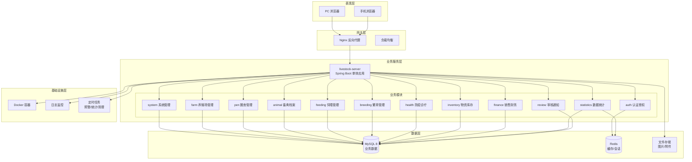
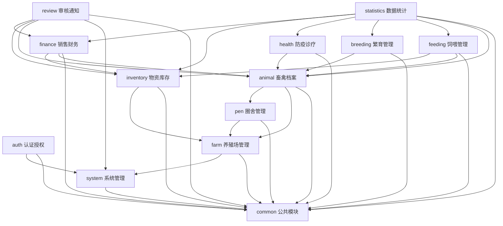
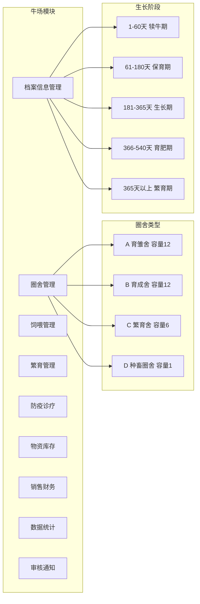
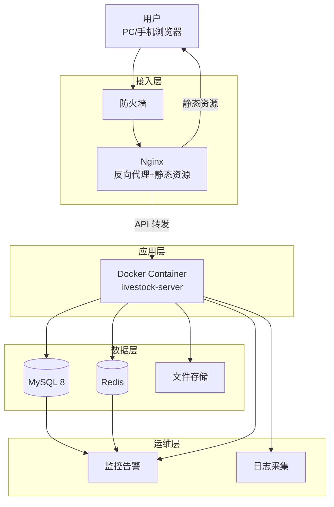
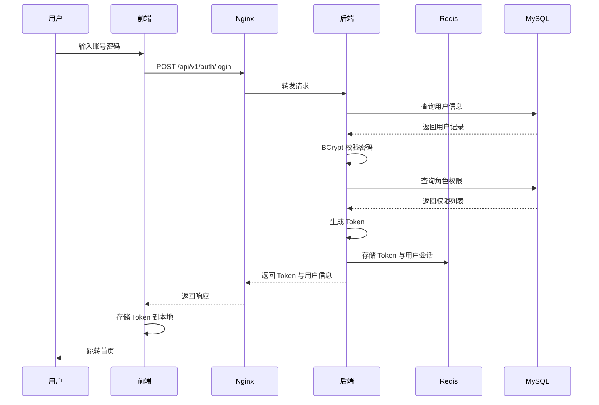
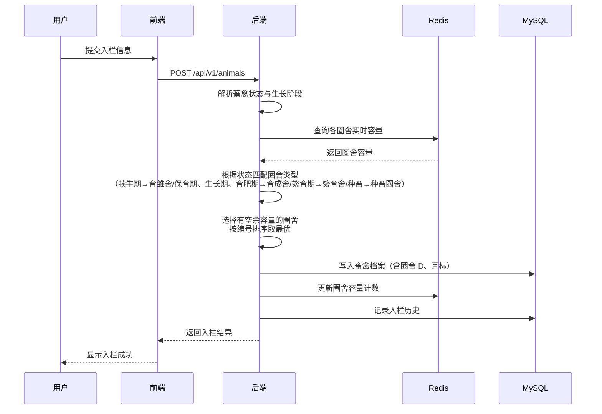
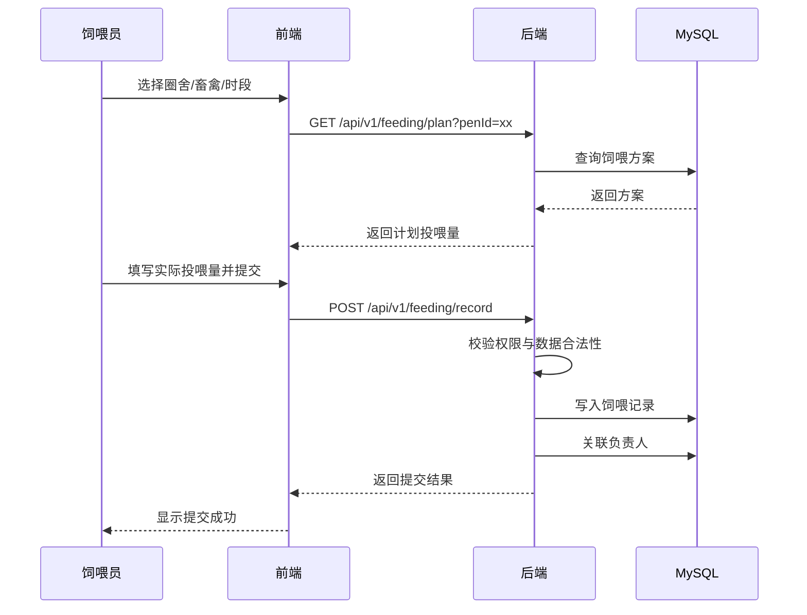
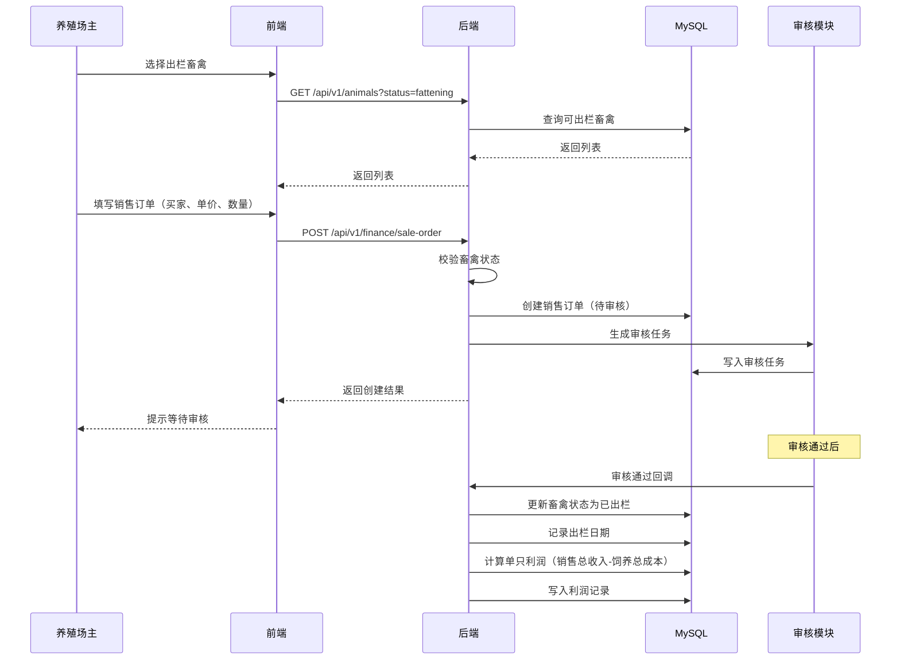
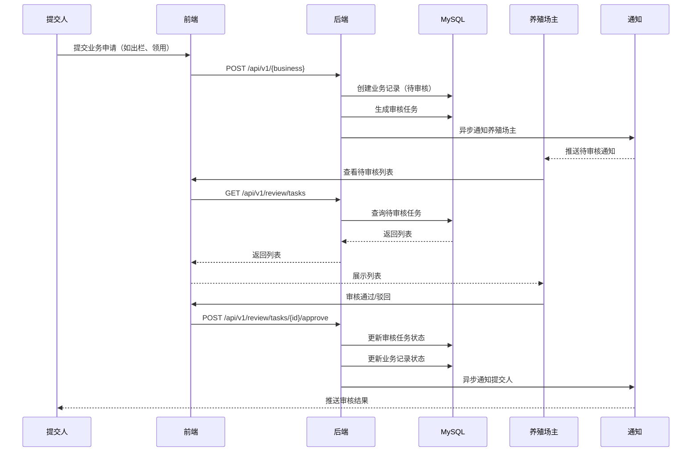

# 智能养殖信息管理系统概要设计文档（HDD）

## 1. 文档信息

### 1.1 基本信息

| 项目 | 内容 |
| ------ | ------ |
| 项目名称 | 智能养殖信息管理系统 |
| 文档名称 | High-Level Design Document（概要设计文档） |
| 文档版本 | V1.0 |
| 文档状态 | 草稿 |
| 编制日期 | 2026-08-10 |
| 文档密级 | 内部公开 |

### 1.2 修订记录

| 版本 | 修改日期 | 修改人 | 修改内容 | 备注 |
| ------ | ------ | ------ | ------ | ------ |
| V1.0 | 2026-08-10 | 系统架构组 | 初始版本，完成总体架构、模块划分、安全设计、部署架构等内容 | 首次发布 |

### 1.3 术语与缩写

| 术语 | 说明 |
| ------ | ------ |
| HDD | High-Level Design Document，概要设计文档 |
| RBAC | Role-Based Access Control，基于角色的访问控制 |
| JWT | JSON Web Token，一种基于 Token 的无状态认证方案 |
| Sa-Token | 一款轻量级 Java 权限认证框架 |
| LLD | Low-Level Design Document，详细设计文档 |
| SLA | Service Level Agreement，服务等级协议 |
| BCP | Business Continuity Plan，业务连续性计划 |

---

## 2. 系统概述

### 2.1 项目背景

随着畜禽养殖行业规模化、集约化发展，传统的人工台账式管理已难以满足现代养殖场对精细化、标准化、信息化的管理诉求。养殖过程中存在的档案不完整、饲喂不规范、繁育预警滞后、防疫追溯困难、物资损耗不清、财务核算不准等问题日益突出。

智能养殖信息管理系统面向牛、羊、猪三类畜禽养殖场景，覆盖畜禽档案、饲喂管理、繁育管理、防疫诊疗、物资库存、销售台账、数据统计、审核通知等全流程业务，通过数字化手段实现养殖业务的全链路闭环管理，提升养殖效率、降低运营成本、保障食品安全可追溯。

### 2.2 设计目标

| 目标编号 | 目标名称 | 目标描述 |
| ------ | ------ | ------ |
| G1 | 全流程覆盖 | 覆盖从入栏到出栏的全生命周期管理，包括档案、饲喂、繁育、防疫、物资、销售、统计、审核八大业务域 |
| G2 | 多角色协同 | 支持超级管理员、养殖场主管理员、养殖场员工（饲喂员/繁育员/兽医/库管员）三类角色协同作业 |
| G3 | 多场种支持 | 牛、羊、猪独立子模块，路由 /:species/（cattle/sheep/pig）隔离，差异通过独立子模块与参数化配置实现 |
| G4 | 数据可追溯 | 全量业务数据留存，支持单只畜禽从出生到出栏的全链路追溯 |
| G5 | 智能预警 | 自动触发配种孕检、临产、发情等关键节点预警，辅助决策 |
| G6 | 多终端访问 | 支持 PC 端与手机浏览器通过 IP 访问，适配多场景办公需求 |
| G7 | 数据可视化 | 提供综合大屏与多维度统计报表，支撑经营决策 |

### 2.3 设计原则

| 原则 | 说明 |
| ------ | ------ |
| 高内聚低耦合 | 模块内部职责单一、功能内聚，模块之间通过标准化接口交互，降低耦合度，便于独立演进 |
| 可扩展性 | 支持横向扩展（新增养殖场、新增畜禽种类）与纵向扩展（新增业务模块），架构层面预留扩展点 |
| 安全可靠 | 多租户数据隔离、细粒度权限控制、敏感数据加密、操作审计，保障数据安全与业务合规 |
| 配置化 | 畜禽种类差异（品种、生长阶段日龄、饲喂参数、饲料成本）通过配置化实现，避免硬编码 |
| 标准化 | 遵循 RESTful 接口规范、统一返回格式、统一异常处理、统一编码规范 |
| 易用性 | 界面交互符合用户习惯，关键操作提供引导与预警提示，降低学习成本 |
| 可运维性 | 提供健康检查、日志监控、性能指标采集能力，便于日常运维与故障定位 |

---

## 3. 系统总体架构

### 3.1 架构图

系统采用分层架构设计，自上而下分为表现层、网关层、业务服务层、数据层、基础设施层。



### 3.2 架构说明

#### 3.2.1 前后端分离

系统采用前后端分离架构，前端与后端通过 RESTful API 进行数据交互。

| 维度 | 说明 |
| ------ | ------ |
| 前端 | Vue3 + TypeScript 单页应用，部署于 Nginx 静态资源目录 |
| 后端 | Spring Boot 3 提供 RESTful 接口，独立部署于 Tomcat 容器 |
| 通信协议 | HTTP/HTTPS，JSON 数据格式 |
| 跨域处理 | Nginx 反向代理统一转发，规避浏览器跨域问题 |
| 接口文档 | Knife4j 自动生成在线接口文档，前后端协同开发 |

#### 3.2.2 单体应用选型说明

| 选项 | 评估结论 |
| ------ | ------ |
| 微服务架构 | 业务规模较小、模块间耦合紧密、运维成本高，当前阶段不采用 |
| 单体架构 | 部署简单、开发效率高、模块通过 Maven 多模块组织保证内聚低耦合，作为当前阶段选型 |

后端采用 Maven 多模块单体架构（livestock-server），按业务域拆分为 common、system、auth、farm、pen、animal、feeding、breeding、health、inventory、finance、statistics、review 等子模块，模块间通过接口依赖而非实现依赖，为未来向微服务演进预留空间。

#### 3.2.3 部署架构

| 组件 | 部署方式 | 说明 |
| ------ | ------ | ------ |
| 前端 | Nginx 静态资源 | 通过 IP 访问，Nginx 反向代理后端接口 |
| 后端 | Docker 容器 | Spring Boot 应用打包为 jar，运行于 Docker 容器 |
| 数据库 | MySQL 8 独立部署 | 主从复制可选 |
| 缓存 | Redis 独立部署 | 会话、字典、热点数据缓存 |
| 文件存储 | 本地磁盘或对象存储 | 图片、附件存储 |

---

## 4. 技术选型

### 4.1 技术栈总览

| 层次 | 技术 | 版本 | 用途 |
| ------ | ------ | ------ | ------ |
| 前端框架 | Vue 3 | 3.4.x | 渐进式前端框架 |
| 前端语言 | TypeScript | 5.x | 类型安全的 JavaScript 超集 |
| 构建工具 | Vite | 5.x | 前端构建与开发服务器 |
| UI 组件库 | Element Plus | 2.x | 基于 Vue 3 的桌面端组件库 |
| 状态管理 | Pinia | 2.x | Vue 3 官方推荐的状态管理库 |
| 路由 | Vue Router | 4.x | 前端路由管理 |
| HTTP 客户端 | Axios | 1.x | HTTP 请求库 |
| 图表库 | ECharts | 5.x | 数据可视化图表 |
| 后端框架 | Spring Boot | 3.2.x | Java 企业级应用框架 |
| 安全框架 | Spring Security + Sa-Token | 6.x / 1.37.x | 认证授权 |
| Token 方案 | JWT | - | 无状态 Token 认证 |
| ORM 框架 | MyBatis-Plus | 3.5.x | MyBatis 增强工具 |
| 数据库 | MySQL | 8.0 | 关系型数据库 |
| 缓存 | Redis | 7.x | 内存数据库 |
| 接口文档 | Knife4j | 4.x | Swagger 增强 UI |
| 工具库 | Hutool | 5.x | Java 工具类库 |
| 简化代码 | Lombok | 1.18.x | 注解消除样板代码 |
| 构建工具 | Maven | 3.9.x | 后端依赖管理与构建 |
| 包管理 | npm | 9.x | 前端依赖管理 |
| 容器化 | Docker | 24.x | 应用容器化部署 |
| 反向代理 | Nginx | 1.24.x | 静态资源与反向代理 |

### 4.2 技术选型对比表

#### 4.2.1 前端框架对比

| 候选 | 优点 | 缺点 | 结论 |
| ------ | ------ | ------ | ------ |
| Vue 3 | 学习曲线平缓、生态成熟、Composition API 灵活、性能优异 | 大型项目需配合 TypeScript 约束 | 选用 |
| React | 生态丰富、组件化能力强 | 学习曲线陡峭、JSX 与模板语法差异大 | 不选用 |
| Angular | 企业级完整方案、内置功能丰富 | 学习成本高、体积大、过度工程化 | 不选用 |

#### 4.2.2 UI 组件库对比

| 候选 | 优点 | 缺点 | 结论 |
| ------ | ------ | ------ | ------ |
| Element Plus | 与 Vue 3 深度集成、组件丰富、文档完善、后台管理场景适配度高 | 定制化样式需覆盖默认主题 | 选用 |
| Ant Design Vue | 组件丰富、设计规范 | 与 Vue 3 集成略晚于 Element Plus | 不选用 |
| Naive UI | TypeScript 友好、轻量 | 后台管理组件覆盖度不及 Element Plus | 不选用 |

#### 4.2.3 后端框架对比

| 候选 | 优点 | 缺点 | 结论 |
| ------ | ------ | ------ | ------ |
| Spring Boot 3 | 生态成熟、社区活跃、Java 17+ 支持、与企业级组件集成良好 | 启动较慢、内存占用较高 | 选用 |
| Quarkus | 启动快、内存占用低、云原生友好 | 生态不及 Spring 丰富、团队学习成本 | 不选用 |
| Micronaut | 编译期依赖注入、性能好 | 生态小、社区活跃度低 | 不选用 |

#### 4.2.4 ORM 框架对比

| 候选 | 优点 | 缺点 | 结论 |
| ------ | ------ | ------ | ------ |
| MyBatis-Plus | 基于 MyBatis 增强、CRUD 内置、代码生成、分页插件、多租户插件支持 | 复杂查询仍需手写 XML | 选用 |
| JPA/Hibernate | 全自动 ORM、面向对象 | 复杂查询性能难控、SQL 透明度低 | 不选用 |
| 原生 MyBatis | 灵活、SQL 可控 | 基础 CRUD 重复劳动多 | 不选用 |

#### 4.2.5 认证授权方案对比

| 候选 | 优点 | 缺点 | 结论 |
| ------ | ------ | ------ | ------ |
| Sa-Token | 轻量、API 简洁、内置 RBAC/SSO/多租户支持、与 Spring Boot 集成简单 | 社区规模不及 Spring Security | 选用（建议） |
| Spring Security | 功能强大、生态成熟、可扩展性强 | 配置复杂、学习曲线陡峭 | 配合使用 |
| 纯 JWT 手写实现 | 完全可控 | 重复造轮子、安全风险高 | 不选用 |

---

## 5. 系统模块划分

### 5.1 前端模块划分

| 模块 | 子模块 | 职责说明 |
| ------ | ------ | ------ |
| 公共模块 | layout、components、utils、api、store、router | 全局布局、通用组件、工具函数、API 封装、状态管理、路由配置 |
| 登录注册模块 | login、register | 账号登录、注册（仅养殖场主）、找回密码；员工由养殖场主在员工管理开通 |
| 养殖场主模块 | cow、sheep、pig | 牛场、羊场、猪场独立子模块（路由 /:species/），包含圈舍、档案、饲喂、繁育、防疫、物资、销售、统计、审核九大功能 |
| 养殖场员工模块 | employee | 员工工作台（/:species/workbench，按饲喂员/兽医/繁育员/库管员四岗位分流）、待办任务、饲喂记录、繁育记录、防疫记录、物资领用 |
| 超级管理员模块 | admin | 养殖场管理、用户管理、角色管理、系统配置、数据看板 |

### 5.2 后端模块划分

后端项目 livestock-server 采用 Maven 多模块结构，模块划分如下：

| 模块 | 模块名 | 职责说明 |
| ------ | ------ | ------ |
| 公共模块 | common | 通用工具类、统一返回对象、统一异常处理、全局常量、基础实体、拦截器、AOP |
| 系统管理模块 | system | 用户管理、角色管理、权限管理、菜单管理、字典管理、系统配置、操作日志 |
| 认证授权模块 | auth | 登录认证、注册、Token 管理、权限校验、会话管理 |
| 养殖场管理模块 | farm | 养殖场档案、养殖种类配置、养殖场员工关系维护 |
| 圈舍管理模块 | pen | 圈舍档案（A 育雏舍/B 育成舍/C 繁育舍/D 种畜圈舍）、容量配置、自动分配策略 |
| 畜禽档案模块 | animal | 畜禽档案（耳标、品种、圈舍、性别、日龄、生长阶段、生理状态、状态）、入栏、出栏、批量操作、历史记录清理 |
| 饲喂管理模块 | feeding | 饲喂方案、饲喂记录（早/晚时段、计划/实际投喂、状态、负责人） |
| 繁育管理模块 | breeding | 母畜档案、公畜档案、母畜生理状态管理（入栏=发情、配种=妊娠、孕检阴性/删除配种=发情、产犊=泌乳、休情/淘汰手动）、配种记录、产仔记录、繁育预警（孕检、临产、发情） |
| 防疫诊疗模块 | health | 防疫记录、诊疗记录、疫苗追溯 |
| 物资库存模块 | inventory | 库存管理（饲料/疫苗/兽药）、进货记录、领用记录（自动减扣库存） |
| 销售财务模块 | finance | 薪资管理、出栏销售、销售订单、成本支出、利润核算 |
| 数据统计模块 | statistics | 首页今日待办（dashboard todos：今日待办/临产提醒/库存不足提醒/存栏总数/圈舍总数）、综合大屏、存栏繁育统计、防疫诊疗统计、物资消耗统计、财务统计 |
| 审核通知模块 | review | 待审核列表、审核流程、消息通知 |

### 5.3 模块依赖关系图



依赖关系说明：

| 上游模块 | 下游模块 | 依赖说明 |
| ------ | ------ | ------ |
| 所有业务模块 | common | 依赖公共工具、统一返回、异常处理 |
| auth | system | 认证依赖用户、角色、权限数据 |
| pen | farm | 圈舍归属养殖场 |
| animal | farm、pen | 畜禽归属养殖场与圈舍 |
| feeding | animal、inventory | 饲喂关联畜禽与饲料库存 |
| breeding | animal | 繁育关联畜禽档案 |
| health | animal | 防疫诊疗关联畜禽档案 |
| inventory | farm | 物资归属养殖场 |
| finance | animal、inventory | 销售关联畜禽、成本关联物资 |
| statistics | animal、feeding、breeding、health、inventory、finance | 统计聚合多源数据 |
| review | system、animal、inventory、finance | 审核关联多业务实体 |

---

## 6. 功能架构

### 6.1 功能模块与系统模块映射表

| 业务功能 | 前端模块 | 后端模块 | 数据表（核心） |
| ------ | ------ | ------ | ------ |
| 登录 | 登录注册模块 | auth | sys_user、sys_role、sys_user_role |
| 注册（养殖场主） | 登录注册模块 | auth、farm | sys_user、farm_info |
| 员工管理（开通员工账号） | 养殖场主模块 | system、farm | sys_user |
| 用户管理 | 超级管理员模块 | system | sys_user、sys_role |
| 角色权限管理 | 超级管理员模块 | system | sys_role、sys_menu、sys_user_role |
| 养殖场管理 | 超级管理员模块 | farm | farm_info |
| 圈舍管理 | 养殖场主模块 | pen | pen_info |
| 畜禽档案管理 | 养殖场主模块 | animal | animal_archive、animal_history |
| 入栏（个体/批量） | 养殖场主模块 | animal、pen | animal_archive、pen_info |
| 出栏 | 养殖场主模块 | animal、finance | animal_archive、sale_order |
| 饲喂方案 | 养殖场主模块 | feeding | feeding_plan |
| 饲喂记录 | 养殖场主/员工模块 | feeding | feeding_record |
| 配种记录 | 养殖场主模块 | breeding | breeding_record |
| 产仔记录 | 养殖场主模块 | breeding | farrowing_record |
| 繁育预警 | 养殖场主模块 | breeding | breeding_warning |
| 防疫记录 | 养殖场主模块 | health | health_record |
| 诊疗记录 | 养殖场主模块 | health | treatment_record |
| 库存管理 | 养殖场主模块 | inventory | inventory_stock |
| 进货记录 | 养殖场主模块 | inventory | purchase_record |
| 领用记录 | 养殖场主/员工模块 | inventory | use_record |
| 薪资管理 | 养殖场主模块 | finance | salary_record |
| 销售订单 | 养殖场主模块 | finance | sale_order |
| 成本支出 | 养殖场主模块 | finance | cost_record |
| 利润核算 | 养殖场主模块 | finance | profit_record |
| 综合大屏 | 养殖场主模块 | statistics | 视图聚合 |
| 存栏繁育统计 | 养殖场主模块 | statistics | 视图聚合 |
| 防疫诊疗统计 | 养殖场主模块 | statistics | 视图聚合 |
| 物资消耗统计 | 养殖场主模块 | statistics | 视图聚合 |
| 财务统计 | 养殖场主模块 | statistics | 视图聚合 |
| 待审核列表 | 养殖场主模块 | review | （无独立表，审核状态在各业务表 audit_status） |
| 首页今日待办（dashboard todos） | 养殖场主/员工模块 | statistics | 视图聚合（今日待办/临产提醒/库存不足提醒/存栏总数/圈舍总数） |

### 6.2 牛场功能架构图



---

## 7. 接口架构概述

### 7.1 RESTful 规范

| 规范项 | 说明 | 示例 |
| ------ | ------ | ------ |
| 协议 | HTTPS | https://ip:port |
| 路径风格 | 小写复数名词，层级表达从属关系 | /api/v1/farms/{farmId}/animals |
| HTTP 方法 | GET 查询、POST 新增、PUT 全量更新、PATCH 部分更新、DELETE 删除 | GET /api/v1/animals/{id} |
| 版本控制 | URL 路径中携带版本号 | /api/v1/、/api/v2/ |
| 查询参数 | 分页、排序、过滤统一参数 | ?page=1&size=20&sort=createTime,desc&keyword=xxx |
| 状态码 | 遵循 HTTP 标准状态码语义 | 200 成功、400 参数错误、401 未认证、403 无权限、404 不存在、500 服务器错误 |

### 7.2 统一返回格式

```json
{
  "code": 200,
  "message": "操作成功",
  "data": {
    "id": 1,
    "earTag": "A001"
  },
  "timestamp": 1691616000000
}
```

| 字段 | 类型 | 说明 |
| ------ | ------ | ------ |
| code | Integer | 业务状态码，200 表示成功，其他为业务错误码 |
| message | String | 提示信息 |
| data | Object/Array | 业务数据 |
| timestamp | Long | 服务器时间戳 |

分页返回格式：

```json
{
  "code": 200,
  "message": "操作成功",
  "data": {
    "records": [],
    "total": 100,
    "current": 1,
    "size": 20,
    "pages": 5
  }
}
```

### 7.3 统一异常处理

| 异常类型 | 处理类 | 返回码 | 说明 |
| ------ | ------ | ------ | ------ |
| 业务异常 BusinessException | GlobalExceptionHandler | 400 / 自定义 | 业务校验失败 |
| 参数校验异常 MethodArgumentNotValidException | GlobalExceptionHandler | 400 | 请求参数不合法 |
| 未认证异常 NotLoginException | GlobalExceptionHandler | 401 | 未登录或 Token 失效 |
| 无权限异常 NotPermissionException | GlobalExceptionHandler | 403 | 无访问权限 |
| 资源不存在异常 | GlobalExceptionHandler | 404 | 资源未找到 |
| 系统异常 Exception | GlobalExceptionHandler | 500 | 未捕获异常 |

### 7.4 鉴权方式

| 维度 | 说明 |
| ------ | ------ |
| 认证方式 | Sa-Token + JWT，登录成功后签发 Token |
| Token 携带 | 请求头 Authorization: Bearer {token} |
| Token 有效期 | 默认 2 小时，支持续签 |
| 刷新机制 | Token 即将过期时前端调用刷新接口换取新 Token |
| 权限校验 | 注解式校验 @SaCheckPermission、@SaCheckRole |
| 会话存储 | Redis 存储 Token 与用户信息映射 |

---

## 8. 数据架构概述

### 8.1 数据库选型

| 维度 | 选型 | 说明 |
| ------ | ------ | ------ |
| 数据库 | MySQL 8.0 | 关系型数据库，事务一致性、生态成熟、运维成本低 |
| 字符集 | utf8mb4 | 支持 emoji 与生僻字 |
| 存储引擎 | InnoDB | 支持事务、行级锁、外键 |
| 命名规范 | 小写下划线 | 如 animal_archive、feeding_record |

### 8.2 核心数据表清单

| 业务域 | 数据表 | 说明 |
| ------ | ------ | ------ |
| 系统管理 | sys_user、sys_role、sys_menu、sys_user_role、sys_dict_type、sys_dict_data、oper_log、login_log、sys_notice | 用户、角色、菜单、字典、日志、通知 |
| 养殖场 | farm_info | 养殖场档案（畜种由 livestock_types 字段承载，员工归属靠 sys_user.farm_id+post） |
| 圈舍 | pen_info | 圈舍档案（圈舍类型由字典 sys_pen_type 承载） |
| 畜禽档案 | animal_archive、animal_archive_history | 畜禽档案、历史记录（生长阶段按日龄代码判定，无独立表） |
| 饲喂 | feeding_plan、feeding_record | 饲喂方案、饲喂记录 |
| 繁育 | mating_record、birth_record、breeding_alert | 配种、产犊、繁育预警 |
| 防疫诊疗 | vaccine_record、medical_record | 防疫、诊疗 |
| 物资 | material_stock、material_purchase、material_consume | 库存、进货、领用 |
| 财务 | salary_config、salary_record、sale_order、sale_order_detail、cost_expense | 薪资配置、薪资、销售订单、销售明细、成本支出 |
| 审核 | （无独立表） | 审核状态由各业务表 audit_status 承载；通知公告见 sys_notice |

### 8.3 缓存设计

| 缓存场景 | Key 设计 | 有效期 | 说明 |
| ------ | ------ | ------ | ------ |
| 登录会话 | satoken:login:token:{token} | 2 小时 | Sa-Token 会话信息 |
| 用户权限 | satoken:perm:{userId} | 30 分钟 | 用户权限列表缓存 |
| 字典数据 | dict:{dictType} | 1 小时 | 字典数据缓存 |
| 系统配置 | config:{configKey} | 1 小时 | 系统配置缓存 |
| 养殖场信息 | farm:info:{farmId} | 30 分钟 | 养殖场基本信息缓存 |
| 圈舍容量 | pen:capacity:{penId} | 5 分钟 | 圈舍实时容量缓存，防止超分配 |
| 统计大屏 | stats:dashboard:{farmId} | 5 分钟 | 综合大屏数据缓存 |
| 限流计数 | rate:limit:{ip}:{api} | 1 分钟 | 接口限流计数 |

### 8.4 文件存储

| 文件类型 | 存储方式 | 访问方式 |
| ------ | ------ | ------ |
| 畜禽照片 | 本地磁盘 / 对象存储 | 通过文件 ID 接口下载 |
| 防疫凭证 | 本地磁盘 / 对象存储 | 通过文件 ID 接口下载 |
| 销售合同 | 本地磁盘 / 对象存储 | 通过文件 ID 接口下载 |
| 附件 | 本地磁盘 / 对象存储 | 通过文件 ID 接口下载 |

文件元数据存储于 file_info 表，业务表通过 file_id 关联。

### 8.5 多租户策略

| 维度 | 说明 |
| ------ | ------ |
| 隔离模型 | 共享数据库、共享 Schema、通过 farm_id 字段隔离 |
| 实现方式 | MyBatis-Plus 多租户插件，自动在 SQL 中拼接 farm_id 条件 |
| 租户上下文 | 登录后从 Token 中解析 farm_id，存入 ThreadLocal |
| 超级管理员 | 超级管理员不受 farm_id 隔离限制，可跨租户查询 |
| 数据表规范 | 所有业务表必须包含 farm_id 字段，并建立联合索引 |

---

## 9. 安全设计

### 9.1 认证与授权

| 维度 | 说明 |
| ------ | ------ |
| 认证框架 | Sa-Token + JWT |
| 认证流程 | 账号密码登录 -> 校验密码（BCrypt） -> 签发 Token -> Redis 存储会话 |
| 授权模型 | RBAC（Role-Based Access Control） |
| 角色定义 | 超级管理员、养殖场主管理员、饲喂员、繁育员、兽医、库管员 |
| 权限粒度 | 菜单权限（页面级） + 按钮权限（操作级） + 数据权限（数据级） |
| 数据权限 | 基于 farm_id 的多租户隔离，员工仅能访问所属养殖场数据 |

角色权限矩阵：

| 功能 | 超级管理员 | 养殖场主 | 饲喂员 | 繁育员 | 兽医 | 库管员 |
| ------ | ------ | ------ | ------ | ------ | ------ | ------ |
| 养殖场管理 | 全部 | 本场 | - | - | - | - |
| 用户管理 | 全部 | 本场员工 | - | - | - | - |
| 圈舍管理 | 查看 | 全部 | 查看 | 查看 | 查看 | 查看 |
| 畜禽档案 | 查看 | 全部 | 查看 | 查看 | 查看 | 查看 |
| 饲喂管理 | 查看 | 全部 | 操作 | 查看 | 查看 | 查看 |
| 繁育管理 | 查看 | 全部 | 查看 | 操作 | 查看 | 查看 |
| 防疫诊疗 | 查看 | 全部 | 查看 | 查看 | 操作 | 查看 |
| 物资库存 | 查看 | 全部 | 领用 | 领用 | 领用 | 操作 |
| 销售财务 | 查看 | 全部 | - | - | - | 查看 |
| 数据统计 | 全部 | 本场 | 查看 | 查看 | 查看 | 查看 |
| 审核通知 | 查看 | 全部 | 查看 | 查看 | 查看 | 查看 |

### 9.2 数据安全

| 维度 | 措施 |
| ------ | ------ |
| 传输安全 | 全站 HTTPS，TLS 1.2+ |
| 密码存储 | BCrypt 加盐哈希，不可逆 |
| 敏感数据脱敏 | 手机号、身份证号等敏感字段查询时脱敏返回（如 138****5678） |
| 数据库备份 | 每日全量备份，保留 30 天 |
| 操作审计 | 关键操作（入栏、出栏、删除、审核）记录操作日志，含操作人、时间、IP、内容 |
| SQL 注入防护 | MyBatis 参数化查询，禁止字符串拼接 SQL |

### 9.3 接口安全

| 维度 | 措施 |
| ------ | ------ |
| 接口限流 | 基于 Redis + AOP 实现接口限流，默认 60 次/分钟/IP |
| 防重放 | 关键接口（入栏、出栏、审核）要求携带时间戳与随机数，服务端校验时效性 |
| 接口签名 | 关键接口要求携带签名（HMAC-SHA256），防止参数篡改 |
| 越权防护 | 每个接口校验当前用户对目标资源的所属权限 |
| 幂等性 | 新增类接口支持幂等键，防止重复提交 |

### 9.4 多租户数据隔离

| 维度 | 措施 |
| ------ | ------ |
| 隔离字段 | farm_id 贯穿所有业务表 |
| SQL 拦截 | MyBatis-Plus 多租户插件自动拼接 farm_id 条件 |
| 上下文传递 | Token 中携带 farm_id，请求拦截器写入 ThreadLocal |
| 越权校验 | 业务层校验操作资源的 farm_id 与当前用户 farm_id 一致 |
| 超管豁免 | 超级管理员角色标记后跳过租户隔离 |

---

## 10. 性能设计

### 10.1 缓存策略

| 场景 | 策略 |
| ------ | ------ |
| 字典/配置 | 启动时加载至 Redis，更新时主动刷新 |
| 综合大屏 | 定时任务每 5 分钟刷新缓存，前端读取缓存 |
| 圈舍容量 | 实时维护 Redis 计数器，分配圈舍时原子操作 |
| 热点查询 | 畜禽档案详情缓存 5 分钟，更新时失效 |
| 缓存一致性 | 写操作先更新数据库再删除缓存（Cache Aside Pattern） |

### 10.2 数据库索引

| 数据表 | 索引字段 | 索引类型 | 说明 |
| ------ | ------ | ------ | ------ |
| animal_archive | farm_id, ear_tag | 唯一索引 | 防止耳标重复 |
| animal_archive | farm_id, pen_id, status | 联合索引 | 圈舍存栏查询 |
| animal_archive | farm_id, growth_stage | 联合索引 | 生长阶段统计 |
| feeding_record | farm_id, feeding_date, session | 联合索引 | 饲喂记录查询 |
| mating_record | farm_id, female_tag, mating_date | 联合索引 | 配种记录查询 |
| sale_order | farm_id, sale_date | 联合索引 | 销售统计 |
| sys_user | phone | 唯一索引 | 手机号唯一 |

### 10.3 分页查询

| 维度 | 说明 |
| ------ | ------ |
| 分页方式 | MyBatis-Plus 分页插件，基于 LIMIT OFFSET |
| 默认页大小 | 20 条，最大 100 条 |
| 深分页优化 | 列表查询超过 10000 条时改用游标分页（基于 ID） |
| 计数优化 | 大表 count 查询走缓存或估算值 |

### 10.4 异步处理

| 场景 | 实现方式 | 说明 |
| ------ | ------ | ------ |
| 繁育预警生成 | 定时任务 + 异步线程池 | 每日扫描配种、产仔记录，生成预警 |
| 统计报表生成 | 定时任务 | 夜间预计算次日报表数据 |
| 历史记录清理 | 定时任务 | 每日清理超过半年的历史记录 |
| 操作日志记录 | 异步线程池 | 不阻塞主业务流程 |
| 消息通知 | 异步线程池 | 审核通知、预警通知异步推送 |

---

## 11. 可用性设计

### 11.1 健康检查

| 检查项 | 检查方式 | 告警阈值 |
| ------ | ------ | ------ |
| 应用存活 | /actuator/health 接口 | 连续 3 次失败 |
| 数据库连通 | 健康检查接口探测连接池 | 连接失败 |
| Redis 连通 | 健康检查接口探测 Redis | 连接失败 |
| 磁盘空间 | 监控磁盘使用率 | 使用率 > 80% |
| JVM 内存 | 监控堆内存使用率 | 使用率 > 85% |

### 11.2 日志监控

| 维度 | 说明 |
| ------ | ------ |
| 日志框架 | Logback |
| 日志级别 | ERROR / WARN / INFO / DEBUG，生产环境 INFO |
| 日志格式 | 包含时间、级别、链路 ID、类名、线程、消息 |
| 日志输出 | 文件滚动输出，按天切割，保留 30 天 |
| 链路追踪 | 请求头携带 traceId，MDC 注入日志 |
| 异常监控 | ERROR 日志告警通知运维 |

### 11.3 容灾备份

| 维度 | 措施 |
| ------ | ------ |
| 数据库备份 | 每日全量备份 + binlog 增量备份，保留 30 天 |
| 应用备份 | Docker 镜像版本化管理，支持快速回滚 |
| 配置备份 | 配置文件纳管 Git，支持版本回溯 |
| 故障恢复 | RTO（恢复时间目标）≤ 2 小时，RPO（恢复点目标）≤ 1 小时 |

---

## 12. 部署架构

### 12.1 部署拓扑图



### 12.2 Nginx 反向代理配置要点

| 配置项 | 说明 |
| ------ | ------ |
| 静态资源 | 前端 dist 目录托管于 Nginx |
| API 代理 | /api/ 路径转发至后端容器 |
| 负载均衡 | 多实例场景配置 upstream |
| gzip | 开启 gzip 压缩，减小传输体积 |
| 缓存 | 静态资源设置 Cache-Control |
| HTTPS | 配置 SSL 证书，强制 HTTPS |

### 12.3 Docker 容器化

| 镜像 | 基础镜像 | 说明 |
| ------ | ------ | ------ |
| livestock-server | openjdk:17-slim | 后端应用镜像 |
| nginx | nginx:1.24 | 前端静态资源镜像 |
| mysql | mysql:8.0 | 数据库镜像 |
| redis | redis:7 | 缓存镜像 |

容器编排通过 docker-compose 管理，定义网络与数据卷。

---

## 13. 关键流程时序图

### 13.1 用户登录流程



### 13.2 畜禽入栏自动分配圈舍流程



### 13.3 饲喂记录提交流程



### 13.4 销售出栏流程



### 13.5 审核流程



---

## 14. 非功能性设计要点

| 非功能需求 | 指标 | 设计措施 |
| ------ | ------ | ------ |
| 性能 | 接口平均响应时间 ≤ 500ms，95% 请求 ≤ 1s | 缓存、索引、分页、异步 |
| 并发 | 支撑 200 并发用户 | Redis 缓存、连接池调优、Tomcat 线程池 |
| 可用性 | 系统可用率 ≥ 99.5% | 健康检查、监控告警、快速回滚 |
| 可扩展性 | 支持新增养殖场、新增畜禽种类 | 多租户隔离、配置化生长阶段与饲喂参数 |
| 安全性 | 通过 OWASP Top 10 安全检查 | HTTPS、BCrypt、限流、签名、SQL 注入防护 |
| 可维护性 | 代码规范、文档完备 | 统一编码规范、Knife4j 接口文档、Logback 日志 |
| 兼容性 | 支持 Chrome、Edge、Safari 主流浏览器 | 前端兼容性测试、Polyfill |
| 数据一致性 | 业务事务强一致，统计最终一致 | Spring 事务管理、定时任务对账 |
| 数据持久性 | 数据丢失风险 ≤ 0.01% | 每日全量备份 + binlog 增量备份 |
| 易用性 | 新用户 30 分钟内完成核心操作 | 引导提示、操作手册、预警提醒 |

---

## 附录

### 附录 A：耳标编码规则

| 位置 | 含义 | 示例 |
| ------ | ------ | ------ |
| 前两位 | 圈舍编号 | A1、B2、C3、D4 |
| 后两位 | 顺序号 | 01、02、...、99 |
| 完整耳标 | 圈舍编号 + 顺序号 | A101、B212 |

### 附录 B：牛场生长阶段配置

| 阶段编号 | 阶段名称 | 日龄范围 | 对应圈舍 |
| ------ | ------ | ------ | ------ |
| S1 | 犊牛期 | 1-60 天 | A 育雏舍 |
| S2 | 保育期 | 61-180 天 | B 育成舍 |
| S3 | 生长期 | 181-365 天 | B 育成舍 |
| S4 | 育肥期 | 366-540 天 | B 育成舍 |
| S5 | 繁育期 | 365 天以上 | C 繁育舍 |
| 种畜 | 种畜 | - | D 种畜圈舍 |

### 附录 C：繁育预警规则

| 预警类型 | 触发条件 | 提醒对象 |
| ------ | ------ | ------ |
| 孕检预警 | 配种后 60 天 | 繁育员 |
| 临产预警 | 配种后 265 天（临产 15 天） | 繁育员、养殖场主 |
| 发情预警 | 产后 60 天未发情 | 繁育员 |
| 产后护理 | 产后 7 天 | 繁育员 |

### 附录 D：圈舍容量配置

| 圈舍类型 | 编号前缀 | 容量 | 适用阶段 |
| ------ | ------ | ------ | ------ |
| A 育雏舍 | A | 12 | 犊牛期 |
| B 育成舍 | B | 12 | 保育期、生长期、育肥期 |
| C 繁育舍 | C | 6 | 繁育期 |
| D 种畜圈舍 | D | 1 | 种畜 |

---

文档结束
