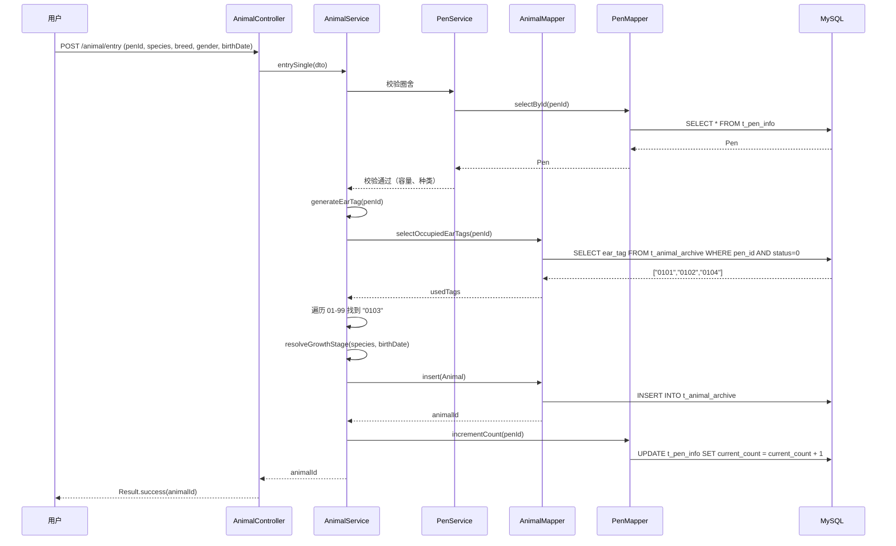
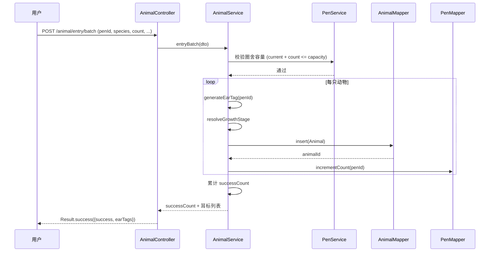
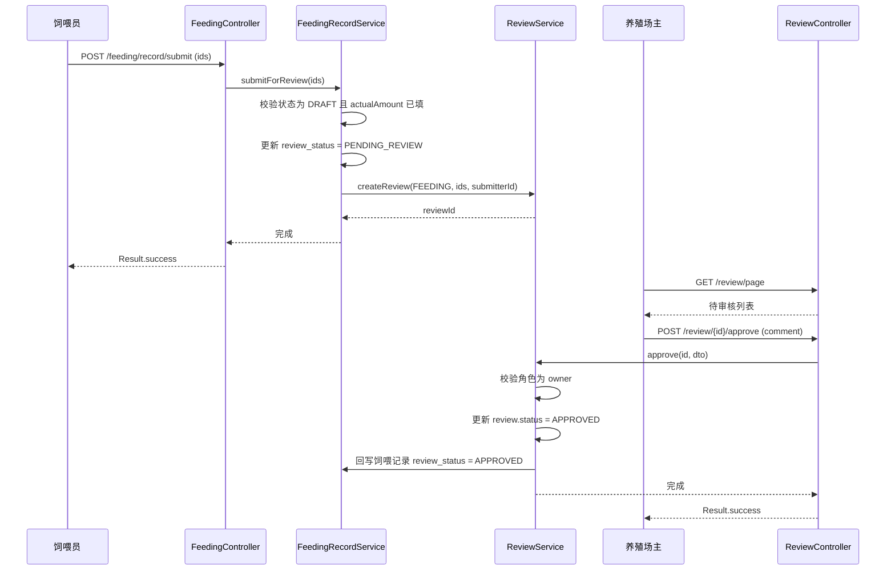
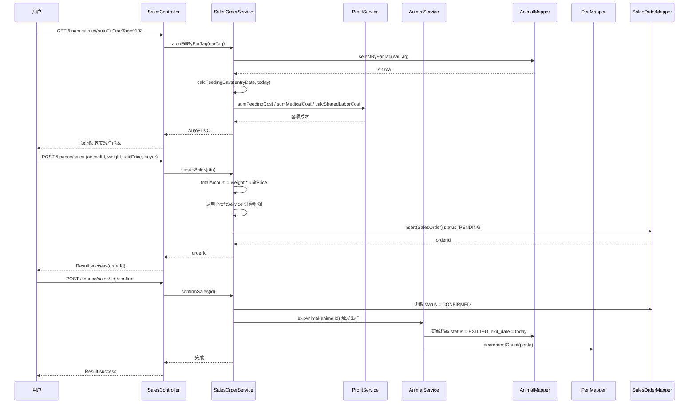

# 智能养殖信息管理系统 详细设计文档（LLD）

## 1. 文档信息

| 项目 | 内容 |
|------|------|
| 项目名称 | 智能养殖信息管理系统 |
| 文档名称 | 详细设计文档（Low-Level Design Document） |
| 文档版本 | V1.0 |
| 后端工程 | livestock-server |
| 前端工程 | livestock-web |
| 编写日期 | 2026-08-10 |
| 状态 | 初稿 |

### 修订记录

| 版本 | 日期 | 作者 | 修订内容 |
|------|------|------|----------|
| V1.0 | 2026-08-10 | 系统组 | 初稿创建，覆盖全部模块详细设计 |

---

## 2. 设计概述

### 2.1 设计目标

- 提供可直接指导编码的细粒度设计，包括包结构、类名、方法签名、字段定义、核心算法伪代码与时序图。
- 统一后端分层规范、接口规范、错误码规范、缓存规范与日志规范。
- 明确前端工程结构、路由、状态管理、请求封装与关键交互组件。
- 覆盖耳标生成、圈舍自动分配、生长阶段判定、利润核算、繁育预警等核心算法。

### 2.2 设计约定

- 后端采用 Spring Boot 3 + MyBatis-Plus + Sa-Token + Redis + MySQL 8 技术栈。
- 前端采用 Vue3 + TypeScript + Element Plus + Pinia + Vite + Axios 技术栈。
- 所有业务表均带 `farm_id` 字段，实现养殖场级别的多租户数据隔离。
- 所有表均含 `create_time`、`update_time`、`create_by`、`update_by`、`deleted` 公共字段。
- 逻辑删除统一使用 `deleted` 字段（0 未删除，1 已删除）。
- 时间字段统一使用 `LocalDateTime`，日期字段使用 `LocalDate`，存储格式 `yyyy-MM-dd HH:mm:ss`。

### 2.3 命名规范

| 类别 | 规范 | 示例 |
|------|------|------|
| 包名 | 全小写，单数 | `com.livestock.animal.service` |
| 类名 | 大驼峰 | `AnimalServiceImpl` |
| 方法名 | 小驼峰 | `generateEarTag` |
| 变量名 | 小驼峰 | `penId` |
| 常量名 | 全大写下划线 | `MAX_CAPACITY` |
| 数据库表名 | 下划线小写，模块前缀 | `t_animal_archive`、`t_pen_info` |
| 数据库字段 | 下划线小写 | `ear_tag`、`farm_id` |
| 接口路径 | 小写连字符，模块前缀 | `/animal/archive/list` |
| 前端组件 | 大驼峰 | `AnimalArchive.vue` |
| 前端 API 文件 | 小驼峰 | `animal.ts` |

### 2.4 模块编码

| 模块 | 编码 | 模块 | 编码 |
|------|------|------|------|
| auth 认证 | 01 | feeding 饲喂 | 06 |
| farm 养殖场 | 02 | breeding 繁育 | 07 |
| pen 圈舍 | 03 | health 防疫诊疗 | 08 |
| animal 档案 | 04 | inventory 物资 | 09 |
| system 系统 | 05 | finance 销售财务 | 10 |
| statistics 统计 | 11 | review 审核 | 12 |

---

## 3. 整体技术架构回顾

详细架构见《HDD-智能养殖信息管理系统.md》，本节仅做简要回顾。

### 3.1 后端架构

- 分层架构：Controller -> Service -> Mapper（DAO）-> Entity。
- 鉴权：Sa-Token 实现 JWT 登录、权限校验、会话管理。
- 多租户：自定义 `FarmInterceptor` 在 ThreadLocal 注入 `farm_id`，MyBatis-Plus 拦截器自动追加查询条件。
- 缓存：Redis 缓存字典、用户权限、登录 Token、热点统计。
- 定时任务：Spring Scheduled 实现每日扫描任务。

### 3.2 前端架构

- Vue3 Composition API + `<script setup>`。
- 路由：Vue Router 4，基于角色的动态路由。
- 状态：Pinia 管理 user、farm、permission。
- 请求：Axios 封装，统一 Token 注入、错误处理、loading。
- UI：Element Plus 按需引入。

### 3.3 部署架构

- 单体后端 + 单体前端，前端构建静态资源由 Nginx 托管。
- MySQL 单实例，Redis 单实例。
- 文件存储使用本地磁盘或 MinIO（饲料图片、动物照片等）。

---

## 4. 后端详细设计

### 4.1 工程结构与分层

#### 4.1.1 顶层工程结构

```
livestock-server/
├── pom.xml
├── src/main/java/com/livestock/
│   ├── LivestockApplication.java              # 启动类
│   ├── common/                                # 通用模块
│   │   ├── annotation/                        # 自定义注解
│   │   │   ├── FarmScope.java                 # 养殖场数据范围注解
│   │   │   ├── OperLog.java                   # 操作日志注解
│   │   │   └── DataPermission.java            # 数据权限注解
│   │   ├── aspect/                            # 切面
│   │   │   ├── OperLogAspect.java             # 操作日志切面
│   │   │   └── DataPermissionAspect.java      # 数据权限切面
│   │   ├── config/                            # 配置类
│   │   │   ├── MybatisPlusConfig.java         # MP 配置（分页、填充）
│   │   │   ├── RedisConfig.java               # Redis 配置
│   │   │   ├── SaTokenConfig.java             # Sa-Token 配置
│   │   │   ├── WebMvcConfig.java              # Web 配置（拦截器注册）
│   │   │   ├── CorsConfig.java                # 跨域配置
│   │   │   └── ScheduleConfig.java            # 定时任务配置
│   │   ├── constant/                          # 常量
│   │   │   ├── CacheConstant.java             # 缓存 key 前缀
│   │   │   ├── RegexConstant.java             # 正则常量
│   │   │   └── SystemConstant.java            # 系统常量
│   │   ├── enums/                             # 通用枚举
│   │   │   ├── ResultCodeEnum.java            # 返回码枚举
│   │   │   ├── SpeciesEnum.java               # 养殖种类枚举
│   │   │   ├── GenderEnum.java                # 性别枚举
│   │   │   └── DeleteFlagEnum.java            # 删除标志枚举
│   │   ├── exception/                         # 异常
│   │   │   ├── BusinessException.java         # 业务异常
│   │   │   ├── SystemException.java           # 系统异常
│   │   │   └── UnauthorizedException.java     # 鉴权异常
│   │   ├── handler/                           # 处理器
│   │   │   └── GlobalExceptionHandler.java    # 全局异常处理
│   │   ├── interceptor/                       # 拦截器
│   │   │   ├── FarmInterceptor.java           # 养殖场拦截器
│   │   │   └── TokenInterceptor.java          # Token 拦截器
│   │   ├── result/                            # 返回结果
│   │   │   ├── Result.java                    # 统一返回
│   │   │   └── PageResult.java                # 分页返回
│   │   ├── context/                           # 上下文
│   │   │   └── FarmContextHolder.java         # 养殖场上下文 ThreadLocal
│   │   └── utils/                             # 工具
│   │       ├── JwtUtils.java
│   │       ├── DateUtils.java
│   │       ├── EarTagUtils.java               # 耳标工具
│   │       └── SecurityUtils.java             # 当前用户工具
│   ├── system/                                # 系统模块（用户/角色/字典）
│   ├── auth/                                  # 认证模块
│   ├── farm/                                  # 养殖场模块
│   ├── pen/                                   # 圈舍模块
│   ├── animal/                                # 档案模块
│   ├── feeding/                               # 饲喂模块
│   ├── breeding/                              # 繁育模块
│   ├── health/                                # 防疫诊疗模块
│   ├── inventory/                             # 物资模块
│   ├── finance/                               # 销售财务模块
│   ├── statistics/                            # 统计模块
│   └── review/                                # 审核模块
└── src/main/resources/
    ├── application.yml
    ├── application-dev.yml
    ├── application-prod.yml
    ├── mapper/                                # XML 映射
    │   ├── system/
    │   ├── auth/
    │   ├── farm/
    │   ├── pen/
    │   ├── animal/
    │   ├── feeding/
    │   ├── breeding/
    │   ├── health/
    │   ├── inventory/
    │   ├── finance/
    │   ├── statistics/
    │   └── review/
    └── db/                                    # SQL 脚本
        └── init.sql
```

#### 4.1.2 业务模块内部分层（以 animal 模块为例）

```
animal/
├── controller/
│   └── AnimalController.java
├── service/
│   ├── AnimalService.java                     # 接口
│   └── impl/
│       └── AnimalServiceImpl.java             # 实现
├── mapper/
│   └── AnimalMapper.java
├── entity/
│   └── Animal.java
├── dto/                                       # 请求 DTO
│   ├── AnimalEntryDTO.java                    # 入栏请求
│   ├── AnimalBatchEntryDTO.java               # 批量入栏
│   ├── AnimalQueryDTO.java                    # 查询条件
│   └── AnimalUpdateDTO.java                   # 更新
├── vo/                                        # 响应 VO
│   ├── AnimalVO.java
│   └── AnimalDetailVO.java
├── enums/                                     # 模块内枚举
│   ├── AnimalStatusEnum.java
│   ├── AnimalSourceEnum.java
│   ├── GrowthStageEnum.java
│   └── PhysioStatusEnum.java
└── convert/                                   # MapStruct 转换
    └── AnimalConvert.java
```

其余模块（auth/farm/pen/feeding/breeding/health/inventory/finance/statistics/review）均遵循上述结构。

#### 4.1.3 分层职责

| 层 | 职责 | 规则 |
|----|------|------|
| Controller | 接收请求、参数校验、调用 Service、组装返回 | 不写业务逻辑，不直接操作 DAO |
| Service | 业务逻辑、事务控制、调用其他 Service | 接口与实现分离，事务注解在实现类 |
| Mapper | 数据访问 | 仅做单表 CRUD 与简单联表，复杂 SQL 走 XML |
| Entity | 数据库映射 | 与表字段一一对应，不加业务方法 |
| DTO | 入参对象 | 携带 JSR-303 校验注解 |
| VO | 出参对象 | 面向前端展示 |

---

### 4.2 通用组件设计

#### 4.2.1 统一返回结果 Result<T>

```java
package com.livestock.common.result;

@Data
public class Result<T> implements Serializable {
    private Integer code;
    private String message;
    private T data;
    private Long timestamp;

    public static <T> Result<T> success() { ... }
    public static <T> Result<T> success(T data) { ... }
    public static <T> Result<T> success(String message, T data) { ... }
    public static <T> Result<T> fail(Integer code, String message) { ... }
    public static <T> Result<T> fail(ResultCodeEnum rc) { ... }
    public static <T> Result<T> fail(BusinessException e) { ... }
}
```

```java
@Data
public class PageResult<T> implements Serializable {
    private List<T> records;
    private Long total;
    private Long current;
    private Long size;
}
```

返回示例：

```json
{
  "code": 200,
  "message": "操作成功",
  "data": { ... },
  "timestamp": 1731859200000
}
```

#### 4.2.2 全局异常处理 GlobalExceptionHandler

```java
@RestControllerAdvice
@Slf4j
public class GlobalExceptionHandler {

    @ExceptionHandler(BusinessException.class)
    public Result<Void> handleBusiness(BusinessException e) {
        log.warn("业务异常: code={}, msg={}", e.getCode(), e.getMessage());
        return Result.fail(e.getCode(), e.getMessage());
    }

    @ExceptionHandler(NotLoginException.class)
    public Result<Void> handleNotLogin(NotLoginException e) {
        return Result.fail(401, "未登录或登录已过期");
    }

    @ExceptionHandler(NotPermissionException.class)
    public Result<Void> handleNoPermission(NotPermissionException e) {
        return Result.fail(403, "无权限访问");
    }

    @ExceptionHandler(MethodArgumentNotValidException.class)
    public Result<Void> handleValid(MethodArgumentNotValidException e) {
        String msg = e.getBindingResult().getFieldErrors().stream()
                .map(f -> f.getField() + ":" + f.getDefaultMessage())
                .collect(Collectors.joining(";"));
        return Result.fail(400, msg);
    }

    @ExceptionHandler(Exception.class)
    public Result<Void> handleSystem(Exception e) {
        log.error("系统异常", e);
        return Result.fail(500, "系统异常，请联系管理员");
    }
}
```

#### 4.2.3 Sa-Token 鉴权过滤器

```java
@Configuration
public class SaTokenConfig implements WebMvcConfigurer {

    @Override
    public void addInterceptors(InterceptorRegistry registry) {
        registry.addInterceptor(new SaInterceptor(handle -> {
            // 登录校验
            SaRouter.match("/**")
                    .notMatch(
                        "/auth/login",
                        "/auth/register",
                        "/captcha/**",
                        "/doc.html",
                        "/swagger-ui/**",
                        "/v3/api-docs/**",
                        "/webjars/**"
                    )
                    .check(r -> StpUtil.checkLogin());
            // 权限校验（按需）
            SaRouter.match("/farm/**").check(r -> StpUtil.checkPermission("farm:manage"));
        })).addPathPatterns("/**");
    }
}
```

#### 4.2.4 多租户拦截器 FarmInterceptor

```java
@Component
@Slf4j
public class FarmInterceptor implements HandlerInterceptor {

    @Autowired
    private SysUserService userService;

    @Override
    public boolean preHandle(HttpServletRequest req, HttpServletResponse resp, Object handler) {
        Long userId = StpUtil.getLoginIdAsLong();
        SysUser user = userService.getCurrentUser(userId);
        if (user.getFarmId() == null && !user.isSuperAdmin()) {
            throw new BusinessException(ResultCodeEnum.FARM_NOT_BOUND);
        }
        FarmContextHolder.setFarmId(user.getFarmId());
        FarmContextHolder.setUserId(userId);
        FarmContextHolder.setRoleCode(user.getRoleCode());
        return true;
    }

    @Override
    public void afterCompletion(HttpServletRequest req, HttpServletResponse resp,
                                Object handler, Exception e) {
        FarmContextHolder.clear();
    }
}
```

```java
public class FarmContextHolder {
    private static final ThreadLocal<Long> FARM_ID = new ThreadLocal<>();
    private static final ThreadLocal<Long> USER_ID = new ThreadLocal<>();
    private static final ThreadLocal<String> ROLE = new ThreadLocal<>();

    public static Long getFarmId() { return FARM_ID.get(); }
    public static Long getUserId() { return USER_ID.get(); }
    public static String getRole() { return ROLE.get(); }
    public static void setFarmId(Long id) { FARM_ID.set(id); }
    public static void setUserId(Long id) { USER_ID.set(id); }
    public static void setRoleCode(String r) { ROLE.set(r); }
    public static void clear() {
        FARM_ID.remove(); USER_ID.remove(); ROLE.remove();
    }
}
```

MyBatis-Plus 自动注入 `farm_id`：

```java
public class MybatisPlusConfig {
    @Bean
    public MybatisPlusInterceptor mybatisPlusInterceptor() {
        MybatisPlusInterceptor interceptor = new MybatisPlusInterceptor();
        // 分页插件
        interceptor.addInnerInterceptor(new PaginationInnerInterceptor(DbType.MYSQL));
        // 多租户插件
        TenantLineInnerInterceptor tenant = new TenantLineInnerInterceptor();
        tenant.setTenantLineHandler(new TenantLineHandler() {
            @Override
            public Expression getTenantId() {
                Long farmId = FarmContextHolder.getFarmId();
                if (farmId == null) return new LongValue(0L);
                return new LongValue(farmId);
            }
            @Override
            public String getTenantIdColumn() { return "farm_id"; }
            @Override
            public boolean ignoreTable(String tableName) {
                // 超级管理员或系统表忽略
                return "t_sys_user".equals(tableName)
                    || "t_sys_role".equals(tableName)
                    || "t_farm_info".equals(tableName);
            }
        });
        interceptor.addInnerInterceptor(tenant);
        return interceptor;
    }
}
```

#### 4.2.5 MyBatis-Plus 配置（自动填充）

```java
@Component
public class MetaObjectHandlerImpl implements MetaObjectHandler {
    @Override
    public void insertFill(MetaObject meta) {
        this.strictInsertFill(meta, "createTime", LocalDateTime.class, LocalDateTime.now());
        this.strictInsertFill(meta, "updateTime", LocalDateTime.class, LocalDateTime.now());
        this.strictInsertFill(meta, "createBy", Long.class, FarmContextHolder.getUserId());
        this.strictInsertFill(meta, "updateBy", Long.class, FarmContextHolder.getUserId());
        this.strictInsertFill(meta, "deleted", Integer.class, 0);
        Long farmId = FarmContextHolder.getFarmId();
        if (farmId != null) {
            this.strictInsertFill(meta, "farmId", Long.class, farmId);
        }
    }
    @Override
    public void updateFill(MetaObject meta) {
        this.strictUpdateFill(meta, "updateTime", LocalDateTime.class, LocalDateTime.now());
        this.strictUpdateFill(meta, "updateBy", Long.class, FarmContextHolder.getUserId());
    }
}
```

#### 4.2.6 Redis 配置

```java
@Configuration
public class RedisConfig {
    @Bean
    public RedisTemplate<String, Object> redisTemplate(RedisConnectionFactory factory) {
        RedisTemplate<String, Object> template = new RedisTemplate<>();
        template.setConnectionFactory(factory);
        template.setKeySerializer(new StringRedisSerializer());
        template.setHashKeySerializer(new StringRedisSerializer());
        Jackson2JsonRedisSerializer<Object> json = new Jackson2JsonRedisSerializer<>(Object.class);
        template.setValueSerializer(json);
        template.setHashValueSerializer(json);
        template.afterPropertiesSet();
        return template;
    }
}
```

---

### 4.3 各业务模块详细设计

#### 4.3.1 auth 模块

##### 接口列表

| 方法 | 路径 | 说明 | 权限 |
|------|------|------|------|
| POST | /auth/login | 登录 | 公开 |
| POST | /auth/register | 注册养殖场主账号 | 公开 |
| POST | /auth/logout | 登出 | 已登录 |
| GET  | /auth/userInfo | 获取当前用户信息 | 已登录 |
| PUT  | /auth/password | 修改密码 | 已登录 |
| GET  | /auth/captcha | 获取图形验证码 | 公开 |

##### Service 方法签名

```java
public interface AuthService {
    LoginVO login(LoginDTO dto);
    void register(RegisterDTO dto);
    void logout();
    UserInfoVO getCurrentUserInfo();
    void changePassword(ChangePwdDTO dto);
}
```

##### 核心业务伪代码

```text
function login(dto):
    # 1. 校验验证码
    captchaInCache = redis.get("captcha:" + dto.uuid)
    if captchaInCache is null or captchaInCache != dto.code:
        throw BusinessException(CAPTCHA_ERROR)
    redis.delete("captcha:" + dto.uuid)

    # 2. 查询用户
    user = userMapper.selectByUsername(dto.username)
    if user is null:
        throw BusinessException(USER_NOT_FOUND)
    if user.status == DISABLED:
        throw BusinessException(USER_DISABLED)

    # 3. 校验密码（BCrypt）
    if not BCrypt.check(dto.password, user.password):
        recordLoginFailure(user.id)
        throw BusinessException(PASSWORD_ERROR)

    # 4. Sa-Token 登录
    StpUtil.login(user.id, new SaLoginModel().setDevice("PC"))
    token = StpUtil.getTokenValue()

    # 5. 缓存用户权限
    permissions = roleMenuService.listPermissionsByUserId(user.id)
    redis.set("perm:" + user.id, permissions, 7200)

    # 6. 记录登录日志
    loginLogService.record(user.id, "登录成功", ip)
    return LoginVO(token, user.id, user.username, user.roleCode)
```

##### Entity 字段

`SysUser`（表 `t_sys_user`）：

| 字段 | 类型 | 说明 |
|------|------|------|
| id | BIGINT PK | 主键 |
| username | VARCHAR(50) | 用户名 |
| password | VARCHAR(100) | BCrypt 密码 |
| real_name | VARCHAR(50) | 真实姓名 |
| phone | VARCHAR(20) | 手机号 |
| avatar | VARCHAR(255) | 头像 |
| farm_id | BIGINT | 所属养殖场（超管为 null） |
| role_code | VARCHAR(20) | 角色编码（admin/owner/feeder/vet/breeder/keeper） |
| status | TINYINT | 状态 0 启用 1 停用 |
| last_login_time | DATETIME | 最后登录时间 |
| create_time / update_time / create_by / update_by / deleted | - | 公共字段 |

`SysRole`（表 `t_sys_role`）：id、role_code、role_name、data_scope、remark。

`SysMenu`（表 `t_sys_menu`）：id、parent_id、menu_name、path、component、perms、menu_type、icon、order_num、visible。

`SysRoleMenu`：role_id、menu_id。

#### 4.3.2 farm 模块

##### 接口列表

| 方法 | 路径 | 说明 |
|------|------|------|
| POST | /farm | 创建养殖场（超管） |
| PUT  | /farm | 更新养殖场 |
| GET  | /farm/list | 养殖场列表（超管可查全部） |
| GET  | /farm/detail/{id} | 养殖场详情 |
| DELETE | /farm/{id} | 删除养殖场 |
| POST | /farm/employee | 新增员工 |
| PUT  | /farm/employee | 更新员工 |
| GET  | /farm/employee/list | 员工列表 |
| DELETE | /farm/employee/{id} | 删除员工 |
| PUT  | /farm/employee/{id}/role | 分配员工角色 |

##### Service 方法签名

```java
public interface FarmService {
    Long createFarm(FarmCreateDTO dto);
    void updateFarm(FarmUpdateDTO dto);
    FarmVO getFarmDetail(Long id);
    PageResult<FarmVO> pageFarm(FarmQueryDTO dto);
    void deleteFarm(Long id);
}

public interface FarmEmployeeService {
    Long addEmployee(EmployeeCreateDTO dto);
    void updateEmployee(EmployeeUpdateDTO dto);
    PageResult<EmployeeVO> pageEmployee(EmployeeQueryDTO dto);
    void deleteEmployee(Long id);
    void assignRole(Long employeeId, String roleCode);
    void resetPassword(Long employeeId);
}
```

##### 核心业务伪代码

```text
function createFarm(dto):
    # 校验养殖场名称唯一
    if farmMapper.selectByName(dto.name) is not null:
        throw BusinessException(FARM_NAME_EXISTS)
    # 校验种类
    if dto.speciesList is empty:
        throw BusinessException(SPECIES_REQUIRED)
    farm = convert(dto)
    farm.farmCode = generateFarmCode()
    farm.status = 0
    farmMapper.insert(farm)
    # 初始化养殖场种类
    for species in dto.speciesList:
        farmSpeciesMapper.insert(farm.id, species)
    # 初始化默认圈舍类型字典
    initPenTypeDict(farm.id)
    return farm.id

function addEmployee(dto):
    # 校验用户名唯一
    if userMapper.selectByUsername(dto.username) is not null:
        throw BusinessException(USERNAME_EXISTS)
    # 校验角色是否属于员工角色
    if dto.roleCode not in [feeder, vet, breeder, keeper]:
        throw BusinessException(ROLE_INVALID)
    user = convert(dto)
    user.farmId = FarmContextHolder.getFarmId()
    user.password = BCrypt.encode(defaultPassword)
    user.status = 0
    userMapper.insert(user)
    # 绑定角色
    userRoleMapper.insert(user.id, roleMapper.selectByCode(dto.roleCode).id)
```

##### Entity 字段

`Farm`（表 `t_farm_info`）：

| 字段 | 类型 | 说明 |
|------|------|------|
| id | BIGINT PK | 主键 |
| farm_code | VARCHAR(20) | 养殖场编码 |
| farm_name | VARCHAR(100) | 养殖场名称 |
| farm_type | VARCHAR(50) | 经营类型 |
| address | VARCHAR(255) | 地址 |
| contact_person | VARCHAR(50) | 联系人 |
| contact_phone | VARCHAR(20) | 联系电话 |
| species_list | VARCHAR(50) | 养殖种类（牛/羊/猪，逗号分隔） |
| status | TINYINT | 状态 |
| establish_date | DATE | 成立日期 |
| remark | VARCHAR(500) | 备注 |

`FarmSpecies`（养殖场畜种）：不设独立表，由 `farm_info.livestock_types`（逗号分隔字符串，如"牛,羊"）承载。

#### 4.3.3 pen 模块

##### 接口列表

| 方法 | 路径 | 说明 |
|------|------|------|
| POST | /pen | 新增圈舍 |
| PUT  | /pen | 更新圈舍 |
| DELETE | /pen/{id} | 删除圈舍（须无存栏） |
| GET  | /pen/list | 圈舍列表 |
| GET  | /pen/page | 分页查询 |
| GET  | /pen/{id} | 圈舍详情 |
| GET  | /pen/{id}/animals | 圈舍内动物列表 |
| GET  | /pen/available | 查询可用圈舍（按种类+阶段） |
| POST | /pen/autoAllocate | 自动分配圈舍预览 |

##### Service 方法签名

```java
public interface PenService {
    Long createPen(PenCreateDTO dto);
    void updatePen(PenUpdateDTO dto);
    void deletePen(Long id);
    PenVO getPenDetail(Long id);
    PageResult<PenVO> pagePen(PenQueryDTO dto);
    List<PenVO> listAvailablePen(String species, String growthStage);
    PenVO autoAllocate(AutoAllocateDTO dto);
    List<AnimalVO> listAnimalsInPen(Long penId);
    void updateCurrentCount(Long penId);
}
```

##### 核心业务伪代码（自动分配圈舍）

```text
function autoAllocate(dto):
    species = dto.species
    stage = dto.growthStage
    count = dto.count

    # 1. 根据种类与生长阶段确定需要的圈舍类型
    penType = resolvePenType(species, stage)
    # 牛：犊牛/保育期->A, 生长期/育肥期->B, 可繁育->C, 种畜->D
    # 羊：羔羊/保育->A, 生长/育肥->B, 可繁育->C, 种畜->D
    # 猪：仔猪/保育->A, 生长/育肥->B, 可繁育->C, 种畜->D

    # 2. 查询该养殖场该类型且种类匹配的可用圈舍
    pens = penMapper.selectAvailableByTypeAndSpecies(
        farmId, penType, species)
    # 过滤容量可用
    available = pens.filter(p -> (p.capacity - p.currentCount) >= count)
    if available is empty:
        throw BusinessException(PEN_NO_AVAILABLE)

    # 3. 按圈舍编号升序，选第一个满足容量的
    pen = available.sortBy(penNo).first()
    return convert(pen)

function resolvePenType(species, stage):
    if stage in [CALF, NURSING, LAMB, WEANING, PIGLET]:
        return "A"  # 育雏舍
    if stage in [GROWING, FATTENING]:
        return "B"  # 育成舍
    if stage == BREEDABLE:
        return "C"  # 繁育舍
    if stage == BREEDER:
        return "D"  # 种畜圈舍
    throw BusinessException(STAGE_INVALID)
```

##### Entity 字段

`Pen`（表 `t_pen_info`）：

| 字段 | 类型 | 说明 |
|------|------|------|
| id | BIGINT PK | 主键 |
| farm_id | BIGINT | 养殖场 |
| pen_no | VARCHAR(10) | 圈舍编号（两位数字，如 01） |
| pen_name | VARCHAR(50) | 圈舍名称 |
| pen_type | VARCHAR(2) | 圈舍类型 A/B/C/D |
| capacity | INT | 容量（A/B=12, C=6, D=1） |
| current_count | INT | 当前存栏数 |
| species | VARCHAR(10) | 养殖种类 |
| status | TINYINT | 状态 0 启用 1 停用 2 清空中 |
| remark | VARCHAR(255) | 备注 |

容量约束（业务校验）：

| 圈舍类型 | 名称 | 默认容量 |
|----------|------|----------|
| A | 育雏舍 | 12 |
| B | 育成舍 | 12 |
| C | 繁育舍 | 6 |
| D | 种畜圈舍 | 1 |

#### 4.3.4 animal 模块

##### 接口列表

| 方法 | 路径 | 说明 |
|------|------|------|
| POST | /animal/entry | 单只入栏 |
| POST | /animal/entry/batch | 批量入栏 |
| PUT  | /animal | 更新档案 |
| DELETE | /animal/{id} | 删除档案（须已出栏） |
| GET  | /animal/page | 分页查询 |
| GET  | /animal/{id} | 档案详情 |
| GET  | /animal/earTag/preview | 耳标分配预览 |
| POST | /animal/exit | 出栏 |
| POST | /animal/death | 死亡登记 |
| GET  | /animal/history | 历史档案（已出栏/死亡） |
| POST | /animal/recover/{id} | 历史档案恢复入栏 |
| GET  | /animal/growthStage/refresh | 手动刷新生长阶段 |

##### Service 方法签名

```java
public interface AnimalService {
    Long entrySingle(AnimalEntryDTO dto);
    Integer entryBatch(AnimalBatchEntryDTO dto);
    void updateAnimal(AnimalUpdateDTO dto);
    void deleteAnimal(Long id);
    AnimalDetailVO getAnimalDetail(Long id);
    PageResult<AnimalVO> pageAnimal(AnimalQueryDTO dto);
    String previewEarTag(Long penId);
    void exitAnimal(AnimalExitDTO dto);
    void deathAnimal(AnimalDeathDTO dto);
    PageResult<AnimalVO> pageHistory(AnimalQueryDTO dto);
    void recoverAnimal(Long id);
    void refreshGrowthStage();
}
```

##### 核心业务伪代码

```text
function entrySingle(dto):
    # 1. 校验圈舍
    pen = penMapper.selectById(dto.penId)
    if pen is null or pen.farmId != currentFarmId:
        throw BusinessException(PEN_NOT_FOUND)
    if pen.currentCount >= pen.capacity:
        throw BusinessException(PEN_FULL)

    # 2. 校验种类一致性
    if pen.species != dto.species:
        throw BusinessException(SPECIES_MISMATCH)

    # 3. 生成耳标
    earTag = generateEarTag(dto.penId)

    # 4. 计算日龄与生长阶段
    ageDays = calcAgeDays(dto.birthDate, LocalDate.now())
    stage = resolveGrowthStage(dto.species, ageDays)

    # 5. 构建实体
    animal = convert(dto)
    animal.earTag = earTag
    animal.ageDays = ageDays
    animal.growthStage = stage
    animal.status = IN_PEN  # 在栏
    # 母畜入栏默认生理状态为发情（physioStatus 仅母畜）
    animal.physioStatus = (dto.gender == FEMALE) ? HEAT : null
    animal.entryDate = LocalDate.now()
    animalMapper.insert(animal)

    # 6. 更新圈舍存栏数
    penMapper.incrementCount(pen.id)
    return animal.id

function entryBatch(dto):
    # dto 包含: penId, species, breed, gender, birthDate, source, count
    pen = penMapper.selectById(dto.penId)
    if pen.currentCount + dto.count > pen.capacity:
        throw BusinessException(PEN_NOT_ENOUGH)

    successCount = 0
    earTags = []
    for i in 1..dto.count:
        try:
            id = entrySingle(buildSingleFromBatch(dto))
            earTags.add(id.earTag)
            successCount++
        catch e:
            log.warn("批量入栏第{}只失败: {}", i, e.message)
    return successCount

function exitAnimal(dto):
    animal = animalMapper.selectById(dto.animalId)
    if animal is null:
        throw BusinessException(ANIMAL_NOT_FOUND)
    if animal.status != IN_PEN:
        throw BusinessException(ANIMAL_STATUS_INVALID)

    animal.status = EXITTED
    animal.exitDate = LocalDate.now()
    animalMapper.updateById(animal)

    # 圈舍存栏 -1
    penMapper.decrementCount(animal.penId)

    # 触发销售订单生成（由 finance 模块调用）
    # 不在此处直接创建，由前端调用销售接口
```

##### Entity 字段

`Animal`（表 `t_animal_archive`）：

| 字段 | 类型 | 说明 |
|------|------|------|
| id | BIGINT PK | 主键 |
| farm_id | BIGINT | 养殖场 |
| ear_tag | VARCHAR(10) | 耳标（4位） |
| pen_id | BIGINT | 圈舍 ID |
| species | VARCHAR(10) | 种类（牛/羊/猪） |
| breed | VARCHAR(50) | 品种 |
| gender | TINYINT | 性别 0 公 1 母 |
| birth_date | DATE | 出生日期 |
| in_date | DATE | 入栏日期 |
| out_date | DATE | 出栏日期 |
| growth_stage | VARCHAR(20) | 生长阶段 |
| status | TINYINT | 0 在栏 1 种用 2 隔离 3 待出栏 4 已出栏 5 死亡 |
| physio_status | VARCHAR(10) | 生理状态（发情/妊娠/泌乳/休情/淘汰，仅母畜） |
| source | VARCHAR(20) | 来源（自繁/外购） |
| dam_tag | VARCHAR(10) | 母本耳标 |
| sire_tag | VARCHAR(10) | 父本耳标 |
| remark | VARCHAR(500) | 备注 |
| create_time / update_time / deleted | - | 公共字段 |

历史档案复用：`status in (4,5)`（已出栏/死亡）视为历史档案，耳标可重用。`recoverAnimal` 将历史档案状态重置为在栏并重新分配耳标与圈舍。

#### 4.3.5 feeding 模块

##### 接口列表

| 方法 | 路径 | 说明 |
|------|------|------|
| POST | /feeding/plan | 新增饲喂方案 |
| PUT  | /feeding/plan | 更新方案 |
| DELETE | /feeding/plan/{id} | 删除方案 |
| GET  | /feeding/plan/list | 方案列表 |
| GET  | /feeding/plan/match | 按种类+阶段匹配方案 |
| POST | /feeding/record | 新增饲喂记录 |
| PUT  | /feeding/record | 更新记录 |
| DELETE | /feeding/record/{id} | 删除记录 |
| GET  | /feeding/record/page | 分页查询 |
| POST | /feeding/record/submit | 提交饲喂记录审核 |
| POST | /feeding/record/batchGenerate | 按方案批量生成当日计划 |

##### Service 方法签名

```java
public interface FeedingPlanService {
    Long createPlan(FeedingPlanDTO dto);
    void updatePlan(FeedingPlanDTO dto);
    void deletePlan(Long id);
    List<FeedingPlanVO> listPlan(FeedingPlanQueryDTO dto);
    FeedingPlanVO matchPlan(String species, String growthStage);
}

public interface FeedingRecordService {
    Long addRecord(FeedingRecordDTO dto);
    void updateRecord(FeedingRecordUpdateDTO dto);
    void deleteRecord(Long id);
    PageResult<FeedingRecordVO> pageRecord(FeedingRecordQueryDTO dto);
    void submitForReview(List<Long> ids);
    Integer batchGenerateTodayPlan();
}
```

##### 核心业务伪代码

```text
function batchGenerateTodayPlan():
    # 每日早晨 6:00 触发
    farmId = currentFarmId
    # 查询所有在栏动物
    animals = animalMapper.selectInPen(farmId)
    count = 0
    for animal in animals:
        plan = feedingPlanService.matchPlan(animal.species, animal.growthStage)
        if plan is null:
            log.warn("动物 {} 未匹配到饲喂方案", animal.earTag)
            continue
        # 早、晚各生成一条计划记录
        for period in [MORNING, EVENING]:
            record = new FeedingRecord()
            record.animalId = animal.id
            record.penId = animal.penId
            record.planId = plan.id
            record.feedingDate = today
            record.period = period
            record.plannedAmount = (period == MORNING) ? plan.morningAmount : plan.eveningAmount
            record.actualAmount = null
            record.status = PENDING  # 待执行
            record.feederId = null
            record.reviewStatus = DRAFT
            feedingRecordMapper.insert(record)
            count++
    return count

function submitForReview(ids):
    records = feedingRecordMapper.selectBatchIds(ids)
    for r in records:
        if r.reviewStatus != DRAFT:
            throw BusinessException(REVIEW_STATUS_INVALID)
        if r.actualAmount is null:
            throw BusinessException(ACTUAL_AMOUNT_REQUIRED)
        r.reviewStatus = PENDING_REVIEW
        feedingRecordMapper.updateById(r)
    # 创建审核记录
    reviewService.createReview(FEEDING, ids, currentUserId)
```

##### Entity 字段

`FeedingPlan`（表 `t_feeding_plan`）：

| 字段 | 类型 | 说明 |
|------|------|------|
| id | BIGINT PK | 主键 |
| farm_id | BIGINT | 养殖场 |
| species | VARCHAR(10) | 种类 |
| growth_stage | VARCHAR(20) | 生长阶段 |
| feed_type | VARCHAR(50) | 饲料类型 |
| morning_amount | DECIMAL(8,2) | 早饲喂量(kg) |
| evening_amount | DECIMAL(8,2) | 晚饲喂量(kg) |
| unit | VARCHAR(10) | 单位 |
| remark | VARCHAR(255) | 备注 |

`FeedingRecord`（表 `t_feeding_record`）：

| 字段 | 类型 | 说明 |
|------|------|------|
| id | BIGINT PK | 主键 |
| farm_id | BIGINT | 养殖场 |
| animal_id | BIGINT | 动物 |
| pen_id | BIGINT | 圈舍 |
| plan_id | BIGINT | 方案 |
| feeding_date | DATE | 饲喂日期 |
| period | TINYINT | 0 早 1 晚 |
| planned_amount | DECIMAL(8,2) | 计划投喂 |
| actual_amount | DECIMAL(8,2) | 实际投喂 |
| status | TINYINT | 0 待执行 1 已执行 2 已跳过 |
| feeder_id | BIGINT | 负责人 |
| review_status | TINYINT | 0 草稿 1 待审核 2 通过 3 驳回 |
| review_id | BIGINT | 审核记录 ID |
| remark | VARCHAR(255) | 备注 |

#### 4.3.6 breeding 模块

##### 接口列表

| 方法 | 路径 | 说明 |
|------|------|------|
| POST | /breeding/male | 登记种公畜 |
| GET  | /breeding/males | 种公畜列表 |
| GET  | /breeding/females | 可繁育母畜列表 |
| PUT  | /breeding/females/{earTag}/physio-status | 更新母畜生理状态 |
| POST | /breeding/record | 新增配种记录 |
| PUT  | /breeding/record | 更新配种记录 |
| GET  | /breeding/record/page | 配种记录分页 |
| POST | /breeding/record/{id}/pregnancyCheck | 孕检登记 |
| POST | /breeding/record/{id}/delivery | 产犊登记 |
| GET  | /breeding/warning/list | 繁育预警列表 |
| POST | /breeding/record/submit | 提交繁育记录审核 |

##### Service 方法签名

```java
public interface BreedingRecordService {
    Long addBreeding(BreedingRecordDTO dto);
    void updateBreeding(BreedingRecordUpdateDTO dto);
    PageResult<BreedingRecordVO> pageBreeding(BreedingRecordQueryDTO dto);
    void pregnancyCheck(Long id, PregnancyCheckDTO dto);
    void delivery(Long id, DeliveryDTO dto);
    void submitForReview(List<Long> ids);
}

public interface BreedingWarningService {
    List<BreedingWarningVO> listWarnings();
    int scanDailyWarnings();
}
```

##### 核心业务伪代码

```text
function addBreeding(dto):
    # 校验母畜
    female = animalMapper.selectByEarTag(dto.femaleEarTag)
    if female is null or female.gender != FEMALE:
        throw BusinessException(FEMALE_INVALID)
    if female.physioStatus != HEAT:
        throw BusinessException(FEMALE_NOT_BREEDABLE)

    # 校验公畜（本交必填，人工受精可选）
    if dto.method == NATURAL:
        male = animalMapper.selectByEarTag(dto.maleEarTag)
        if male is null or male.gender != MALE:
            throw BusinessException(MALE_INVALID)

    # 计算预计生产日期
    gestationDays = speciesGestationDays(female.species)
    # 牛 280, 羊 150, 猪 114
    expectedDate = dto.breedingDate.plusDays(gestationDays)

    record = convert(dto)
    record.expectedDeliveryDate = expectedDate
    record.status = BRED  # 已配种
    record.remainingDays = daysBetween(today, expectedDate)
    breedingRecordMapper.insert(record)

    # 母畜生理状态变更为妊娠
    female.physioStatus = PREGNANT
    animalMapper.updateById(female)
    return record.id

function pregnancyCheck(id, dto):
    record = breedingRecordMapper.selectById(id)
    if record is null:
        throw BusinessException(BREEDING_NOT_FOUND)
    if daysBetween(record.breedingDate, today) < 60:
        throw BusinessException(PREGNANCY_CHECK_TOO_EARLY)
    record.pregnancyCheckDate = dto.checkDate
    record.pregnancyStatus = dto.result  # 怀孕/空怀
    if dto.result == EMPTY:
        # 空怀：母畜生理状态恢复发情
        animal = animalMapper.selectByEarTag(record.femaleEarTag)
        animal.physioStatus = HEAT
        animalMapper.updateById(animal)
        record.status = FAILED
    breedingRecordMapper.updateById(record)

function delivery(id, dto):
    record = breedingRecordMapper.selectById(id)
    record.deliveryDate = dto.deliveryDate
    record.deliveryCount = dto.count
    record.status = DELIVERED
    breedingRecordMapper.updateById(record)
    # 母畜生理状态变更为泌乳
    animal = animalMapper.selectByEarTag(record.femaleEarTag)
    animal.physioStatus = LACTATING
    animalMapper.updateById(animal)
    # 子代登记（如有存活仔畜）
    for child in dto.children:
        entrySingle(buildEntryFromChild(child, animal))
```

##### Entity 字段

`BreedingRecord`（配种/产犊记录，对应实际表 `mating_record` + `birth_record`）：

| 字段 | 类型 | 说明 |
|------|------|------|
| id | BIGINT PK | 主键 |
| farm_id | BIGINT | 养殖场 |
| female_animal_id | BIGINT | 母畜 ID |
| female_ear_tag | VARCHAR(10) | 母畜耳标 |
| male_animal_id | BIGINT | 公畜 ID |
| male_ear_tag | VARCHAR(10) | 公畜耳标 |
| breeding_date | DATE | 配种日期 |
| breeding_method | TINYINT | 0 本交 1 人工受精 |
| status | TINYINT | 0 已配种 1 已孕检 2 已产仔 3 失败 |
| pregnancy_check_date | DATE | 孕检日期 |
| pregnancy_status | TINYINT | 0 未检 1 怀孕 2 空怀 |
| expected_delivery_date | DATE | 预计生产日期 |
| actual_delivery_date | DATE | 实际生产日期 |
| delivery_count | INT | 产仔数 |
| surviving_count | INT | 存活数 |
| remaining_days | INT | 剩余生产天数 |
| reviewer_id | BIGINT | 操作员 |
| remark | VARCHAR(500) | 备注 |

`BreedingMale`（公畜档案）：不设独立表，由 `animal_archive` 按 `gender='公'` + `status='种用'` 筛选。

#### 4.3.7 health 模块

##### 接口列表

| 方法 | 路径 | 说明 |
|------|------|------|
| POST | /health/vaccination | 新增防疫记录 |
| PUT  | /health/vaccination | 更新防疫记录 |
| GET  | /health/vaccination/page | 防疫记录分页 |
| DELETE | /health/vaccination/{id} | 删除防疫记录 |
| POST | /health/medical | 新增诊疗记录 |
| PUT  | /health/medical | 更新诊疗记录 |
| GET  | /health/medical/page | 诊疗记录分页 |
| DELETE | /health/medical/{id} | 删除诊疗记录 |
| GET  | /health/animal/{animalId} | 动物防疫诊疗历史 |
| POST | /health/vaccination/submit | 提交防疫审核 |
| POST | /health/medical/submit | 提交诊疗审核 |

##### Service 方法签名

```java
public interface VaccinationService {
    Long addVaccination(VaccinationDTO dto);
    void updateVaccination(VaccinationDTO dto);
    PageResult<VaccinationVO> pageVaccination(VaccinationQueryDTO dto);
    void deleteVaccination(Long id);
    List<VaccinationVO> listByAnimal(Long animalId);
    void submitForReview(List<Long> ids);
}

public interface MedicalRecordService {
    Long addMedical(MedicalRecordDTO dto);
    void updateMedical(MedicalRecordDTO dto);
    PageResult<MedicalVO> pageMedical(MedicalQueryDTO dto);
    void deleteMedical(Long id);
    void submitForReview(List<Long> ids);
}
```

##### 核心业务伪代码

```text
function addVaccination(dto):
    # 校验动物
    animal = animalMapper.selectById(dto.animalId)
    if animal is null:
        throw BusinessException(ANIMAL_NOT_FOUND)
    # 校验下次防疫日期合理性
    if dto.nextVaccinationDate != null
       and dto.nextVaccinationDate <= dto.vaccinationDate:
        throw BusinessException(NEXT_DATE_INVALID)
    record = convert(dto)
    record.operatorId = currentUserId
    record.reviewStatus = DRAFT
    vaccinationMapper.insert(record)
    # 防疫药品自动扣减库存
    if dto.vaccineInventoryId != null:
        inventoryService.outbound(OutboundDTO(
            inventoryId = dto.vaccineInventoryId,
            quantity = dto.dose,
            purpose = "防疫-" + animal.earTag
        ))
    return record.id

function addMedical(dto):
    animal = animalMapper.selectById(dto.animalId)
    if animal is null:
        throw BusinessException(ANIMAL_NOT_FOUND)
    record = convert(dto)
    record.operatorId = currentUserId
    record.reviewStatus = DRAFT
    medicalMapper.insert(record)
    # 药品扣减库存
    for drug in dto.drugList:
        inventoryService.outbound(...)
    # 严重病例可触发动物状态变更
    if dto.severity == DEATH:
        deathAnimal(animal.id)
```

##### Entity 字段

`VaccinationRecord`（表 `t_health_vaccination`）：

| 字段 | 类型 | 说明 |
|------|------|------|
| id | BIGINT PK | 主键 |
| farm_id | BIGINT | 养殖场 |
| animal_id | BIGINT | 动物 |
| ear_tag | VARCHAR(10) | 耳标 |
| vaccine_name | VARCHAR(100) | 疫苗名称 |
| vaccination_date | DATE | 防疫日期 |
| dose | DECIMAL(8,2) | 剂量 |
| unit | VARCHAR(10) | 单位 |
| operator_id | BIGINT | 操作员 |
| next_vaccination_date | DATE | 下次防疫日期 |
| cost | DECIMAL(10,2) | 费用 |
| review_status | TINYINT | 审核状态 |
| remark | VARCHAR(500) | 备注 |

`MedicalRecord`（表 `t_health_medical`）：

| 字段 | 类型 | 说明 |
|------|------|------|
| id | BIGINT PK | 主键 |
| farm_id | BIGINT | 养殖场 |
| animal_id | BIGINT | 动物 |
| ear_tag | VARCHAR(10) | 耳标 |
| symptom | VARCHAR(500) | 症状 |
| diagnosis | VARCHAR(500) | 诊断 |
| treatment | VARCHAR(1000) | 治疗方案 |
| treatment_date | DATE | 治疗日期 |
| severity | TINYINT | 严重程度 0 轻 1 中 2 重 3 死亡 |
| cost | DECIMAL(10,2) | 费用 |
| vet_id | BIGINT | 兽医 ID |
| review_status | TINYINT | 审核状态 |
| remark | VARCHAR(500) | 备注 |

#### 4.3.8 inventory 模块

##### 接口列表

| 方法 | 路径 | 说明 |
|------|------|------|
| GET  | /inventory/page | 库存分页 |
| GET  | /inventory/{id} | 库存详情 |
| POST | /inventory | 新增库存项 |
| PUT  | /inventory | 更新库存项 |
| DELETE | /inventory/{id} | 删除库存项（须为 0） |
| POST | /inventory/purchase | 进货登记（同步库存） |
| GET  | /inventory/purchase/page | 进货记录分页 |
| POST | /inventory/outbound | 领用登记（扣减库存） |
| GET  | /inventory/outbound/page | 领用记录分页 |
| GET  | /inventory/warning | 临期/过期预警 |
| POST | /inventory/purchase/submit | 提交进货审核 |
| POST | /inventory/outbound/submit | 提交领用审核 |

##### Service 方法签名

```java
public interface InventoryService {
    PageResult<InventoryVO> pageInventory(InventoryQueryDTO dto);
    InventoryVO getInventoryDetail(Long id);
    Long createInventory(InventoryDTO dto);
    void updateInventory(InventoryDTO dto);
    void deleteInventory(Long id);
    List<InventoryWarningVO> listWarning();
    void refreshExpireStatus();
}

public interface PurchaseRecordService {
    Long addPurchase(PurchaseRecordDTO dto);
    PageResult<PurchaseRecordVO> pagePurchase(PurchaseQueryDTO dto);
    void submitForReview(List<Long> ids);
}

public interface OutboundRecordService {
    Long addOutbound(OutboundRecordDTO dto);
    PageResult<OutboundRecordVO> pageOutbound(OutboundQueryDTO dto);
    void submitForReview(List<Long> ids);
}
```

##### 核心业务伪代码

```text
function addPurchase(dto):
    # 进货：库存增加
    inventory = inventoryMapper.selectById(dto.inventoryId)
    if inventory is null:
        # 若未指定库存项，则新建
        inventory = buildInventoryFromPurchase(dto)
        inventoryMapper.insert(inventory)
    # 累加库存数量
    inventory.quantity += dto.quantity
    inventory.unitPrice = dto.unitPrice
    inventory.batchNo = dto.batchNo
    inventory.productionDate = dto.productionDate
    inventory.expiryDate = dto.expiryDate
    # 重新计算过期状态
    inventory.status = calcExpireStatus(inventory.expiryDate)
    inventoryMapper.updateById(inventory)

    # 记录进货流水
    record = convert(dto)
    record.totalAmount = dto.quantity * dto.unitPrice
    record.operatorId = currentUserId
    record.reviewStatus = DRAFT
    purchaseRecordMapper.insert(record)
    return record.id

function addOutbound(dto):
    # 领用：库存扣减
    inventory = inventoryMapper.selectById(dto.inventoryId)
    if inventory is null:
        throw BusinessException(INVENTORY_NOT_FOUND)
    if inventory.quantity < dto.quantity:
        throw BusinessException(INVENTORY_NOT_ENOUGH)

    # 扣减
    inventory.quantity -= dto.quantity
    inventoryMapper.updateById(inventory)

    record = convert(dto)
    record.operatorId = currentUserId
    record.reviewStatus = DRAFT
    outboundRecordMapper.insert(record)
    return record.id
```

##### Entity 字段

`Inventory`（表 `t_inventory`）：

| 字段 | 类型 | 说明 |
|------|------|------|
| id | BIGINT PK | 主键 |
| farm_id | BIGINT | 养殖场 |
| material_name | VARCHAR(100) | 物资名称 |
| material_type | TINYINT | 0 饲料 1 药品 2 疫苗 3 耗材 |
| specification | VARCHAR(100) | 规格 |
| unit | VARCHAR(10) | 单位 |
| quantity | DECIMAL(12,2) | 当前库存 |
| batch_no | VARCHAR(50) | 批次号 |
| production_date | DATE | 生产日期 |
| expiry_date | DATE | 过期日期 |
| status | TINYINT | 0 正常 1 临期 2 过期 |
| unit_price | DECIMAL(10,2) | 单价 |
| warning_threshold | DECIMAL(12,2) | 库存预警阈值 |
| supplier | VARCHAR(100) | 供应商 |
| remark | VARCHAR(500) | 备注 |

`PurchaseRecord`（表 `t_inventory_purchase`）：id、farm_id、inventory_id、material_name、batch_no、quantity、unit_price、total_amount、supplier、purchase_date、operator_id、review_status、remark。

`OutboundRecord`（表 `t_inventory_outbound`）：id、farm_id、inventory_id、material_name、quantity、purpose、recipient_id、outbound_date、operator_id、review_status、remark。

#### 4.3.9 finance 模块

##### 接口列表

| 方法 | 路径 | 说明 |
|------|------|------|
| POST | /finance/salary | 新增薪资记录 |
| PUT  | /finance/salary | 更新薪资 |
| GET  | /finance/salary/page | 薪资分页 |
| POST | /finance/expense | 新增支出 |
| GET  | /finance/expense/page | 支出分页 |
| POST | /finance/sales | 新建销售订单 |
| PUT  | /finance/sales | 更新销售订单 |
| GET  | /finance/sales/page | 销售订单分页 |
| GET  | /finance/sales/{id} | 销售订单详情 |
| POST | /finance/sales/{id}/confirm | 确认销售（出栏） |
| GET  | /finance/profit/animal/{animalId} | 单只利润核算 |
| GET  | /finance/profit/summary | 利润汇总 |
| GET  | /finance/sales/autoFill | 根据耳标自动读取成本 |

##### Service 方法签名

```java
public interface SalaryService {
    Long addSalary(SalaryDTO dto);
    void updateSalary(SalaryDTO dto);
    PageResult<SalaryVO> pageSalary(SalaryQueryDTO dto);
}

public interface ExpenseService {
    Long addExpense(ExpenseDTO dto);
    PageResult<ExpenseVO> pageExpense(ExpenseQueryDTO dto);
}

public interface SalesOrderService {
    Long createSales(SalesOrderDTO dto);
    void updateSales(SalesOrderDTO dto);
    PageResult<SalesOrderVO> pageSales(SalesQueryDTO dto);
    SalesOrderDetailVO getSalesDetail(Long id);
    void confirmSales(Long id);
    SalesAutoFillVO autoFillByEarTag(String earTag);
}

public interface ProfitService {
    AnimalProfitVO calcAnimalProfit(Long animalId);
    ProfitSummaryVO summaryProfit(ProfitQueryDTO dto);
}
```

##### 核心业务伪代码

```text
function autoFillByEarTag(earTag):
    animal = animalMapper.selectByEarTag(earTag)
    if animal is null:
        throw BusinessException(ANIMAL_NOT_FOUND)
    if animal.status != IN_PEN:
        throw BusinessException(ANIMAL_STATUS_INVALID)
    # 饲养天数
    feedingDays = calcFeedingDays(animal.entryDate, today)
    # 饲料成本
    feedCost = sumFeedingCost(animal.id)
    # 药品疫苗成本
    medicalCost = sumMedicalCost(animal.id)
    # 分摊人工耗材成本
    sharedCost = calcSharedLaborCost(animal.id)
    totalCost = feedCost + medicalCost + sharedCost
    return AutoFillVO(animal, feedingDays, feedCost, medicalCost, sharedCost, totalCost)

function confirmSales(id):
    order = salesOrderMapper.selectById(id)
    if order is null:
        throw BusinessException(SALES_NOT_FOUND)
    if order.status != PENDING:
        throw BusinessException(SALES_STATUS_INVALID)
    order.status = CONFIRMED
    salesOrderMapper.updateById(order)
    # 同步档案状态为已出栏
    animal = animalMapper.selectById(order.animalId)
    animal.status = EXITTED
    animal.exitDate = order.saleDate
    animalMapper.updateById(animal)
    # 圈舍存栏 -1
    penMapper.decrementCount(animal.penId)

function calcAnimalProfit(animalId):
    animal = animalMapper.selectById(animalId)
    if animal is null or animal.status != EXITTED:
        throw BusinessException(ANIMAL_NOT_SOLD)
    sales = salesOrderMapper.selectByAnimalId(animalId)
    if sales is null:
        throw BusinessException(SALES_NOT_FOUND)
    totalIncome = sales.totalAmount
    feedCost = sumFeedingCost(animalId)
    medicalCost = sumMedicalCost(animalId)
    sharedCost = calcSharedLaborCost(animalId)
    totalCost = feedCost + medicalCost + sharedCost
    profit = totalIncome - totalCost
    return AnimalProfitVO(animal, totalIncome, feedCost, medicalCost,
                          sharedCost, totalCost, profit)
```

##### Entity 字段

`SalesOrder`（表 `t_finance_sales`）：

| 字段 | 类型 | 说明 |
|------|------|------|
| id | BIGINT PK | 主键 |
| farm_id | BIGINT | 养殖场 |
| order_no | VARCHAR(30) | 订单号 |
| animal_id | BIGINT | 动物 |
| ear_tag | VARCHAR(10) | 耳标 |
| sale_date | DATE | 销售日期 |
| weight | DECIMAL(8,2) | 销售体重 |
| unit_price | DECIMAL(10,2) | 单价（元/kg） |
| total_amount | DECIMAL(12,2) | 销售总额 |
| buyer | VARCHAR(100) | 买方 |
| feeding_days | INT | 饲养天数 |
| feed_cost | DECIMAL(12,2) | 饲料成本 |
| medical_cost | DECIMAL(12,2) | 药品疫苗成本 |
| labor_cost | DECIMAL(12,2) | 分摊人工耗材 |
| total_cost | DECIMAL(12,2) | 总成本 |
| profit | DECIMAL(12,2) | 利润 |
| status | TINYINT | 0 待确认 1 已确认 2 已取消 |
| remark | VARCHAR(500) | 备注 |

`SalaryRecord`（表 `t_finance_salary`）：id、farm_id、employee_id、month、base_salary、bonus、deduction、total_salary、pay_date、remark。

`ExpenseRecord`（表 `t_finance_expense`）：id、farm_id、expense_type（水电/维修/其他）、amount、expense_date、description、operator_id。

#### 4.3.10 statistics 模块

##### 接口列表

| 方法 | 路径 | 说明 |
|------|------|------|
| GET  | /statistics/dashboard | 首页看板（今日待办/临产提醒/库存不足提醒/存栏总数/圈舍总数，响应含 todos） |
| GET  | /statistics/overview | 首页概览（存栏/今日饲喂/预警/利润） |
| GET  | /statistics/animal/byStage | 按生长阶段统计存栏 |
| GET  | /statistics/animal/byPen | 按圈舍统计存栏 |
| GET  | /statistics/animal/bySpecies | 按种类统计存栏 |
| GET  | /statistics/feeding/trend | 饲喂趋势（近30天） |
| GET  | /statistics/breeding/trend | 繁育趋势 |
| GET  | /statistics/sales/trend | 销售利润趋势 |
| GET  | /statistics/inventory/warning | 物资预警统计 |
| GET  | /statistics/profit/rank | 利润排行 |

##### Service 方法签名

```java
public interface StatisticsService {
    OverviewVO overview();
    List<NameValueVO> animalByStage(String species);
    List<NameValueVO> animalByPen();
    List<NameValueVO> animalBySpecies();
    List<TrendVO> feedingTrend(LocalDate start, LocalDate end);
    List<TrendVO> salesTrend(LocalDate start, LocalDate end);
    List<NameValueVO> profitRank(int top);
}
```

##### 统计 SQL 示例

```sql
-- 按生长阶段统计存栏
SELECT growth_stage AS name, COUNT(*) AS value
FROM t_animal_archive
WHERE farm_id = #{farmId} AND status = 0 AND deleted = 0
GROUP BY growth_stage
ORDER BY value DESC;

-- 按圈舍统计存栏
SELECT p.pen_name AS name, COUNT(a.id) AS value
FROM t_pen_info p
LEFT JOIN t_animal_archive a
  ON a.pen_id = p.id AND a.status = 0 AND a.deleted = 0
WHERE p.farm_id = #{farmId} AND p.deleted = 0
GROUP BY p.id, p.pen_name
ORDER BY p.pen_no;

-- 饲喂趋势（近30天实际投喂总量）
SELECT feeding_date AS date, SUM(actual_amount) AS value
FROM t_feeding_record
WHERE farm_id = #{farmId}
  AND feeding_date BETWEEN #{start} AND #{end}
  AND status = 1
  AND deleted = 0
GROUP BY feeding_date
ORDER BY feeding_date;

-- 销售利润趋势
SELECT DATE_FORMAT(sale_date, '%Y-%m') AS date,
       SUM(total_amount) AS income,
       SUM(total_cost) AS cost,
       SUM(profit) AS profit
FROM t_finance_sales
WHERE farm_id = #{farmId}
  AND status = 1
  AND sale_date BETWEEN #{start} AND #{end}
  AND deleted = 0
GROUP BY DATE_FORMAT(sale_date, '%Y-%m')
ORDER BY date;

-- 利润排行（按品种）
SELECT a.breed AS name, SUM(s.profit) AS value
FROM t_finance_sales s
JOIN t_animal_archive a ON a.id = s.animal_id
WHERE s.farm_id = #{farmId} AND s.status = 1 AND s.deleted = 0
GROUP BY a.breed
ORDER BY value DESC
LIMIT #{top};
```

#### 4.3.11 review 模块

##### 接口列表

| 方法 | 路径 | 说明 |
|------|------|------|
| GET  | /review/page | 待审核列表 |
| GET  | /review/{id} | 审核详情 |
| POST | /review/{id}/approve | 审批通过 |
| POST | /review/{id}/reject | 审批驳回 |
| GET  | /review/history | 已审核历史 |

##### Service 方法签名

```java
public interface ReviewService {
    Long createReview(String bizType, List<Long> bizIds, Long submitterId);
    PageResult<ReviewVO> pagePending(ReviewQueryDTO dto);
    ReviewDetailVO getReviewDetail(Long id);
    void approve(Long id, ReviewActionDTO dto);
    void reject(Long id, ReviewActionDTO dto);
    PageResult<ReviewVO> pageHistory(ReviewQueryDTO dto);
}
```

##### 核心业务伪代码

```text
function approve(id, dto):
    review = reviewMapper.selectById(id)
    if review is null:
        throw BusinessException(REVIEW_NOT_FOUND)
    if review.status != PENDING:
        throw BusinessException(REVIEW_STATUS_INVALID)
    if currentRole != owner:
        throw BusinessException(NO_PERMISSION)

    review.status = APPROVED
    review.reviewerId = currentUserId
    review.reviewTime = now
    review.comment = dto.comment
    reviewMapper.updateById(review)

    # 回写业务单据状态
    bizType = review.bizType
    for bizId in review.bizIds:
        switch bizType:
            case FEEDING:
                feedingRecordMapper.updateReviewStatus(bizId, APPROVED)
            case BREEDING:
                breedingRecordMapper.updateReviewStatus(bizId, APPROVED)
            case PURCHASE:
                # 进货审核通过后真正入库
                purchaseRecordMapper.updateReviewStatus(bizId, APPROVED)
                inventoryService.applyPurchase(bizId)
            case OUTBOUND:
                outboundRecordMapper.updateReviewStatus(bizId, APPROVED)
                inventoryService.applyOutbound(bizId)
            case VACCINATION:
                vaccinationMapper.updateReviewStatus(bizId, APPROVED)
            case MEDICAL:
                medicalMapper.updateReviewStatus(bizId, APPROVED)

function reject(id, dto):
    review = reviewMapper.selectById(id)
    if review.status != PENDING:
        throw BusinessException(REVIEW_STATUS_INVALID)
    if dto.comment is empty:
        throw BusinessException(REJECT_REASON_REQUIRED)
    review.status = REJECTED
    review.reviewerId = currentUserId
    review.reviewTime = now
    review.comment = dto.comment
    reviewMapper.updateById(review)
    # 回写业务单据为驳回
    ...
```

> 说明：进货/领用记录提交审核时，库存暂不更新；审核通过后才真正加减库存。这样可避免驳回后库存数据错乱。前文 4.3.8 的 `addPurchase`/`addOutbound` 伪代码中的库存更新动作应放在 `applyPurchase`/`applyOutbound` 内，由审核通过触发。

##### Entity 字段

`ReviewRecord`（审核记录）：不设独立表，审核状态由各业务表 `audit_status`（待审核/通过/驳回）字段承载。

| 字段 | 类型 | 说明 |
|------|------|------|
| id | BIGINT PK | 主键 |
| farm_id | BIGINT | 养殖场 |
| biz_type | VARCHAR(20) | 业务类型（FEEDING/BREEDING/PURCHASE/OUTBOUND/VACCINATION/MEDICAL） |
| biz_ids | VARCHAR(500) | 业务单据 ID 列表（逗号分隔） |
| submitter_id | BIGINT | 提交人 |
| submit_time | DATETIME | 提交时间 |
| reviewer_id | BIGINT | 审核人 |
| review_time | DATETIME | 审核时间 |
| status | TINYINT | 0 待审核 1 通过 2 驳回 |
| comment | VARCHAR(500) | 审核意见 |

---

### 4.4 核心算法详细设计

#### 4.4.1 耳标生成算法

```text
输入: penId
输出: 4 位耳标字符串

function generateEarTag(penId):
    pen = penMapper.selectById(penId)
    if pen is null:
        throw BusinessException(PEN_NOT_FOUND)

    # 前两位：圈舍编号（已保证 2 位，例如 "01"）
    prefix = pen.penNo
    if prefix.length != 2:
        throw BusinessException(PEN_NO_FORMAT_ERROR)

    # 查询该圈舍所有"占用中"的耳标（包括在栏与历史未释放）
    # 已释放条件：档案状态为已出栏/死亡，且距出栏超过释放期（默认 0 天，即立即可复用）
    usedTags = animalMapper.selectOccupiedEarTagsByPenId(penId)
    # usedTags 是 Set<String>，例如 {"0101","0102","0104"}

    # 从 01 顺序递增，找到第一个未占用的
    for seq in 1..99:
        seqStr = (seq < 10) ? "0" + seq : "" + seq
        candidate = prefix + seqStr
        if candidate not in usedTags:
            return candidate

    # 99 个用尽
    throw BusinessException(EAR_TAG_EXHAUSTED)
```

`selectOccupiedEarTagsByPenId` SQL：

```sql
SELECT ear_tag FROM t_animal_archive
WHERE pen_id = #{penId}
  AND status = 0           -- 仅在栏占用耳标
  AND deleted = 0;
```

#### 4.4.2 圈舍自动分配算法

```text
输入: species, growthStage, count
输出: PenVO

function autoAllocate(species, growthStage, count):
    penType = resolvePenType(species, growthStage)
    pens = penMapper.selectAvailableByTypeAndSpecies(farmId, penType, species)
    # 排序：按 pen_no 升序
    pens.sort(by penNo asc)
    for pen in pens:
        available = pen.capacity - pen.currentCount
        if available >= count:
            return pen
    throw BusinessException(PEN_NO_AVAILABLE)

function resolvePenType(species, stage):
    # 育雏/保育阶段 -> A
    earlyStages = {
        牛: [CALF, NURSING],
        羊: [LAMB, NURSING],
        猪: [PIGLET, NURSING]
    }
    # 生长/育肥阶段 -> B
    midStages = [GROWING, FATTENING]
    # 繁育阶段 -> C
    breedStages = [BREEDABLE]
    # 种畜 -> D
    if stage == BREEDER:
        return "D"
    if stage in earlyStages[species]:
        return "A"
    if stage in midStages:
        return "B"
    if stage in breedStages:
        return "C"
    throw BusinessException(STAGE_INVALID)
```

#### 4.4.3 生长阶段判定算法

```text
输入: species, birthDate
输出: GrowthStageEnum

function resolveGrowthStage(species, birthDate):
    ageDays = daysBetween(birthDate, today)

    # 妊娠不再作为生长阶段，由母畜生理状态 physioStatus 单独维护
    # （配种=妊娠、孕检阴性/删除配种=发情、产犊=泌乳），不参与日龄判定

    # 按种类日龄区间判定
    switch species:
        case 牛:
            if ageDays in 1..60: return CALF            # 犊牛
            if ageDays in 61..180: return NURSING       # 保育期
            if ageDays in 181..365: return GROWING      # 生长期
            if ageDays in 366..540: return FATTENING    # 育肥期
            if ageDays > 365: return BREEDABLE          # 可繁育
        case 羊:
            if ageDays in 1..45: return LAMB            # 羔羊
            if ageDays in 46..90: return NURSING        # 保育
            if ageDays in 91..180: return GROWING       # 生长
            if ageDays in 181..270: return FATTENING    # 育肥
            if ageDays > 300: return BREEDABLE          # 可繁育
        case 猪:
            if ageDays in 1..28: return PIGLET          # 仔猪
            if ageDays in 29..70: return NURSING        # 保育
            if ageDays in 71..120: return GROWING       # 生长
            if ageDays in 121..180: return FATTENING    # 育肥
            if ageDays > 220: return BREEDABLE          # 可繁育

    # 兜底
    return BREEDABLE
```

说明：牛日龄区间存在重叠（366-540 既是育肥期又 >365 可繁育），实现时按"先匹配育肥期，再判定可繁育"的优先级处理；前端展示时同时标识"育肥/可繁育"。羊的 271-300 天、猪的 181-220 天视为育肥后期，统一归类为 FATTENING。

#### 4.4.4 饲养天数计算

```text
输入: entryDate, exitDate(可空)
输出: 天数

function calcFeedingDays(entryDate, exitDate):
    endDate = (exitDate != null) ? exitDate : today
    return daysBetween(entryDate, endDate)
```

#### 4.4.5 饲养成本累计算法

```text
输入: animalId
输出: 成本明细

function sumFeedingCost(animalId):
    # 饲料成本 = SUM(实际投喂量 * 饲料单价)
    # 饲料单价取最近一次进货单价（按 feed_type 关联 inventory）
    records = feedingRecordMapper.selectActualByAnimal(animalId)
    feedCost = 0
    for r in records:
        unitPrice = inventoryMapper.selectLatestUnitPrice(r.feedType)
        feedCost += r.actualAmount * unitPrice
    return feedCost

function sumMedicalCost(animalId):
    # 药品疫苗成本 = SUM(防疫记录.cost) + SUM(诊疗记录.cost)
    vaccineCost = vaccinationMapper.sumCostByAnimal(animalId)
    medicalCost = medicalMapper.sumCostByAnimal(animalId)
    return vaccineCost + medicalCost

function calcSharedLaborCost(animalId):
    # 分摊人工耗材成本
    # 入栏期间该员工薪资 + 耗材领用总额，按当期存栏数均摊
    animal = animalMapper.selectById(animalId)
    feedingDays = calcFeedingDays(animal.entryDate, animal.exitDate)
    # 入栏期间总薪资（按月统计）
    salaryTotal = salaryMapper.sumBetweenMonths(
        animal.farmId, animal.entryDate, animal.exitDate)
    # 入栏期间耗材领用总额
    consumableTotal = outboundMapper.sumConsumableBetween(
        animal.farmId, animal.entryDate, animal.exitDate)
    # 同期平均存栏数
    avgStock = animalMapper.avgStockBetween(
        animal.farmId, animal.entryDate, animal.exitDate)
    if avgStock == 0:
        return 0
    totalShared = salaryTotal + consumableTotal
    return totalShared / avgStock
```

#### 4.4.6 利润核算算法

```text
输入: animalId
输出: AnimalProfitVO

function calcAnimalProfit(animalId):
    animal = animalMapper.selectById(animalId)
    sales = salesOrderMapper.selectByAnimalId(animalId)
    totalIncome = sales.totalAmount

    feedCost = sumFeedingCost(animalId)
    medicalCost = sumMedicalCost(animalId)
    sharedCost = calcSharedLaborCost(animalId)
    totalCost = feedCost + medicalCost + sharedCost
    profit = totalIncome - totalCost

    return AnimalProfitVO(
        animal, totalIncome,
        feedCost, medicalCost, sharedCost, totalCost, profit)
```

#### 4.4.7 繁育预警算法

```text
输入: 无（扫描全养殖场）
输出: 预警列表

function scanBreedingWarnings():
    warnings = []
    farmId = currentFarmId
    records = breedingRecordMapper.selectActiveByFarm(farmId)

    for r in records:
        # 1. 孕检预警：配种后 60 天未做孕检
        daysSinceBreed = daysBetween(r.breedingDate, today)
        if r.pregnancyStatus == UNCHECKED and daysSinceBreed >= 60:
            warnings.add(buildWarning(
                r, PREGNANCY_CHECK_DUE,
                "配种后 {} 天未做孕检".format(daysSinceBreed)))

        # 2. 临产预警：距预计生产日期 15 天内
        if r.status == BRED or r.status == PREGNANCY_CONFIRMED:
            remaining = daysBetween(today, r.expectedDeliveryDate)
            if remaining >= 0 and remaining <= 15:
                warnings.add(buildWarning(
                    r, DELIVERY_DUE,
                    "距生产剩余 {} 天".format(remaining)))

        # 3. 未发情预警：产后 60 天未发情（无新配种记录）
        if r.status == DELIVERED and r.actualDeliveryDate != null:
            daysAfterDelivery = daysBetween(r.actualDeliveryDate, today)
            if daysAfterDelivery >= 60:
                hasNewBreed = breedingRecordMapper.existsNewBreedAfter(
                    r.femaleAnimalId, r.actualDeliveryDate)
                if not hasNewBreed:
                    warnings.add(buildWarning(
                        r, NO_ESTRUS_AFTER_DELIVERY,
                        "产后 {} 天未发情配种".format(daysAfterDelivery)))
    return warnings
```

#### 4.4.8 物资有效期状态算法

```text
输入: expiryDate
输出: 状态枚举

function calcExpireStatus(expiryDate):
    if expiryDate is null:
        return NORMAL  # 无过期日的物资（如部分耗材）
    daysRemaining = daysBetween(today, expiryDate)
    if daysRemaining < 0:
        return EXPIRED      # 已过期
    if daysRemaining <= 30:
        return NEAR_EXPIRY  # 临期
    return NORMAL           # 正常
```

批量刷新库存状态：

```text
function refreshExpireStatus():
    farmId = currentFarmId
    inventories = inventoryMapper.selectAllByFarm(farmId)
    for inv in inventories:
        newStatus = calcExpireStatus(inv.expiryDate)
        if newStatus != inv.status:
            inv.status = newStatus
            inventoryMapper.updateById(inv)
```

---

### 4.5 定时任务设计

采用 Spring Scheduled，统一在 `com.livestock.common.schedule` 包下。

```java
package com.livestock.common.schedule;

@Component
@Slf4j
public class DailyScheduleTask {

    @Autowired private AnimalService animalService;
    @Autowired private BreedingWarningService breedingWarningService;
    @Autowired private InventoryService inventoryService;
    @Autowired private HistoryCleanService historyCleanService;
    @Autowired private FeedingRecordService feedingRecordService;

    /** 每日 00:05 刷新全部动物日龄与生长阶段 */
    @Scheduled(cron = "0 5 0 * * ?")
    public void refreshGrowthStage() {
        log.info("[定时任务] 开始刷新生长阶段");
        // 遍历所有养殖场
        List<Long> farmIds = farmMapper.selectAllIds();
        for (Long farmId : farmIds) {
            FarmContextHolder.setFarmId(farmId);
            try {
                animalService.refreshGrowthStage();
            } finally {
                FarmContextHolder.clear();
            }
        }
        log.info("[定时任务] 生长阶段刷新完成");
    }

    /** 每日 06:00 生成当日饲喂计划 */
    @Scheduled(cron = "0 0 6 * * ?")
    public void generateFeedingPlan() { ... }

    /** 每日 08:00 扫描繁育预警 */
    @Scheduled(cron = "0 0 8 * * ?")
    public void scanBreedingWarning() { ... }

    /** 每日 09:00 更新物资过期状态 */
    @Scheduled(cron = "0 0 9 * * ?")
    public void refreshInventoryExpire() { ... }

    /** 每月 1 日 02:00 清理半年前历史记录 */
    @Scheduled(cron = "0 0 2 1 * ?")
    public void cleanHistory() {
        historyCleanService.cleanHalfYearAgo();
    }
}
```

| 任务 | Cron | 说明 | 删除对象 |
|------|------|------|----------|
| 生长阶段刷新 | `0 5 0 * * ?` | 每日 00:05 | 无（仅更新） |
| 饲喂计划生成 | `0 0 6 * * ?` | 每日 06:00 | 无 |
| 繁育预警扫描 | `0 0 8 * * ?` | 每日 08:00 | 无 |
| 物资过期更新 | `0 0 9 * * ?` | 每日 09:00 | 无 |
| 历史记录清理 | `0 0 2 1 * ?` | 每月 1 日 02:00 | 半年前已出栏/死亡档案、对应饲喂/繁育/医疗记录 |

历史记录清理伪代码：

```text
function cleanHalfYearAgo():
    threshold = today.minusMonths(6)
    # 删除已出栏/死亡超过半年的档案及其关联记录
    oldAnimals = animalMapper.selectOldHistory(threshold)
    for animal in oldAnimals:
        feedingRecordMapper.deleteByAnimal(animal.id)
        breedingRecordMapper.deleteByAnimal(animal.id)
        vaccinationMapper.deleteByAnimal(animal.id)
        medicalMapper.deleteByAnimal(animal.id)
        animalMapper.deleteById(animal.id)
    # 销售订单、进货/领用记录保留（财务凭证）
```

---

## 5. 前端详细设计

### 5.1 工程结构

```
livestock-web/
├── package.json
├── vite.config.ts
├── tsconfig.json
├── index.html
└── src/
    ├── main.ts
    ├── App.vue
    ├── api/                            # 接口定义
    │   ├── auth.ts
    │   ├── farm.ts
    │   ├── pen.ts
    │   ├── animal.ts
    │   ├── feeding.ts
    │   ├── breeding.ts
    │   ├── health.ts
    │   ├── inventory.ts
    │   ├── finance.ts
    │   ├── statistics.ts
    │   ├── review.ts
    │   └── types.ts                    # 接口出入参类型
    ├── assets/                         # 静态资源
    ├── components/                     # 公共组件
    │   ├── layout/                     # 布局
    │   │   ├── Layout.vue
    │   │   ├── Sidebar.vue
    │   │   ├── Header.vue
    │   │   └── TagsView.vue
    │   ├── EarTagPreview/              # 耳标分配预览
    │   ├── PenCapacityBar/             # 圈舍容量条
    │   ├── AnimalSelector/             # 动物选择器
    │   ├── ReviewDialog/               # 审批弹窗
    │   ├── BatchEntryDialog/           # 批量入栏对话框
    │   ├── ProfitChart/                # 利润图表
    │   └── StatusTag/                  # 状态标签
    ├── composables/                    # 组合式函数
    │   ├── useTable.ts                 # 表格通用逻辑
    │   ├── usePermission.ts
    │   └── useDict.ts
    ├── router/                         # 路由
    │   ├── index.ts
    │   └── modules/
    │       ├── admin.ts
    │       └── employee.ts
    ├── stores/                         # Pinia
    │   ├── user.ts
    │   ├── farm.ts
    │   └── permission.ts
    ├── styles/                         # 样式
    ├── utils/                          # 工具
    │   ├── request.ts                  # Axios 封装
    │   ├── auth.ts                     # Token 工具
    │   ├── format.ts                   # 格式化
    │   └── validate.ts                 # 校验
    └── views/                          # 页面
        ├── login/
        │   └── Login.vue
        ├── dashboard/
        │   └── Index.vue
        ├── farm/
        ├── pen/
        ├── animal/
        ├── feeding/
        ├── breeding/
        ├── health/
        ├── inventory/
        ├── finance/
        ├── statistics/
        ├── workbench/
        └── review/
```

### 5.2 路由设计

#### 5.2.1 公共路由

```ts
// router/index.ts
const routes: RouteRecordRaw[] = [
  { path: '/login', component: () => import('@/views/login/Login.vue'), meta: { title: '登录' } },
  {
    path: '/',
    component: () => import('@/components/layout/Layout.vue'),
    redirect: '/dashboard',
    children: [
      { path: 'dashboard', component: () => import('@/views/dashboard/Index.vue'),
        meta: { title: '首页', icon: 'Dashboard' } },
      { path: 'profile', component: () => import('@/views/farm/Profile.vue'),
        meta: { title: '个人中心' } }
    ]
  }
]
```

#### 5.2.2 管理员路由（admin/owner）

```ts
// router/modules/admin.ts
export default [
  { path: '/:species/farm', component: () => import('@/views/farm/Index.vue'),
    meta: { title: '养殖场管理', roles: ['admin', 'owner'] } },
  { path: '/:species/farm/employee', component: () => import('@/views/farm/Employee.vue'),
    meta: { title: '员工管理', roles: ['owner'] } },
  { path: '/:species/pen', component: () => import('@/views/pen/Index.vue'),
    meta: { title: '圈舍管理', roles: ['owner'] } },
  { path: '/:species/animal', component: () => import('@/views/animal/Index.vue'),
    meta: { title: '档案管理', roles: ['owner'] } },
  { path: '/:species/animal/history', component: () => import('@/views/animal/History.vue'),
    meta: { title: '历史档案', roles: ['owner'] } },
  { path: '/:species/feeding', component: () => import('@/views/feeding/Index.vue'),
    meta: { title: '饲喂管理', roles: ['owner'] } },
  { path: '/:species/feeding/plan', component: () => import('@/views/feeding/Plan.vue'),
    meta: { title: '饲喂方案', roles: ['owner'] } },
  { path: '/:species/breeding', component: () => import('@/views/breeding/Index.vue'),
    meta: { title: '繁育管理', roles: ['owner'] } },
  { path: '/:species/health', component: () => import('@/views/health/Index.vue'),
    meta: { title: '防疫诊疗', roles: ['owner'] } },
  { path: '/:species/inventory', component: () => import('@/views/inventory/Index.vue'),
    meta: { title: '物资管理', roles: ['owner', 'keeper'] } },
  { path: '/:species/finance/salary', component: () => import('@/views/finance/Salary.vue'),
    meta: { title: '薪资管理', roles: ['owner'] } },
  { path: '/:species/finance/sales', component: () => import('@/views/finance/Sales.vue'),
    meta: { title: '销售管理', roles: ['owner'] } },
  { path: '/:species/finance/profit', component: () => import('@/views/finance/Profit.vue'),
    meta: { title: '利润核算', roles: ['owner'] } },
  { path: '/:species/statistics', component: () => import('@/views/statistics/Index.vue'),
    meta: { title: '统计报表', roles: ['owner'] } },
  { path: '/:species/review', component: () => import('@/views/review/Index.vue'),
    meta: { title: '审核中心', roles: ['owner'] } }
]
```

#### 5.2.3 员工路由（feeder/vet/breeder/keeper）

```ts
// router/modules/employee.ts
// 员工使用单工作台页面，按岗位（feeder/vet/breeder/keeper）在工作台内分流
export default [
  { path: '/:species/workbench', component: () => import('@/views/workbench/Index.vue'),
    meta: { title: '员工工作台', roles: ['feeder', 'vet', 'breeder', 'keeper'] } }
]
```

#### 5.2.4 路由守卫

```ts
router.beforeEach(async (to, from, next) => {
  const userStore = useUserStore()
  const permStore = usePermissionStore()
  if (to.path === '/login') return next()
  if (!userStore.token) return next('/login')
  if (!permStore.routes.length) {
    await permStore.generateRoutes()
    permStore.routes.forEach(r => router.addRoute(r))
    return next({ ...to, replace: true })
  }
  // 角色校验
  if (to.meta.roles && !to.meta.roles.includes(userStore.roleCode)) {
    return next('/403')
  }
  next()
})
```

### 5.3 状态管理

#### 5.3.1 user store

```ts
// stores/user.ts
export const useUserStore = defineStore('user', {
  state: () => ({
    token: localStorage.getItem('token') || '',
    userId: 0,
    username: '',
    realName: '',
    avatar: '',
    roleCode: '' as RoleCode,
    farmId: 0
  }),
  actions: {
    async login(form: LoginForm) {
      const res = await loginApi(form)
      this.token = res.token
      this.userId = res.userId
      this.roleCode = res.roleCode
      localStorage.setItem('token', res.token)
    },
    async fetchUserInfo() {
      const info = await userInfoApi()
      Object.assign(this, info)
    },
    logout() {
      this.$reset()
      localStorage.removeItem('token')
      router.push('/login')
    }
  }
})
```

#### 5.3.2 farm store

```ts
// stores/farm.ts
export const useFarmStore = defineStore('farm', {
  state: () => ({
    farmId: 0,
    farmName: '',
    speciesList: [] as Species[]
  }),
  actions: {
    async loadCurrent() {
      const farm = await currentFarmApi()
      this.farmId = farm.id
      this.farmName = farm.farmName
      this.speciesList = farm.speciesList
    }
  }
})
```

#### 5.3.3 permission store

```ts
// stores/permission.ts
export const usePermissionStore = defineStore('permission', {
  state: () => ({
    routes: [] as RouteRecordRaw[],
    permissions: [] as string[]
  }),
  actions: {
    async generateRoutes() {
      const userStore = useUserStore()
      const role = userStore.roleCode
      let accessedRoutes: RouteRecordRaw[] = []
      if (role === 'admin' || role === 'owner') {
        accessedRoutes = adminRoutes
      } else {
        accessedRoutes = employeeRoutes.filter(r =>
          r.meta?.roles?.includes(role))
      }
      this.routes = accessedRoutes
    }
  }
})
```

### 5.4 请求封装

```ts
// utils/request.ts
import axios, { type AxiosInstance, type InternalAxiosRequestConfig } from 'axios'
import { ElMessage, ElLoading } from 'element-plus'
import { useUserStore } from '@/stores/user'

const service: AxiosInstance = axios.create({
  baseURL: import.meta.env.VITE_API_BASE,
  timeout: 15000
})

let loadingCount = 0
let loadingInstance: any = null

function showLoading() {
  if (loadingCount++ === 0) {
    loadingInstance = ElLoading.service({ fullscreen: true, lock: true })
  }
}
function hideLoading() {
  if (--loadingCount <= 0) {
    loadingInstance?.close()
    loadingCount = 0
  }
}

// 请求拦截：注入 token
service.interceptors.request.use((config: InternalAxiosRequestConfig) => {
  const userStore = useUserStore()
  if (userStore.token) {
    config.headers['Authorization'] = 'Bearer ' + userStore.token
  }
  if (config.showLoading !== false) showLoading()
  return config
})

// 响应拦截：统一错误处理
service.interceptors.response.use(
  response => {
    hideLoading()
    const res = response.data
    if (res.code !== 200) {
      ElMessage.error(res.message || '请求失败')
      if (res.code === 401) {
        useUserStore().logout()
      }
      return Promise.reject(new Error(res.message))
    }
    return res
  },
  error => {
    hideLoading()
    const status = error.response?.status
    if (status === 401) {
      ElMessage.error('登录已过期，请重新登录')
      useUserStore().logout()
    } else if (status === 403) {
      ElMessage.error('无权限访问')
    } else if (status >= 500) {
      ElMessage.error('服务器异常')
    } else {
      ElMessage.error(error.message || '网络错误')
    }
    return Promise.reject(error)
  }
)

export default service
```

### 5.5 各模块页面组件设计

| 模块 | 页面 | 路径 | 核心功能 |
|------|------|------|----------|
| 登录 | Login | /login | 用户名密码 + 验证码 |
| 首页 | Dashboard | /dashboard | 今日待办、临产提醒、库存不足提醒、存栏总数、圈舍总数 |
| 养殖场 | Farm.Index / Employee | /:species/farm、/:species/farm/employee | 养殖场列表、员工 CRUD、角色分配 |
| 圈舍 | Pen.Index | /:species/pen | 圈舍列表、容量可视化、自动分配预览 |
| 档案 | Animal.Index / History | /:species/animal、/:species/animal/history | 档案列表、单只/批量入栏、出栏、死亡、恢复 |
| 饲喂 | Feeding.Index / Plan | /:species/feeding、/:species/feeding/plan | 饲喂记录、方案管理、提交审核 |
| 繁育 | Breeding.Index | /:species/breeding | 配种记录、孕检、产犊、预警列表 |
| 防疫诊疗 | Health.Index | /:species/health | 防疫记录、诊疗记录 |
| 物资 | Inventory.Index | /:species/inventory | 库存查询、进货、领用、临期预警 |
| 销售 | Finance.Sales / Profit | /:species/finance/sales、/:species/finance/profit | 销售订单、利润核算、自动填充成本 |
| 统计 | Statistics.Index | /:species/statistics | 多维度图表 |
| 审核 | Review.Index | /:species/review | 待审核列表、审批弹窗 |
| 员工 | Workbench | /:species/workbench | 单工作台，按岗位（feeder/vet/breeder/keeper）分流 |

### 5.6 关键交互组件

#### 5.6.1 批量入栏对话框 BatchEntryDialog

```vue
<template>
  <el-dialog v-model="visible" title="批量入栏" width="640px">
    <el-form ref="formRef" :model="form" :rules="rules" label-width="100px">
      <el-form-item label="养殖种类" prop="species">
        <el-radio-group v-model="form.species">
          <el-radio-button v-for="s in farmStore.speciesList" :key="s" :label="s" />
        </el-radio-group>
      </el-form-item>
      <el-form-item label="圈舍" prop="penId">
        <el-select v-model="form.penId" @change="onPenChange">
          <el-option v-for="p in penOptions" :key="p.id"
            :label="`${p.penName} (剩 ${p.capacity - p.currentCount})`" :value="p.id" />
        </el-select>
      </el-form-item>
      <el-form-item label="品种" prop="breed">
        <el-input v-model="form.breed" />
      </el-form-item>
      <el-form-item label="性别" prop="gender">
        <el-radio-group v-model="form.gender">
          <el-radio :label="0">公</el-radio>
          <el-radio :label="1">母</el-radio>
        </el-radio-group>
      </el-form-item>
      <el-form-item label="出生日期" prop="birthDate">
        <el-date-picker v-model="form.birthDate" type="date" />
      </el-form-item>
      <el-form-item label="数量" prop="count">
        <el-input-number v-model="form.count" :min="1" :max="maxCount" />
      </el-form-item>
      <el-form-item label="来源" prop="source">
        <el-radio-group v-model="form.source">
          <el-radio label="SELF">自繁</el-radio>
          <el-radio label="PURCHASE">外购</el-radio>
        </el-radio-group>
      </el-form-item>
    </el-form>
    <template #footer>
      <el-button @click="visible = false">取消</el-button>
      <el-button type="primary" @click="preview">耳标预览</el-button>
      <el-button type="success" @click="submit">确认入栏</el-button>
    </template>
    <EarTagPreview ref="previewRef" :pen-id="form.penId" :count="form.count" />
  </el-dialog>
</template>
```

#### 5.6.2 耳标分配预览 EarTagPreview

```vue
<template>
  <el-dialog v-model="visible" title="耳标分配预览" width="480px">
    <el-alert type="info" :closable="false">
      将为圈舍 {{ penNo }} 分配以下 {{ earTags.length }} 个耳标
    </el-alert>
    <el-tag v-for="tag in earTags" :key="tag" class="tag-item" type="success">
      {{ tag }}
    </el-tag>
  </el-dialog>
</template>
<script setup lang="ts">
import { previewEarTagApi } from '@/api/animal'
const props = defineProps<{ penId: number; count: number }>()
const earTags = ref<string[]>([])
async function load() {
  // 后端接口返回该圈舍下接下来 count 个可用耳标
  const res = await previewEarTagApi({ penId: props.penId, count: props.count })
  earTags.value = res.data
}
defineExpose({ open: () => { load(); visible.value = true } })
</script>
```

#### 5.6.3 圈舍存栏查看 PenCapacityBar

```vue
<template>
  <div class="pen-capacity">
    <div class="pen-name">{{ pen.penName }} ({{ pen.penType }})</div>
    <el-progress
      :percentage="percent"
      :color="color"
      :stroke-width="14"
      :format="() => `${pen.currentCount}/${pen.capacity}`" />
  </div>
</template>
<script setup lang="ts">
const props = defineProps<{ pen: PenVO }>()
const percent = computed(() =>
  Math.round(props.pen.currentCount / props.pen.capacity * 100))
const color = computed(() =>
  percent.value >= 100 ? '#F56C6C'
  : percent.value >= 80 ? '#E6A23C' : '#67C23A')
</script>
```

#### 5.6.4 审批弹窗 ReviewDialog

```vue
<template>
  <el-dialog v-model="visible" title="审核" width="500px">
    <el-descriptions :column="1" border>
      <el-descriptions-item label="业务类型">{{ bizTypeLabel }}</el-descriptions-item>
      <el-descriptions-item label="提交人">{{ review.submitterName }}</el-descriptions-item>
      <el-descriptions-item label="提交时间">{{ review.submitTime }}</el-descriptions-item>
      <el-descriptions-item label="详情">
        <el-link type="primary" @click="goDetail">查看单据</el-link>
      </el-descriptions-item>
    </el-descriptions>
    <el-form :model="form" label-width="80px" class="mt-4">
      <el-form-item label="审核意见">
        <el-input v-model="form.comment" type="textarea" :rows="3" />
      </el-form-item>
    </el-form>
    <template #footer>
      <el-button @click="visible = false">取消</el-button>
      <el-button type="danger" @click="reject">驳回</el-button>
      <el-button type="primary" @click="approve">通过</el-button>
    </template>
  </el-dialog>
</template>
```

---

## 6. 接口设计原则

### 6.1 统一返回格式

所有接口统一返回 `Result<T>` 结构：

```json
{
  "code": 200,
  "message": "操作成功",
  "data": { ... },
  "timestamp": 1731859200000
}
```

分页接口返回 `Result<PageResult<T>>`：

```json
{
  "code": 200,
  "message": "操作成功",
  "data": {
    "records": [ ... ],
    "total": 100,
    "current": 1,
    "size": 10
  }
}
```

### 6.2 接口规范

- 使用 RESTful 风格：GET 查询、POST 新增、PUT 更新、DELETE 删除。
- 路径小写连字符，模块前缀：`/animal/entry/batch`。
- 分页参数统一：`current`（页码，从 1 开始）、`size`（每页条数，默认 10）。
- 列表查询统一支持 `keyword`、`startTime`、`endTime` 等通用过滤参数。

### 6.3 参数校验

使用 JSR-303 校验注解：

```java
@Data
public class AnimalEntryDTO {
    @NotNull(message = "圈舍不能为空")
    private Long penId;

    @NotBlank(message = "种类不能为空")
    @Pattern(regexp = "^(牛|羊|猪)$", message = "种类非法")
    private String species;

    @NotBlank(message = "品种不能为空")
    @Length(max = 50)
    private String breed;

    @NotNull(message = "性别不能为空")
    @Range(min = 0, max = 1)
    private Integer gender;

    @NotNull(message = "出生日期不能为空")
    @Past(message = "出生日期必须早于今天")
    private LocalDate birthDate;

    @NotBlank(message = "来源不能为空")
    private String source;
}
```

Controller 使用 `@Valid`：

```java
@PostMapping("/entry")
public Result<Long> entry(@Valid @RequestBody AnimalEntryDTO dto) {
    return Result.success(animalService.entrySingle(dto));
}
```

---

## 7. 异常与错误码设计

### 7.1 错误码规则

错误码为 5 位整数，第一位标识模块，第二位标识子类，后三位为序号。

| 前缀 | 模块 | 范围 |
|------|------|------|
| 1xxxx | 系统通用 | 10000-19999 |
| 2xxxx | 用户/认证 | 20000-29999 |
| 3xxxx | 档案（animal） | 30000-39999 |
| 4xxxx | 圈舍（pen） | 40000-49999 |
| 5xxxx | 饲喂（feeding） | 50000-59999 |
| 6xxxx | 繁育（breeding） | 60000-69999 |
| 7xxxx | 防疫诊疗（health） | 70000-79999 |
| 8xxxx | 物资（inventory） | 80000-89999 |
| 9xxxx | 财务（finance） | 90000-99999 |
| 11000 | 统计 | 110000-110999 |
| 12000 | 审核 | 120000-120999 |

### 7.2 业务错误码表

| 错误码 | 含义 |
|--------|------|
| 10001 | 系统异常 |
| 10002 | 参数校验失败 |
| 10003 | 数据库异常 |
| 10004 | 文件上传失败 |
| 20001 | 用户名或密码错误 |
| 20002 | 用户不存在 |
| 20003 | 用户已被禁用 |
| 20004 | 验证码错误 |
| 20005 | 用户名已存在 |
| 20006 | 未绑定养殖场 |
| 20007 | 角色无效 |
| 20008 | 无权限访问 |
| 20009 | 未登录或登录已过期 |
| 30001 | 档案不存在 |
| 30002 | 档案状态无效 |
| 30003 | 耳标已用尽 |
| 30004 | 耳标已存在 |
| 30005 | 动物未在栏 |
| 30006 | 动物未销售 |
| 40001 | 圈舍不存在 |
| 40002 | 圈舍已满 |
| 40003 | 圈舍容量不足 |
| 40004 | 圈舍编号格式错误 |
| 40005 | 无可用圈舍 |
| 40006 | 圈舍存栏不为零，无法删除 |
| 40007 | 种类与圈舍不匹配 |
| 50001 | 饲喂方案不存在 |
| 50002 | 饲喂记录不存在 |
| 50003 | 实际投喂量未填 |
| 50004 | 审核状态无效 |
| 60001 | 配种记录不存在 |
| 60002 | 母畜无效 |
| 60003 | 公畜无效 |
| 60004 | 母畜不可繁育 |
| 60005 | 孕检时间过早 |
| 70001 | 防疫记录不存在 |
| 70002 | 诊疗记录不存在 |
| 70003 | 下次防疫日期无效 |
| 80001 | 库存不存在 |
| 80002 | 库存不足 |
| 80003 | 库存项不为零，无法删除 |
| 80004 | 物资已过期 |
| 90001 | 销售订单不存在 |
| 90002 | 销售订单状态无效 |
| 120001 | 审核记录不存在 |
| 120002 | 审核状态非法 |
| 120003 | 驳回原因必填 |

错误码枚举：

```java
@Getter
public enum ResultCodeEnum {
    SUCCESS(200, "操作成功"),
    SYSTEM_ERROR(10001, "系统异常"),
    PARAM_INVALID(10002, "参数校验失败"),
    LOGIN_ERROR(20001, "用户名或密码错误"),
    USER_NOT_FOUND(20002, "用户不存在"),
    USER_DISABLED(20003, "用户已被禁用"),
    CAPTCHA_ERROR(20004, "验证码错误"),
    USERNAME_EXISTS(20005, "用户名已存在"),
    FARM_NOT_BOUND(20006, "未绑定养殖场"),
    ROLE_INVALID(20007, "角色无效"),
    NO_PERMISSION(20008, "无权限访问"),
    NOT_LOGIN(20009, "未登录或登录已过期"),
    ANIMAL_NOT_FOUND(30001, "档案不存在"),
    ANIMAL_STATUS_INVALID(30002, "档案状态无效"),
    EAR_TAG_EXHAUSTED(30003, "耳标已用尽"),
    EAR_TAG_EXISTS(30004, "耳标已存在"),
    ANIMAL_NOT_IN_PEN(30005, "动物未在栏"),
    ANIMAL_NOT_SOLD(30006, "动物未销售"),
    PEN_NOT_FOUND(40001, "圈舍不存在"),
    PEN_FULL(40002, "圈舍已满"),
    PEN_NOT_ENOUGH(40003, "圈舍容量不足"),
    PEN_NO_FORMAT_ERROR(40004, "圈舍编号格式错误"),
    PEN_NO_AVAILABLE(40005, "无可用圈舍"),
    PEN_HAS_ANIMAL(40006, "圈舍存栏不为零，无法删除"),
    SPECIES_MISMATCH(40007, "种类与圈舍不匹配"),
    FEEDING_PLAN_NOT_FOUND(50001, "饲喂方案不存在"),
    FEEDING_RECORD_NOT_FOUND(50002, "饲喂记录不存在"),
    ACTUAL_AMOUNT_REQUIRED(50003, "实际投喂量未填"),
    REVIEW_STATUS_INVALID(50004, "审核状态无效"),
    BREEDING_NOT_FOUND(60001, "配种记录不存在"),
    FEMALE_INVALID(60002, "母畜无效"),
    MALE_INVALID(60003, "公畜无效"),
    FEMALE_NOT_BREEDABLE(60004, "母畜不可繁育"),
    PREGNANCY_CHECK_TOO_EARLY(60005, "孕检时间过早"),
    VACCINATION_NOT_FOUND(70001, "防疫记录不存在"),
    MEDICAL_NOT_FOUND(70002, "诊疗记录不存在"),
    NEXT_DATE_INVALID(70003, "下次防疫日期无效"),
    INVENTORY_NOT_FOUND(80001, "库存不存在"),
    INVENTORY_NOT_ENOUGH(80002, "库存不足"),
    INVENTORY_NOT_EMPTY(80003, "库存项不为零，无法删除"),
    INVENTORY_EXPIRED(80004, "物资已过期"),
    SALES_NOT_FOUND(90001, "销售订单不存在"),
    SALES_STATUS_INVALID(90002, "销售订单状态无效"),
    REVIEW_NOT_FOUND(120001, "审核记录不存在"),
    REVIEW_STATUS_INVALID(120002, "审核状态非法"),
    REJECT_REASON_REQUIRED(120003, "驳回原因必填");

    private final Integer code;
    private final String message;
    ResultCodeEnum(Integer code, String message) {
        this.code = code; this.message = message;
    }
}
```

---

## 8. 日志设计

### 8.1 日志分类

| 类别 | 用途 | 存储 |
|------|------|------|
| 操作日志 | 用户关键业务操作 | 数据库 `oper_log` |
| 登录日志 | 登录成功/失败 | 数据库 `login_log` |
| 异常日志 | 系统异常堆栈 | 文件 |
| 业务日志 | 关键业务流转 | 文件 |

### 8.2 操作日志

通过自定义注解 `@OperLog` + AOP 切面实现：

```java
@Target(ElementType.METHOD)
@Retention(RetentionPolicy.RUNTIME)
public @interface OperLog {
    String title();          // 模块
    String action();         // 操作类型（新增/修改/删除/导出）
    boolean saveParam() default true;
    boolean saveResult() default true;
}

// 使用示例
@OperLog(title = "档案管理", action = "新增入栏")
@PostMapping("/entry")
public Result<Long> entry(@Valid @RequestBody AnimalEntryDTO dto) { ... }
```

`OperLogAspect` 切面在方法执行前后记录日志，捕获异常时记录错误信息。

`oper_log` 表：id、title、action、method、request_url、request_param、response_result、oper_user_id、oper_time、cost_time、ip、status（0 成功 1 失败）、error_msg。

### 8.3 登录日志

`login_log` 表：id、username、oper_user_id、login_time、ip、location、browser、os、status（0 成功 1 失败）、msg。

### 8.4 文件日志配置

`logback-spring.xml` 关键配置：

```xml
<appender name="FILE" class="ch.qos.logback.core.rolling.RollingFileAppender">
  <file>logs/livestock.log</file>
  <rollingPolicy class="ch.qos.logback.core.rolling.TimeBasedRollingPolicy">
    <fileNamePattern>logs/livestock.%d{yyyy-MM-dd}.%i.log</fileNamePattern>
    <maxFileSize>100MB</maxFileSize>
    <maxHistory>30</maxHistory>
  </rollingPolicy>
  <encoder>
    <pattern>%d{yyyy-MM-dd HH:mm:ss} [%thread] %-5level %logger{36} - %msg%n</pattern>
  </encoder>
</appender>
<root level="INFO">
  <appender-ref ref="FILE" />
</root>
```

异常日志单独输出到 `logs/error.log`，level = ERROR。

---

## 9. 缓存设计

### 9.1 Redis Key 规范

统一前缀 `farm:{farmId}:` 实现养殖场隔离。

| Key 模式 | 说明 | TTL |
|----------|------|-----|
| `farm:{farmId}:user:info:{userId}` | 用户信息缓存 | 2h |
| `farm:{farmId}:user:perm:{userId}` | 用户权限列表 | 2h |
| `farm:{farmId}:dict:pen_type` | 圈舍类型字典 | 24h |
| `farm:{farmId}:dict:species` | 养殖种类字典 | 24h |
| `farm:{farmId}:pen:available:{type}:{species}` | 可用圈舍缓存 | 5min |
| `farm:{farmId}:animal:count` | 存栏总数缓存 | 10min |
| `farm:{farmId}:statistics:overview` | 首页概览缓存 | 10min |
| `farm:{farmId}:inventory:warning` | 物资预警列表 | 5min |
| `farm:{farmId}:breeding:warning` | 繁育预警列表 | 5min |
| `farm:{farmId}:ear_tag:used:{penId}` | 圈舍占用耳标集合 | 30min |
| `auth:token:{userId}` | 登录 Token | 12h |
| `auth:captcha:{uuid}` | 图形验证码 | 5min |
| `lock:task:{taskName}` | 定时任务分布式锁 | 1h |

### 9.2 缓存更新策略

- 字典类：管理端修改后主动删除对应 key，下次查询回源并回写。
- 统计类：定时任务每日刷新；管理端关键操作（入栏、出栏、销售）后异步刷新。
- 用户权限：角色变更、员工新增/删除时清空对应 key。

### 9.3 缓存工具类

```java
@Component
public class CacheHelper {
    @Autowired private RedisTemplate<String, Object> redis;

    public <T> T getOrLoad(String key, long ttl, Supplier<T> loader, Class<T> clazz) {
        T value = redis.opsForValue().get(key) == null
            ? null : clazz.cast(redis.opsForValue().get(key));
        if (value != null) return value;
        value = loader.get();
        if (value != null) redis.opsForValue().set(key, value, ttl, TimeUnit.SECONDS);
        return value;
    }

    public void delete(String pattern) {
        Set<String> keys = redis.keys(pattern);
        if (keys != null && !keys.isEmpty()) redis.delete(keys);
    }
}
```

---

## 10. 关键流程时序图

### 10.1 耳标生成与圈舍分配



### 10.2 批量入栏



### 10.3 饲喂记录审批



### 10.4 销售出栏



---

## 附录 A. 公共字段约定

所有业务表均包含以下公共字段：

| 字段 | 类型 | 默认值 | 说明 |
|------|------|--------|------|
| create_time | DATETIME | now() | 创建时间 |
| update_time | DATETIME | now() ON UPDATE | 更新时间 |
| create_by | BIGINT | - | 创建人 ID |
| update_by | BIGINT | - | 更新人 ID |
| deleted | TINYINT | 0 | 逻辑删除标志 |

## 附录 B. 枚举值定义

### B.1 养殖种类 SpeciesEnum

| 编码 | 名称 |
|------|------|
| CATTLE | 牛 |
| SHEEP | 羊 |
| PIG | 猪 |

### B.2 生长阶段 GrowthStageEnum（按种类）

| 种类 | 阶段编码 | 名称 | 日龄区间 |
|------|----------|------|----------|
| 牛 | CALF | 犊牛 | 1-60 |
| 牛 | NURSING | 保育期 | 61-180 |
| 牛 | GROWING | 生长期 | 181-365 |
| 牛 | FATTENING | 育肥期 | 366-540 |
| 牛 | BREEDABLE | 可繁育 | >365 |
| 羊 | LAMB | 羔羊 | 1-45 |
| 羊 | NURSING | 保育 | 46-90 |
| 羊 | GROWING | 生长 | 91-180 |
| 羊 | FATTENING | 育肥 | 181-270 |
| 羊 | BREEDABLE | 可繁育 | >300 |
| 猪 | PIGLET | 仔猪 | 1-28 |
| 猪 | NURSING | 保育 | 29-70 |
| 猪 | GROWING | 生长 | 71-120 |
| 猪 | FATTENING | 育肥 | 121-180 |
| 猪 | BREEDABLE | 可繁育 | >220 |

### B.3 母畜生理状态 PhysioStatusEnum（仅母畜）

| 编码 | 名称 |
|------|------|
| HEAT | 发情 |
| PREGNANT | 妊娠 |
| LACTATING | 泌乳 |
| NON_HEAT | 休情 |
| ELIMINATED | 淘汰 |

自动流转：入栏=发情，配种=妊娠，孕检阴性/删除配种=发情，产犊=泌乳。妊娠不再作为生长阶段（growthStage）。

### B.4 圈舍类型 PenTypeEnum

| 编码 | 名称 | 默认容量 |
|------|------|----------|
| A | 育雏舍 | 12 |
| B | 育成舍 | 12 |
| C | 繁育舍 | 6 |
| D | 种畜圈舍 | 1 |

### B.5 动物状态 AnimalStatusEnum

| 编码 | 名称 |
|------|------|
| IN_PEN | 在栏 |
| BREEDING | 种用 |
| QUARANTINE | 隔离 |
| PENDING_EXIT | 待出栏 |
| EXITTED | 已出栏 |
| DEATH | 死亡 |

### B.6 审核状态 ReviewStatusEnum

| 编码 | 名称 |
|------|------|
| DRAFT | 草稿 |
| PENDING_REVIEW | 待审核 |
| APPROVED | 通过 |
| REJECTED | 驳回 |

### B.7 物资状态 InventoryStatusEnum

| 编码 | 名称 |
|------|------|
| NORMAL | 正常 |
| NEAR_EXPIRY | 临期 |
| EXPIRED | 过期 |

---

## 附录 C. 数据库表清单

| 序号 | 表名 | 模块 | 说明 |
|------|------|------|------|
| 1 | t_sys_user | system | 用户 |
| 2 | t_farm_info | farm | 养殖场 |
| 3 | t_pen_info | pen | 圈舍 |
| 4 | t_animal_archive | animal | 畜禽档案 |
| 5 | t_animal_archive_history | animal | 档案历史（删除转历史） |
| 6 | t_sys_dict_type | system | 字典类型 |
| 7 | t_sys_dict_data | system | 字典数据 |
| 8 | t_feeding_plan | feeding | 饲喂方案 |
| 9 | t_feeding_record | feeding | 饲喂记录 |
| 10 | t_material_stock | inventory | 物资库存 |
| 11 | t_material_purchase | inventory | 进货记录 |
| 12 | t_material_consume | inventory | 领用记录 |
| 13 | t_vaccine_record | health | 防疫记录 |
| 14 | t_medical_record | health | 诊疗记录 |
| 15 | t_mating_record | breeding | 配种记录 |
| 16 | t_birth_record | breeding | 产犊记录 |
| 17 | t_breeding_alert | breeding | 繁育预警 |
| 18 | t_sale_order | finance | 销售订单 |
| 19 | t_sale_order_detail | finance | 销售明细 |
| 20 | t_cost_expense | finance | 成本支出 |
| 21 | t_salary_config | finance | 薪资配置 |
| 22 | t_salary_record | finance | 薪资记录 |
| 23 | t_sys_role | system | 角色 |
| 24 | t_sys_menu | system | 菜单 |
| 25 | t_sys_user_role | system | 用户角色 |
| 26 | t_oper_log | system | 操作日志 |
| 27 | t_login_log | system | 登录日志 |
| 28 | t_sys_notice | system | 通知公告 |

---

## 附录 D. 配置示例

### D.1 application.yml

```yaml
server:
  port: 8080
  servlet:
    context-path: /api

spring:
  application:
    name: livestock-server
  datasource:
    url: jdbc:mysql://localhost:3306/livestock?useUnicode=true&characterEncoding=utf8&serverTimezone=Asia/Shanghai
    username: root
    password: ${DB_PASSWORD}
    driver-class-name: com.mysql.cj.jdbc.Driver
    hikari:
      maximum-pool-size: 20
      minimum-idle: 5
  redis:
    host: localhost
    port: 6379
    database: 0
    timeout: 5000
  jackson:
    date-format: yyyy-MM-dd HH:mm:ss
    time-zone: Asia/Shanghai

mybatis-plus:
  mapper-locations: classpath*:mapper/**/*.xml
  configuration:
    map-underscore-to-camel-case: true
    log-impl: org.apache.ibatis.logging.stdout.StdOutImpl
  global-config:
    db-config:
      logic-delete-field: deleted
      logic-delete-value: 1
      logic-not-delete-value: 0
      id-type: AUTO

sa-token:
  token-name: Authorization
  timeout: 43200
  active-timeout: -1
  is-concurrent: true
  is-share: false
  token-style: uuid
  is-log: false

logging:
  level:
    com.livestock: info
  file:
    name: logs/livestock.log
```

### D.2 前端环境变量

```bash
# .env.development
VITE_API_BASE = /api
VITE_TITLE = 智能养殖信息管理系统

# .env.production
VITE_API_BASE = https://api.livestock.com
VITE_TITLE = 智能养殖信息管理系统
```

### D.3 vite.config.ts 关键配置

```ts
import { defineConfig } from 'vite'
import vue from '@vitejs/plugin-vue'
import path from 'path'
import AutoImport from 'unplugin-auto-import/vite'
import Components from 'unplugin-vue-components/vite'
import { ElementPlusResolver } from 'unplugin-vue-components/resolvers'

export default defineConfig({
  plugins: [
    vue(),
    AutoImport({ resolvers: [ElementPlusResolver()] }),
    Components({ resolvers: [ElementPlusResolver()] })
  ],
  resolve: {
    alias: { '@': path.resolve(__dirname, 'src') }
  },
  server: {
    port: 5173,
    proxy: {
      '/api': {
        target: 'http://localhost:8080',
        changeOrigin: true
      }
    }
  }
})
```

---

## 附录 E. 关键流程说明

### E.1 进货/领用审核与库存联动

为保证库存数据准确，避免驳回后数据错乱，库存的加减动作不在录入时执行，而是在审核通过后由 `ReviewService.approve` 调用 `InventoryService.applyPurchase` / `applyOutbound` 触发：

```text
录入阶段（员工）:
  addPurchase  -> 仅写 t_inventory_purchase（status=DRAFT）
  addOutbound  -> 仅写 t_inventory_outbound（status=DRAFT），并做库存预校验（不真正扣减）

提交审核:
  submitForReview -> 业务单据置 audit_status=待审核

审核通过:
  approve -> applyPurchase / applyOutbound
    applyPurchase:  inventory.quantity += record.quantity（真正入库）
    applyOutbound:  inventory.quantity -= record.quantity（真正扣减，二次校验库存不足）

审核驳回:
  reject -> 仅更新单据 review_status=REJECTED，库存不变
```

### E.2 生长阶段定时刷新

由于日龄随时间变化，每日 00:05 由 `DailyScheduleTask.refreshGrowthStage` 遍历所有在栏动物，重算 `age_days` 与 `growth_stage`，并写入数据库。妊娠不再作为生长阶段，母畜生理状态 `physio_status` 由繁育操作维护（配种=妊娠、孕检阴性/删除配种=发情、产犊=泌乳），不参与日龄判定。

### E.3 历史档案耳标复用

动物出栏/死亡后，`status` 不再为 0（在栏），耳标自动从占用集合中释放。下次该圈舍新增入栏时，`generateEarTag` 会优先复用已释放的最小耳标号。`recoverAnimal` 接口可将历史档案恢复为在栏状态，并重新分配耳标与圈舍。

---

## 附录 F. 编码建议

1. **事务边界**：所有写多表的服务方法（如 `entrySingle`、`confirmSales`、`approve`）必须加 `@Transactional(rollbackFor = Exception.class)`。
2. **乐观锁**：库存扣减、圈舍存栏更新建议使用 `@Version` 或 SQL 条件更新（`UPDATE ... SET quantity = quantity - #{n} WHERE id = #{id} AND quantity >= #{n}`），避免并发超扣。
3. **批量入栏**：单批数量建议限制 ≤ 50，超过需分批提交，避免长事务。
4. **缓存击穿**：可用圈舍、存栏数等热点查询使用 `CacheHelper.getOrLoad`，配合互斥锁防止击穿。
5. **定时任务分布式锁**：多实例部署时使用 Redis `SETNX` 加锁，避免重复执行。
6. **接口幂等**：销售订单创建、配种记录新增等关键操作建议前端传 `requestId`，后端用 Redis 去重。

---

文档结束。